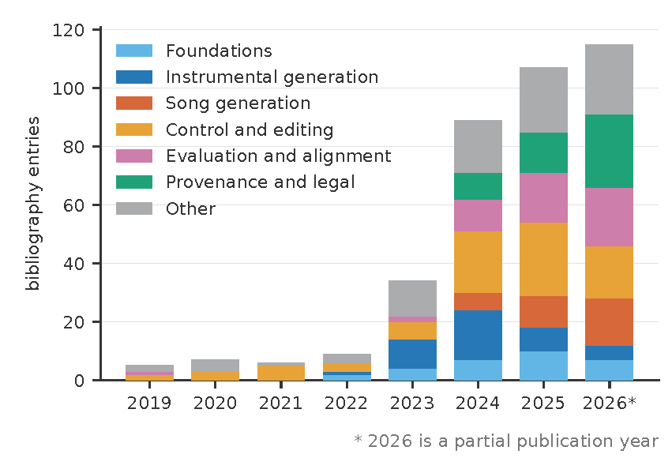
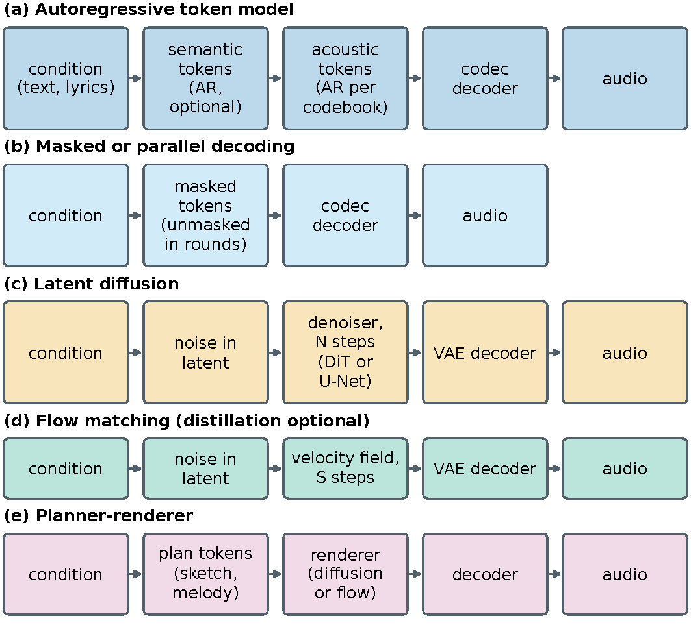
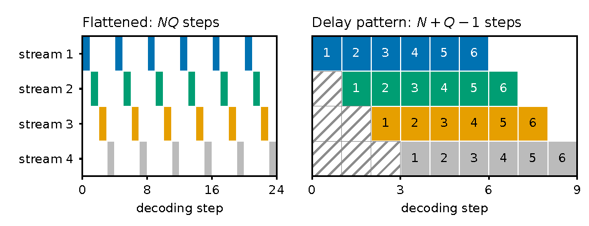
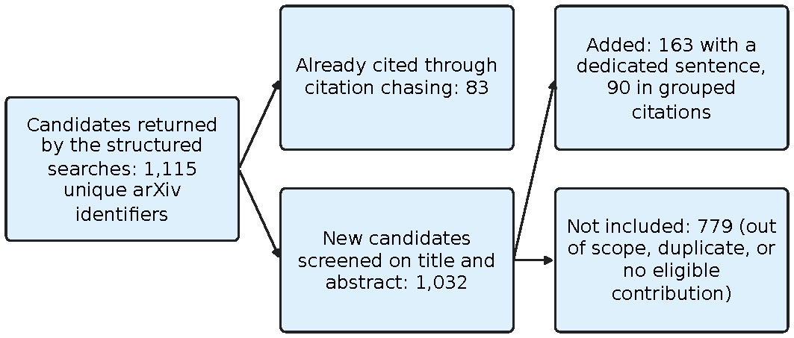
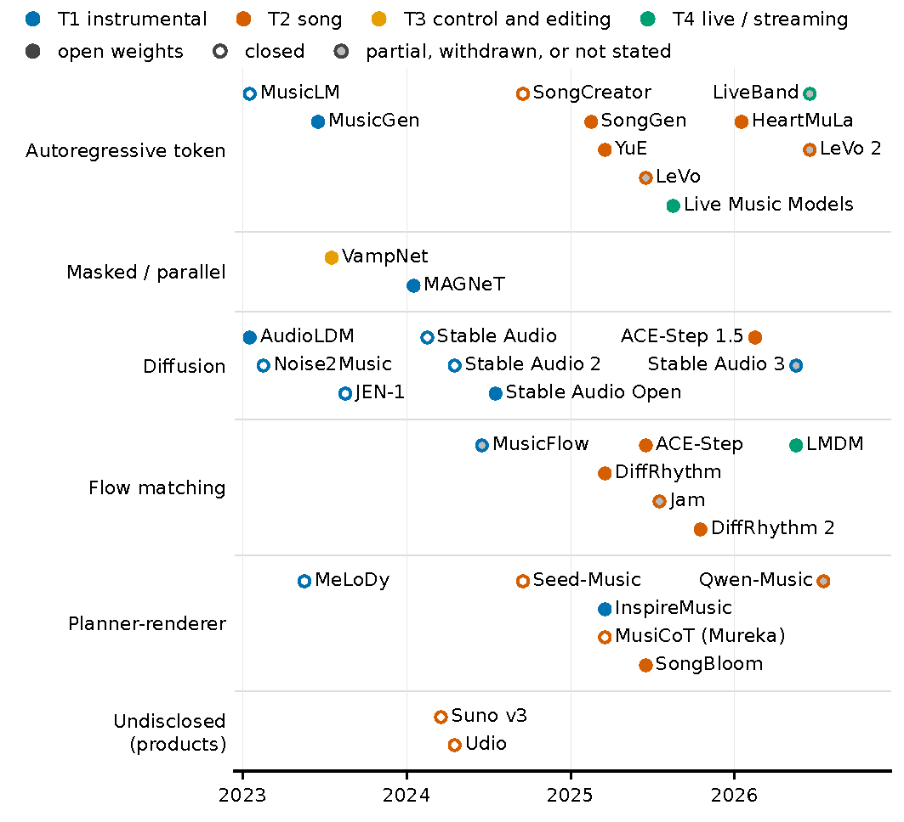
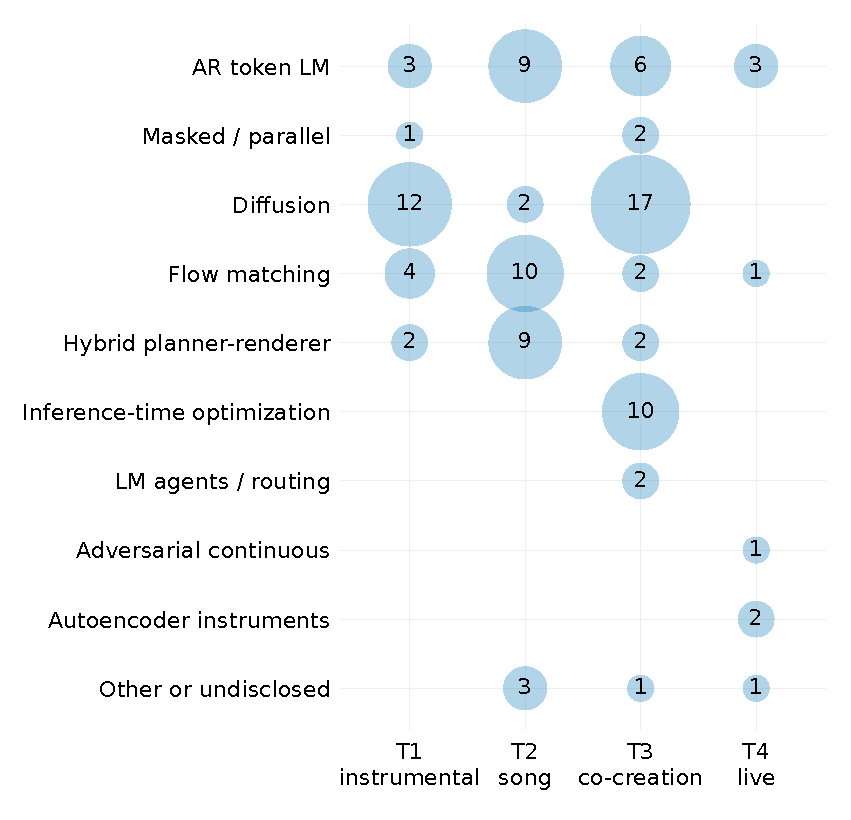
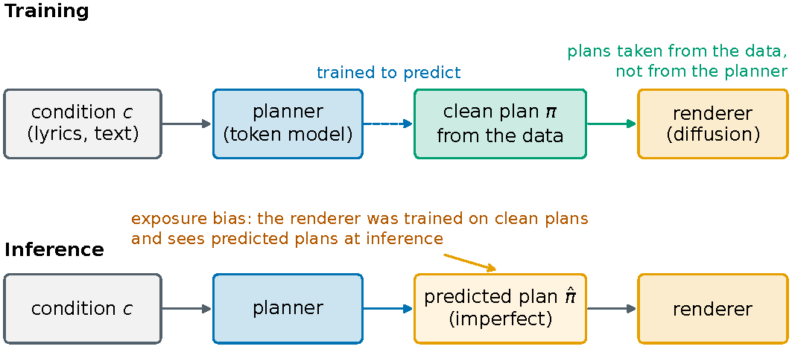
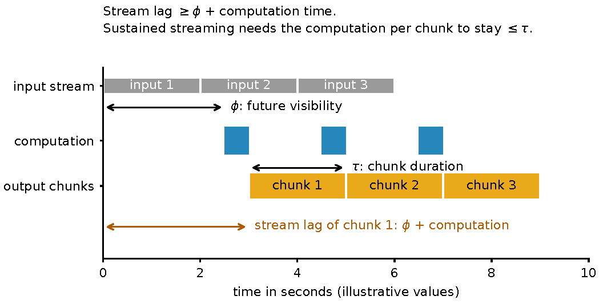
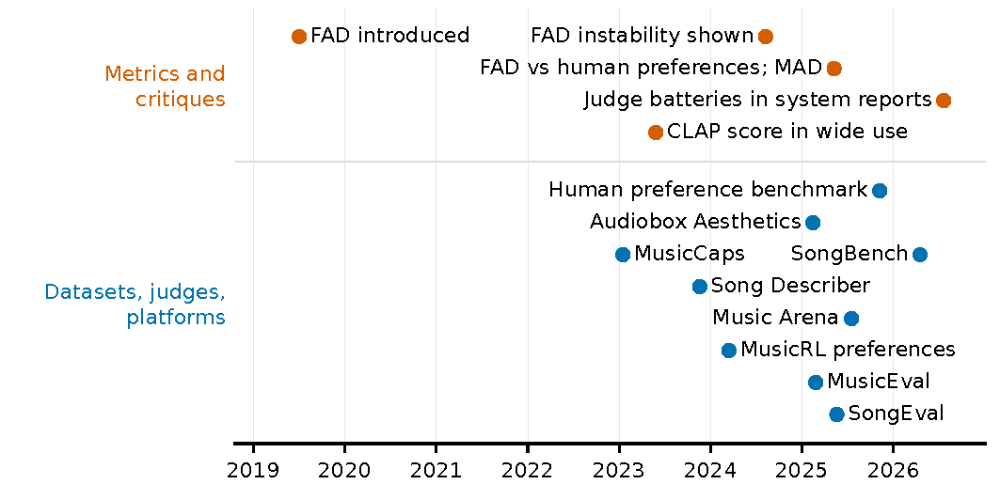

# 音乐音频生成模型教程：从文本转音乐到现场表演

## [0] 摘要

音乐音频生成涵盖器乐片段、带人声的完整歌曲、对现有录音的编辑，以及能与音乐家实时同台演奏的系统。
本专著为熟悉神经网络训练但初次接触音乐生成的读者解释这些系统背后的方法。
它以统一的记号介绍神经音频编解码器与自编码器、自回归与掩码 token 模型、扩散与流匹配、采样加速以及偏好优化。
工作示例将训练目标与采样过程同已发表系统联系起来。
应用部分将器乐生成、歌曲、编辑和现场表演的音乐需求与模型设计相关联。
对比表记录论文与官方来源中记载的表示、方法、输入、任务和发布信息。
符号作曲、语音和音效在与音乐音频相关之处予以纳入。
我们解释如何解读自动指标与学习型评判器、如何设计与报告听测，以及如何评估关于数据来源、记忆化、署名和输出检测的证据。
精选的法律判决与纠纷说明其对训练与发布的影响。
所评述的系统将既有生成范式与新的表示、规划阶段和后训练流程相结合。
数据、规模和评估上的差异，限制了跨系统比较在判断这些报告增益的来源时能得出什么结论。

## [1] 引言 

一个有用的音乐生成器不能只产生听起来合理的音响。
歌词到歌曲系统必须在歌曲各段落之间协调歌词、演唱和任何伴奏。
编辑必须改变所请求的特征，并保留录音的其余部分。
用于现场表演的系统必须响应得足够快，使音乐家能对所听到的内容做出反应。
这些要求对表示、生成和控制提出了不同的需求，而当前系统用来满足这些需求的方法分散在论文中，这些论文往往假定读者熟悉早期工作。
神经音频生成比本文所讨论的系统早了近十年。
自回归波形模型证明了神经网络可以逐个样本合成音频**WaveNet**[^oord2016wavenet]，[^mehri2017samplernn]，两阶段文本转语音流水线确立了先生成中间表示再用神经声码器渲染的模式 (**Tacotron2**[^shen2017natural])，而基于符号 token 的 transformer 捕捉了长程音乐结构[^huang2019musictransformer]。
Jukebox 直接在音频域生成了带演唱的完整歌曲[^dhariwal2020jukebox]，但保真度低，采样时间以小时计。
对音乐而言，这些系统仍是概念验证，而非可用工具。

变化发生在 2023 年初，三项成果在几个月内相继出现。
- **MusicLM**[^agostinelli2023musiclm] 将文本转音乐生成框定为离散音频 token 上的分层语言建模，它建立在带残差向量量化的 **SoundStream**[^zeghidour2021soundstream] 编解码器、**AudioLM**[^borsos2023audiolm] 的语义加声学 token 分解以及联合音乐-文本嵌入 (**MuLan**[^huang2022mulan]) 之上。
其他广泛使用的开源编解码器包括 **EnCodec**[^defossez2022high] 和 **Descript Audio Codec** (**DAC**[^kumar2023high])。
- 同年，一条并行工作表明，基于连续表示的潜在扩散模型达到了可比的质量 ([^huang2023noise2music]，**AudioLDM**[^liu2023audioldm]，[^schneider2024mousai])，
- **MusicGen**[^copet2023simple] 证明了采用简单码本交错方案的单阶段 token 语言模型足以作为强大的开源基线。

这些系统共同确立了两条架构谱系——基于编解码器 token 的语言模型和潜在扩散模型——本专著中列出的大多数系统都据此组织（[图 6.2](#fig:paradigm-tier)给出了计数）。

随后出现的工作同时向几个方向扩散。
它从片段级器乐生成扩展到带人声、歌词和主歌-副歌结构的完整歌曲，先是封闭商业系统 ([^suno2026]，[^udio2026]，[^bai2024seedmusic])，然后是开放模型 (**YuE**[^yuan2025yue]，[^ning2025diffrhythm]，[^gong2025acestep]，**LeVo**[^lei2025levo]，[^yang2026heartmula])。
两条谱系汇聚为规划器-渲染器混合架构，其中语言模型规划粗略结构，扩散或流模型渲染音频 (**MeLoDy**[^lam2023efficient]，[^yang2025songbloom]，[^lam2025musicot]，[^qwen2026music])。
流匹配、蒸馏和对抗后训练将采样成本降低到快于实时和流式生成的程度 (**MusicFlow**[^prajwal2024musicflow]，[^novack2025presto]，[^evans2026stableaudio3]，[^caillon2025live]，[^novack2026lmdm])。
偏好对齐由面向音乐的大规模 RLHF (**MusicRL**[^cideron2024musicrl]) 和面向文本转音频的直接偏好优化 ([^majumder2024tango2]) 引入，已成为日益常见的后训练阶段 (**LeVo**[^lei2025levo]，[^chen2025diffrhythmplus])。
一条并行线索发展了细粒度和时变控制 ([^wu2024musiccontrolnet]，[^tal2024jasco]，[^novack2024ditto]) 以及基于指令的编辑 ([^han2023instructme]，[^zhang2024musicmagus]，[^zhang2024instructmusicgen])，推动系统从一次性生成器走向制作工具。

评估方法的改进比生成方法更慢。
Fréchet Audio Distance[^kilgour2019fad]是这一时期大多数情况下默认的自动指标，它对嵌入和参考集的选择敏感[^gui2024adapting]，[^tailleur2024correlation]，[^jeong2026empirical]，并且与人类音乐偏好的相关性较弱[^huang2025aligning]。
社区正在以经人类偏好验证的指标[^huang2025aligning]、专家标注的基准[^liu2025musiceval]，[^yao2025songeval]、实时人类偏好竞技场[^kim2025musicarena]以及学习型美学预测器[^tjandra2025aesthetics]作出回应，但尚未形成标准协议，尤其是对带歌词的完整歌曲。

音乐生成器训练和发布的条件存在争议。
围绕训练数据的唱片公司诉讼[^riaa2024lawsuits]与部分和解及许可协议[^umg2025udio]，[^wmg2025udio]，[^wmg2025suno]，[^malik2025warner]并行持续，而慕尼黑地区法院作出了[第 12 节](#sec:data)讨论的两项判决[^lgmuenchen2025gema]，[^lgmuenchen2026suno]。
商业协议改变了公司之间的特定关系。
它们本身并不能确立完整的训练数据来源、解决其他方的索赔，或证明音乐家已同意或获得公平补偿。
因此，我们将数据文档、记忆化、署名和输出识别作为不同问题分别考察，各有其方法：记忆化测量**YuE**[^yuan2025yue]，[^bralios2023generation]、水印[^sanroman2024audioseal]和合成音乐检测[^rahman2025sonics]，[^comanducci2025fakemusiccaps]，[^afchar2024detecting]。
报告仍然有限，尽管一些系统记录了其训练来源[^evans2025stableaudioopen]，[^nistal2024diffariff]。
我们还根据各自提供的证据，区分公司公告、法律指控和法院认定。

部分文献已有综述，本文依托它们，并在其论述更深入之处指向它们。
早期的深度学习综述按目标、表示和架构组织生成[^briot2017deep]，[^ji2020comprehensive]，或按系统生成的音乐维度组织[^herremans2018functional]，且写于音频域系统达到可用质量之前。
在近期综述中，对音乐基础模型最广泛的论述涵盖理解与生成[^ma2024foundation]。
其他综述覆盖单一分支，如用语言模型方法进行符号生成[^le2024natural]、视频到音乐生成[^ji2025comprehensive]，[^wang2025vision]、音乐理解模型[^li2024survey]、跨语音、声音和音乐的大型音频模型[^latif2023sparks]、实时交互中的生成[^agchar2024survey]、工具与产品[^zhu2023survey]，或通用音频生成方法[^bozic2024survey]，[^chen2024applications]。
评估有自己的综述[^xiong2023comprehensive]，[^kader2025survey]，[^lerch2025survey]，对齐有一篇[^herremans2025aligning]，伦理有一篇[^barnett2023ethical]，还有一篇立场论文描绘了基础模型时代音乐 AI 的开放研究领域[^wei2024prevailing]。
范围最接近的综述按引导模态组织跨符号和音频输出的音乐生成，并按任务、年份和架构列表方法[^li2025survey]。
它对符号生成和多模态融合设计的覆盖比我们更广，其最新系统截至 2025 年初。
这些综述提供互补的覆盖，我们请读者参阅它们以获取个别分支的更完整论述。
本文的目的是教授当前系统共享的基础，展示其背后的设计选择如何出现在已发表系统中，并使读者能够阅读下一个系统的报告、定位它并评判它。

本专著有四个学习目标。
在[第 2 节](#sec:background)至[第 5 节](#sec:taxonomy)之后，读者应能在系统描述中识别表示、生成方法、条件及其主张背后的证据，写出其范式的训练目标和采样过程，并从其编解码器计算决定其成本的 token 速率（每秒音频的 token 数）、序列长度和步数。
[第 4 节](#sec:notation)的工作示例对 MusicGen 做了这些，阅读指南对标准指标做了同样的事。
[第 6 节](#sec:intrumental)至[第 9 节](#sec:realtime)解释与三个实践选择相关的证据：给定部署下 token 谱系与潜在谱系之间的选择；给定控制下适配器（冻结模型内的小型训练模块）、控制分支、推理时优化和显式计划之间的选择；以及给定延迟预算下大型蒸馏模型与小型专用模型之间的选择。
证据和未决的权衡在每节末尾陈述。
在[第 11 节](#sec:evaluation)之后，读者能分辨系统报告评估中哪些数字已对照人类判断检验，并能设计和报告听测。
在[第 12 节](#sec:data)之后，读者能阅读模型卡中关于数据、许可和记忆化的说明。
同一节说明有日期的法律记录涉及这些陈述中的哪些。

这一目标塑造了文本的构建方式。
共享目标和采样过程以统一记号陈述，并在代表性系统中展示其运作，图表构建为无需周围文字即可阅读。
对比表记录论文、模型卡、仓库和官方产品来源中记载的设计与发布信息。
[第 2.2 节](#sec:method)解释筛选过程，[附录 A](#app:search)记录覆盖范围和观察日期。
缺失信息保持明确，使读者能区分已报告属性与推断。

六个问题在各系统中反复出现，我们请读者带着它们贯穿全文，因为每一个首先是机器学习问题，其次才是音乐问题，且在[第 6 节](#sec:intrumental)至[第 9 节](#sec:realtime)的应用类别中各有不同答案。

!!! question
    - **Q1，表示。** 生成的表示保留和丢弃什么信息，这决定了保真度、序列长度和控制的什么？编解码器 token、连续潜在和草图给出不同答案（[第 3 节](#sec:building-blocks)、[第 5.1 节](#sec:d1)和[第 6 节](#sec:intrumental)）。
    - **Q2，成本。** 序列长度、token 速率和生成范式如何决定训练和推理成本，什么约束延迟？[第 4 节](#sec:notation)的目标使成本显式化。
      [第 6 节](#sec:intrumental)和[第 9 节](#sec:realtime)报告它们。
    - **Q3，条件。** 全局条件、时变条件和参考音频如何进入模型，每条路径在训练和保真度上代价如何？第 5.3 节和[第 8 节](#sec:control)回答。
    - **Q4，规划。** 何时应在音频之前生成计划，计划应包含什么，分离的代价是什么？[第 4 节](#sec:notation)陈述规划器-渲染器目标。
      [第 7 节](#sec:song)和[第 8 节](#sec:control)记录分离在何处有帮助。
    - **Q5，测量。** 分布级指标能就生成的音乐确立什么，它们在何处失败，替代工具与人类判断的一致程度如何？[第 11 节](#sec:evaluation)回答。
    - **Q6，制品。** 当模型是已发布制品而非论文时，什么发生变化：开放性、来源、记忆化和法律记录？[第 5.5 节](#sec:d5)和[第 12 节](#sec:data)回答。

这些问题指导应用部分的比较。
[第 5 节](#sec:taxonomy)的比较框架记录 Q1 至 Q4 背后的设计选择、每个选择所在的应用类别，以及 Q6 所问的关于数据、访问和发布条件的证据。
[第 14 节](#sec:conclusion)带着所收集系统支持的答案回到六个问题。
答案汇聚于一个观察，并在那里连同其局限陈述：表中的每个生成范式到 2023 年都已被知晓，此后的系统在生成对象、训练之后跟随什么以及渲染器之前是否有规划器上有所不同。
这些表无法确立这些变化中哪些解释了所报告的增益，因为系统在数据、规模和评估上各不相同。

[图 5.1](#fig:overview)展示本专著的结构。
[第 2 节](#sec:background)至[第 5 节](#sec:taxonomy)教授基础：范围、构建模块，以及带记号和工作示例的分类法。
[第 6 节](#sec:intrumental)至[第 10 节](#sec:crossmodal-symbolic)按应用类别评述系统。
[第 11 节](#sec:evaluation)和[第 12 节](#sec:data)涵盖评估和数据。
[第 13 节](#sec:discussion)和[第 14 节](#sec:conclusion)讨论并总结。
[附录 A](#app:search)记录检索。
数学部分使用向量、条件概率、期望和梯度，并将神经网络视为拟合训练样本的参数化函数。
不假定音频信号处理知识。
在出现 transformer、自编码器和其他架构之处，文本解释其在流水线中的作用，而不推导它们。
四条阅读路径覆盖我们设想的读者。
熟悉机器学习但初次接触音乐生成的读者应按顺序阅读[第 2 节](#sec:background)至[第 4 节](#sec:notation)，然后阅读[第 6 节](#sec:intrumental)和一个感兴趣的应用节，并按需查阅[第 5 节](#sec:taxonomy)和表格。
构建或选择系统的读者应阅读[第 4 节](#sec:notation)、[第 6 节](#sec:intrumental)至[第 9 节](#sec:realtime)中目标应用类别的节及其末尾的经验与权衡小节，以及对比表。
[第 5.6 节](#sec:map)解释如何浏览它们。
希望先看思想再看公式的音乐家或制作人可阅读[第 6 节](#sec:intrumental)至[第 9 节](#sec:realtime)的开篇、贯穿示例和末尾经验，以[第 9.2 节](#sec:instruments)关于神经乐器和[第 9.1 节](#sec:streaming)关于实时交互为入口，然后阅读评估和来源讨论。
公式和统计协议假定所述背景。
关注评估、数据或政策的读者可直接阅读[第 11 节](#sec:evaluation)和[第 12 节](#sec:data)。
它们仅通过类别名称依赖分类法。

**范围。**
本专著涵盖以文本、歌词、音频、符号信号或视频为条件的音乐音频生成，包括器乐、带人声的歌曲、分轨（混音中单独的乐器或人声轨）和伴奏，以及对现有录音的编辑。
仅在符号作曲与音频流水线或共同创作相遇之处才处理它，因为其方法和评估与音频生成不同，[第 10.3 节](#sec:symbolic)说明两者在何处相遇。
从乐谱生成歌声、语音合成和音效生成被排除，除非系统也生成音乐。
我们从原始来源报告训练数据、评估和发布状态。
许多工业系统只披露部分信息。
覆盖范围和来源日期记录在[第 2.2 节](#sec:method)和[附录 A](#app:search)。

## [2] 背景与范围 

本综述聚焦自 **MusicLM**[^agostinelli2023musiclm]以来的音乐音频生成，并在早期工作确立了这些系统所用方法之处予以纳入。
我们以 MusicLM 为起点，因为正是在这一点上，文本转音乐生成同时变得高保真、分钟级，并且被详细到足以确立可复用设计的程度。
通用文本转音频模型在其以音乐为评估对象或作为音乐系统基础时予以纳入。
覆盖范围的其他限制即[第 1 节](#sec:intro)范围段落所述。

[第 3 节](#sec:building-blocks)和[第 4 节](#sec:notation)展开表示与目标，应用各节将它们与音乐任务联系起来，[第 11 节](#sec:evaluation)解释评估证据。
[第 12 节](#sec:data)将数据与记忆化的技术问题同有日期的案例与和解记述分开。
[第 2.2 节](#sec:method)和[附录 A](#app:search)记录收集过程及其局限。

### [2.1] 早期基础 

2023 年的系统合并了四条更早的线索，此处各因其贡献的设计而引用。
自回归波形模型表明，神经网络可以从学习到的分布中逐个样本合成音频，代价是每个样本一次顺序预测**WaveNet**[^oord2016wavenet]，[^mehri2017samplernn]。
[第 6 节](#sec:intrumental)的 token 语言模型保留了自回归分解，并将其从样本移到编解码器 token 上，速率低两个数量级。
两阶段流水线——一个模型生成中间表示，第二个将其渲染——已在文本转语音中确立**Tacotron2**[^shen2017natural]，并在[第 7 节](#sec:song)的每个规划器-渲染器系统中反复出现。
基于符号 token 的 transformer 用相对注意力捕捉长程音乐结构[^huang2019musictransformer]，这是 token 系统所扩展的模型类别，而 Jukebox 将同一类别应用于 VQ-VAE 音频码的层次结构，以低保真度和以小时计的采样时间生成了带演唱的完整歌曲[^dhariwal2020jukebox]。
带残差向量量化的神经编解码器**SoundStream**[^zeghidour2021soundstream]，**EnCodec**[^defossez2022high]以及 **AudioLM** 的语义加声学分解[^borsos2023audiolm]使该层次结构快到可用的程度。
对抗合成在小规模上展示了快速频谱域生成**GANSynth**[^engel2019gansynth]，其判别器作为当前扩散模型的对抗后训练回归。
可微信号处理**DDSP**[^engel2020ddsp]和 RAVE 自编码器[^caillon2021rave]与文本转音乐系统并行且独立地开启了[第 9.2 节](#sec:instruments)的乐器线索。
这些技术中的每一项都在本文综述的文献中以修改后的形式重现。

2023 年系统背后的基础设施在此作为构建模块涵盖。
第一，带残差向量量化的神经音频编解码器将波形压缩为语言模型可预测的离散 token 序列**SoundStream**[^zeghidour2021soundstream]，**EnCodec**[^defossez2022high]，**DAC**[^kumar2023high]，更新的 tokenizer 进一步降低 token 成本[^ji2025wavtokenizer]，[^cheng2026bandtok]。
第二，对比音频-文本嵌入提供连接自由语言与音频的条件信号**MuLan**[^huang2022mulan]，[^wu2023clap]，自监督音乐编码器为理解和评估提供特征[^li2024mert]，**MuQ**[^zhu2025muq]。
评估在系统之后的[第 11 节](#sec:evaluation)处理，该节给出指标及其对[第 6 节](#sec:intrumental)至[第 10 节](#sec:crossmodal-symbolic)质量主张的已知局限。

### [2.2] 文献收集 

参考文献表通过三种互补方法构建，贯穿收集期应用，并在分类固定时关闭。
引文追踪从标志性系统向前和向后追踪参考文献，并覆盖 ISMIR、ICLR、NeurIPS、ICML、ICASSP、Interspeech、AAAI 和 IJCAI 的会议录以及 TASLP、TISMIR 和 TMLR 期刊。
结构化检索用固定检索字符串查询 arXiv API，分十九个主题组，从综述和编解码器到来源、偏好对齐、神经合成乐器、多智能体作曲、运动与游戏，以及一个针对最近月份的组。
在收集期内它们返回了 1,115 个唯一候选，其中 83 个在检索时已通过引文追踪引用。
每个候选都按标题和摘要筛选。
收集期内新增 253 个，其中 163 个在正文中有专门句子，90 个在分组引用中。
对当时未纳入的每个候选摘要的第二次阅读于 2026 年 10 月分类关闭后完成，发现另外 13 个符合纳入标准的候选和 137 个值得分组提及的候选。
这些新增未纳入当前分类或其计数。
其中五个早于资格截止日期，但在分类最终确定后才被识别，[附录 A.1](#app:screening)列出了它们。

会议监控使用 ISMIR 2026 的录用论文列表（140 篇），将 36 篇分类为生成式音乐工作，38 篇为相邻工作，并为 62 篇找到公开版本。
没有公开版本的录用论文不予引用。
论文若生成音乐音频或直接支持之（编解码器、嵌入、评估、来源），并引入后续工作所依托的架构、控制机制、训练过程、评估方法或资源，则予以纳入。
仅以预印本形式可用的工作，在符合这些标准时予以纳入，并在参考文献表中标记为预印本。
[图 2.1](fig:corpus)展示所得参考文献表按年份和类别的构成。

候选按 arXiv 标识符和规范化标题与参考文献表及跨组去重。
候选在筛选时若未生成音乐音频且不支持此类系统，若为已纳入工作的重复或较晚版本，或若未贡献上述类型的架构、控制机制、训练过程、评估方法或资源，则予以排除。
每个候选的决定及理由均有记录。
来源不一致时，本专著遵循固定顺序：同行评审版本优先于预印本，预印本优先于模型卡，模型卡优先于产品文档，产品文档优先于新闻或法律报道，但制品的开放性、许可和撤回状态取自其模型卡或仓库，因为这些在论文之后会变化。
来源按主张选择：目标取方法论文，检查点许可取带版本的模型卡，当前产品行为取产品文档，判决取法院记录。
[附录 A](#app:search)给出检索字符串、每组起始日期、检索关闭日期、每组计数，以及从候选到纳入工作的流程（[图 A.1](#fig:flow)）。

系统比较包括选定发布，资格截止日期为 \windowend{} 末。
[附录 A](#app:search)将该截止日期与结构化检索的关闭日期及发布信息的观察日期区分开。
参考文献表还引用一些较晚的工作作为背景，这些工作不进入表格或计数。
表格描述本综述纳入的有记载版本。
不应将其读作持续更新的产品规格。

!!! note <a id="fig:corpus">图 2.1</a> 所评述文献按年份和类别的构成。
    
    计数仅描述本专著的参考文献表。
    2023 年之前的条目是为提供背景而引用的前驱工作，2019 年之前发表的九个条目未显示。
    2026 年是部分发表年份，[第 2.2 节](#sec:method)将系统截止日期与较晚的背景补充区分开。
  
## [3] 构建模块 

### [3.1] 编解码器、分词器与自编码器 

波形每秒钟声音包含数万个样本，因此大多数系统用短得多的序列来描述它。
编码器产生该描述，解码器从中重建音频，生成模型学习产生同类的新描述。
表示决定了多少信息得以保留，以及生成器必须做多少工作。
例外是波形域级联系统以及表格中标记为符号系统的系统。
在离散一侧，SoundStream 引入了带残差向量量化（RVQ）的神经编解码器，将波形转换为 token 序列的堆栈**SoundStream**[^zeghidour2021soundstream]。
EnCodec 提供了开放的高保真实现，并成为音乐语言模型的默认分词器**EnCodec**[^defossez2022high]，而 Descript Audio Codec 大幅提高了每比特保真度**DAC**[^kumar2023high]。
AudioLM 增加了如今标准的划分：承载结构的语义 token 与承载细节的声学 token[^borsos2023audiolm]。
从 token 到波形的扩散解码器提高了固定 token 流的保真度上限**MBD**[^roman2023discrete]。

编解码器的三个属性对生成器很重要，此后每个分词器都可读作改进其中之一的一次尝试。
第一是 token 速率，即语言模型每秒音频必须预测的 token 数，它决定序列长度，从而决定成本和可达时长。
[第 4 节](#sec:notation)的工作示例为 MusicGen 计算了它。
第二是语义内容：token 是否携带关于演奏和演唱内容的信息——语言模型可以学习预测——还是只关于其听感。
第三是优雅降级：丢弃 RVQ 堆栈中更细的码本是以受控方式去除细节，还是破坏信号。
RVQ 堆栈的代价——每帧多条并行 token 流——推动了沿这三个方向的工作。

在 token 速率上，单码本编解码器达到极低速率[^ji2025wavtokenizer]，音乐专用编解码器达到极端压缩[^xu2025mucodec]，频谱域编解码器覆盖全频带立体声[^li2025spectrostream]，二维梅尔频谱图分词器跨频带共享一个码本，其作者认为 RVQ 堆栈与自回归预测匹配不佳[^cheng2026bandtok]，**MelTok**[^li2025meltok]。
在语义内容上，仅为重建训练的编解码器可能以语言模型无法高效预测的形式编码信息，X-Codec 通过用语义编码器监督编解码器来解决这一点**X-Codec**[^ye2024codec]。
源感知双轨分词器为人声和伴奏语言模型提供重建良好且保持可预测的 token[^lin2025duotok]。
最新一步是语义监督的低速率分词器：Qwen-Music 用转录、色度和梅尔重建损失训练单个 25 Hz 码本，使 token 保留歌词和音高信息，并将剩余声学细节留给下游生成渲染器[^qwen2026music]。
在降级上，多尺度量化器将码本置于不同时间分辨率**SNAC**[^siuzdak2024snac]，频率有序训练使截断 RVQ 堆栈去除可预测的频带[^yang2026harp]。
编解码器基准[^wu2024codec]和离散音频分词器的系统综述[^mousavi2025discrete]比较了这些设计。
通用低帧率编解码器、通用声音语义编解码器、流式对话编解码器以及大规模训练的纯 transformer 分词器继续发展[^hu2026omnicodec]，**SemantiCodec**[^liu2024semanticodec]，**Moshi**[^defossez2024moshi]，[^gong2026moss]，[^he2026tqcodec]，快速立体声声码器将压缩表示解码为音频[^zhu2024musichifi]。

离散表示从有限词汇表中选择条目，连续表示使用实数向量。
两种情况下生成器都在压缩空间中工作，解码器将其输出转为音频。
解码器在真实录音的重建上训练，单独的生成器学习在同一空间中产生合理的新序列。
变分自编码器是学习连续空间的一种方式，其分布在训练中被正则化，以下关注所得表示和解码器，而非训练目标。
在连续一侧，扩散和流模型在 VAE 潜在或频谱图上运作**AudioLDM**[^liu2023audioldm]，[^evans2024fast]。
设计趋势是朝向同时紧凑、重建准确且语义结构化的自编码器。
高度压缩的潜在使单上下文内生成完整歌曲成为可能[^evans2024longform]，低至 5 Hz 的帧率使分块生成变得可行[^jiang2025diffrhythm2]。
语义-声学目标为下游生成和编辑构建潜在结构[^parker2026same]，[^evans2026stableaudio3]，以一致性目标训练的自编码器（[第 4.4 节](#sec:acceleration)）从潜在一步重建[^pasini2024musiclatent]，复频谱自编码器解决高压缩解码器的高频、相位和立体声失败[^wang2026fourier]。

### [3.2] 音频-文本嵌入与音乐编码器

条件是为引导生成而提供的信息：描述、旋律、歌词或现有录音。
嵌入将此类信息转为生成器可用的数值特征，当同一嵌入也对输出打分时，分数继承了嵌入学会做出的区分。
文本提示通过文本编码器或通过训练为使录音与其描述彼此靠近的联合音频-文本嵌入到达生成器，联合嵌入也用作提示遵循度分数。
MuLan 在 4400 万条录音上对比训练，是 **MusicLM** 的条件主干**MuLan**[^huang2022mulan]。
CLAP 是其开放对应物，也用作自动提示遵循度分数[^wu2023clap]。
自监督音乐编码器为理解、控制和评估提供特征：MERT 是常见选择[^li2024mert]，MuQ 使用 Mel-RVQ token 预测，报告优于 MERT，并发布配对的音乐-文本嵌入**MuQ**[^zhu2025muq]。
CLaMP~3 将对比音乐-文本预训练扩展到符号、音频和多种语言[^wu2025clamp]。
这些表示的基准[^yuan2023marble]对生成研究很重要，因为指标、奖励模型和规划方案[^lam2025musicot]继承了其所依托编码器的偏差（[第 11 节](#sec:evaluation)）。

### [3.3] 数据

训练语料大多未披露。
我们将来源和许可推迟到[第 12 节](#sec:data)。
技术层面反复出现两个数据问题。
第一，描述：配对的音乐-文本数据稀缺，因此系统用语言模型生成伪描述[^huang2023noise2music]，或从丰富描述中解析音乐元数据[^melechovsky2024mustango]。
评估依赖小型人工撰写的描述集**MusicLM**[^agostinelli2023musiclm]，[^manco2023songdescriber]。
开放描述语料通过大规模为自由许可音乐撰写描述[^roy2025jamendomaxcaps]或通过改写专家专辑评论[^alonsojimenez2026allmusiccaps]构建。
第二，质量：开放语料有噪声，系统在训练中日益考虑录音质量，或通过以每片段质量为条件使推理可被引导向高质量输出[^li2025qamdt]，或通过学习型美学预测器进行过滤和奖励[^tjandra2025aesthetics]。

!!! tip 关键要点
    - 编解码器约束生成器的成本。
      其 token 速率决定给定音频时长的序列长度，而其比特率和重建质量影响系统能保留的细节。
      语义内容和优雅降级是后续分词器竞争的两个其他属性。
    - 连续潜在在高频、相位和立体声像上以压缩换解码器损失，最新的自编码器被训练为同时紧凑、重建准确且语义结构化。
    - 文本通过文本编码器或对比音频-文本嵌入到达生成器。
      当同一嵌入也用作提示遵循度分数时，系统与其指标可能共享盲点。
    - 训练语料大多未披露，描述稀缺且常为合成，有文档的数据集对世界大多数音乐代表性不足。

## [4] 目标、采样与指标

本节对音乐音频生成作一共通描述，并固定记号。
它界定主要的生成式方法与偏好方法（preference methods）的训练目标，解释采样与加速，并引入标准评估指标。
[第 5 节](#sec:taxonomy)随后用这些定义来比较各系统。
全文之中，采样（sampling）指从一个已学习的概率模型中产生输出。
一个音频样本（audio sample）是波形的一个数值，而音乐采样（musical sampling）指复用一段录制的片段。
这些陈述均取自所引方法论文中的标准表述，以共享记号呈现，并附以实例，使读者能够解读[第 6 节](#sec:intrumental)至[第 9 节](#sec:realtime)的系统比较。
偏好从例子入手的读者，可以从实例读起；凡实例能够独立成立之处，实例均置于形式化陈述之前。

### [4.1] 一般性问题

本专著中的每个系统都通过填充四个槽位来生成音乐音频。
- **一种表示。** 一个从波形 $x$ 到模型所生成对象的映射，该对象是编解码器 token 序列、连续潜变量、符号乐谱或草图，外加一个将该对象映射回音频的解码器。
- **一种分解**，即给定条件 $c$ 时该对象分布的分解方式：一次一个 token、多 token 并行、一串去噪步骤、一个从噪声积分到数据的向量场，或先规划再渲染。
- **一条条件的通路。** 条件以全局嵌入的形式进入、在每一步被注意力关注；或以与表示在时间上对齐的序列形式进入；或以模型延续或反转的参考音频形式进入；或经由规划进入。
- **一个采样器**，连同其网络评估次数，以及任何能减少该次数的手段：更少的步数、一个蒸馏出的学生模型、一个跨块的缓存。
[第 5 节](#sec:taxonomy)将前三项决策用作其比较问题，将采样器的后果记录在表格的延迟单元格中，并将应用与发布条件作为解读某系统结果的语境一并加入。
要阅读一份新的系统报告，请识别这四个槽位中各自所做的选择。
本专著中的大多数权衡都是槽位之间的权衡。
槽位 1 中较低的 token 率会缩短序列，从而降低槽位 4 的解码成本，但通常以重建质量为代价。
槽位 2 中的规划可以使结构显式化。
它同时也引入第二个模型，以及训练中所见规划与推理时所预测规划之间可能存在的失配。
槽位 3 中时间对齐的条件给出更直接的控制，但支持一种新的控制往往需要额外的训练。
[图 4.1](#fig:schematics)画出了五种范式的槽位 2，[表 4.1](#tab:notation)列出了下文所用的符号。

!!! note <a id="tab:notation">表 4.1</a> 记号。
    每一节均使用相同的符号。
    凡所引论文使用其他符号之处，正文中的记号说明会给出对应关系。

|符号|含义|
|---|---|
|$x$、$T$、$f_{\mathrm{s}}$|波形、其样本数、采样率|
|$c$|条件：文本、歌词、音频、符号信号或视频|
|$E$、$D$|编解码器或自编码器的编码器与解码器|
|$e_n$、$N$、$f_{\mathrm{fr}}$|编码器帧、其数量、帧率|
|$Q$、$K$、$\mathcal{C}^{(q)}$|码本数量、码本大小、第 $q$ 个码本|
|$z^{(q)}_n$、$u_i$|第 $n$ 帧第 $q$ 个流的 token；展平后的 token 序列|
|$s_{1:M}$|一个语义 token 流|
|$h$、$L$|一个连续潜变量及其长度|
|$\pi$|一个规划：语义 token、草图、旋律或乐谱|
|$t$、$\alpha_t$、$\sigma_t$、$\varepsilon$|时间、噪声调度、高斯噪声|
|$\varepsilon_\theta$、$v_\theta$、$f_\theta$|噪声预测器、速度场、一致性函数|
|$w$|无分类器引导权重|
|$S$|采样或解掩码（unmasking）的步数|
|$r(x, c)$、$\beta$、$p_{\mathrm{ref}}$|奖励、其相对于参考模型的权衡系数、参考模型|
|$\mu$、$\Sigma$、$k$|嵌入均值与协方差、一个核函数|
|$\phi$、$\tau$|流式模型的未来可见性与块时长|

### [4.2] 表示

**先看实例。**
MusicGen 的编解码器是一个用于 32 kHz 单声道音频的 EnCodec 模型（**MusicGen**[^copet2023simple]）。
它以 640 个样本的步幅把波形切成帧，因此每秒产生 $32{,}000 / 640 = 50$ 帧，并用四个 token 描述每一帧，每个 token 取自一张含 2,048 个条目的表。
因此，MusicGen 背后的语言模型必须为每一秒音乐产生 $50 \cdot 4 = 200$ 个 token，对于一个 30 秒的片段则为 $6{,}000$ 个 token；编解码器的比特率为 $50 \cdot 4 \cdot \log_2 2048 = 2{,}200$ 比特每秒。
这些数字有助于解释表格中的时长与运行时间权衡。
token 率决定序列长度，而比特率与编解码器设计制约重建质量。
在固定上下文上限下，较低的 token 率允许更长的输出，并可降低生成成本，尽管可能降低重建质量。
[第 3 节](#sec:building-blocks)的分词器研究正是在这一权衡上展开。
本小节的其余部分陈述该实例所计算内容的一般形式。

我们用 $x \in \mathbb{R}^{T}$ 表示含 $T$ 个样本的波形，用 $c$ 表示条件输入（文本、歌词、音频、符号信号或视频）。
大多数系统在 $x$ 的一种学习得到的压缩表示上生成，该表示由编码器 $E$ 产生、由解码器 $D$ 反演。
波形域级联系统与符号系统是表格中如此标注的例外。

一个采用残差向量量化（RVQ）的**神经编解码器****SoundStream**[^zeghidour2021soundstream]、**EnCodec**[^defossez2022high] 将 $x$ 映射为 $Q$ 条并行的 token 流。
编码器以帧率 $f_{\mathrm{fr}}$ 产生帧 $e_1, \dots, e_N \in \mathbb{R}^{d}$，因此在采样率 $f_{\mathrm{s}}$ 下 $N = f_{\mathrm{fr}} \cdot T / f_{\mathrm{s}}$；每一帧在 $Q$ 个阶段上针对大小为 $K$ 的码本 $\mathcal{C}^{(1)}, \dots, \mathcal{C}^{(Q)}$ 被量化：
$$
r^{(0)}_n = e_n, \qquad z^{(q)}_n = \arg\min_{k} \big\lVert r^{(q-1)}_n - \mathcal{C}^{(q)}_k \big\rVert_2, \qquad r^{(q)}_n = r^{(q-1)}_n - \mathcal{C}^{(q)}_{z^{(q)}_n}.
$$
编解码器以 $D(z)$ 对 $x$ 的重建损失（在所引编解码器中为频谱项与对抗项）、一个将每个编码器残差拉向其被选码本条目的承诺损失（commitment loss），以及一个将码本条目移向分配给它们的残差的码本更新来训练。
量化器本身不可微，梯度径直穿过它传给编码器。
第一条流承载帧的大部分能量，后续流细化残差，这正是截断的堆叠仍能解码、以及语言模型可以按重要性顺序预测各流的原因。
用音乐的话说，该堆叠是先有一张草图，随后是越来越精细的修正；丢掉最后的修正，留下的是一个更粗糙但可辨认的渲染。
比特率为 $f_{\mathrm{fr}} \cdot Q \cdot \log_2 K$ 比特每秒，生成器所见的 token 率为 $f_{\mathrm{fr}} \cdot Q$ token 每秒。
这两个数字都出现在[第 3 节](#sec:building-blocks)的编解码器讨论中。
**语义分词器**经训练产生单条流 $s_{1:M}$，保留结构（音高、歌词、时序），把其余声学细节留给渲染器。
它保留什么，是其监督信号的一种性质。
语义 token 与声学 token 的划分正是 **AudioLM**[^borsos2023audiolm] 所引入的。
**连续自编码器**将 $x$ 映射为潜变量 $h \in \mathbb{R}^{L \times d}$，其中 $L \ll T$，以重建损失训练，在变分情形下还加一个使潜变量接近高斯先验的 Kullback–Leibler 惩罚。
这三种输出，加上作为第四种的符号 token，就是表示维度 D1 的各个类别。
在实例中，$f_{\mathrm{fr}} = 50$、$Q = 4$、$K = 2048$。

!!! note **记号说明。**
    编解码器论文把码本数量写作 $N_q$（SoundStream）或 $K$（EnCodec 与 MusicGen），MusicGen 的论文把并行流称为"codebook streams"。
    我们的 $Q$ 是它们的码本数量，我们的 $K$ 是它们的码本大小。
    我们的 $N$ 计的是帧数，EnCodec 将其写作 $T / \mathrm{stride}$。

!!! warning **警告：语义 token 与声学 token 不是两种编解码器。**
    两者都是某帧率下的离散流，论文可能把其中任一称为"tokens"。
    语义流被构建为语言模型可以预测它（它保留什么取决于其训练；此处综述的语义分词器保留音高、歌词与时序，丢弃音色与房间感），且没有渲染器就无法解码为音频。
    声学流被构建为解码器可以重建波形，它更难预测。
    一个"生成 token"的系统可能在做其中任一件事，表格在 D1 列标出区别（当后续接渲染器时，语义流归入混合类）。

### [4.3] 生成范式

!!! note <a id="fig:schematics">图 4.1</a>
    
    五种生成范式（D2）的数据路径。
    方框是一个样本所经过的各阶段，从条件到音频；箭头给出计算顺序。
    记号遵循[第 4 节](#sec:notation)。

每种范式都在上述某一种表示上对 $p(\cdot \mid c)$ 建模。
下文出现两条时间轴，必须加以区分。
表示的帧跟随音乐的播放时间。
扩散或流采样器的时间变量索引的是采样的进度：每一步更新整个片段的表示，因此帧数决定一次更新的规模，步数决定进行多少次更新。

**先看实例。**
MusicGen 通过将流 $q$ 延迟 $q-1$ 步，在一次从左到右的传递中预测其四条 token 流，从而在每一步模型为每条流各输出一个 token，且靠后的流能看到同一帧中靠前的流（**MusicGen**[^copet2023simple]）。
该模式是一首卡农：每个声部在前一声部之后一步进入，并跟随它。
[图 4.2](#fig:delay)画出了两种调度。

因此，一个 50 帧每秒的 30 秒片段需要 $1{,}500$ 个解码步，再加上末尾三个延迟步，每一步都是在不断增长的上下文上的一次完整 transformer 传递，这正是其论文报告的数字。
若四条流依次预测，同一片段需要 $6{,}000$ 步；而像 MusicLM 那样先预测语义流、再预测声学流，需要三个长度不同的阶段：语义、粗声学、细声学。
因此，模式的选择就是顺序步数的选择。
实际耗时还取决于每一步的成本（即使有键值缓存，它仍随上下文增长），以及模型大小、硬件和编解码器解码。
[表 6.1](#tab:t1)中没有任何自回归 token 模型带有快于实时的标记。
顺序步数是原因之一。
另一个原因是，代码只记录每篇论文实际测量的内容，而这些论文没有报告此类测量。
一般形式如下。

!!! note <a id="fig:delay">图 4.2</a> 用一个自回归模型预测六帧的四条 token 流的两种调度。
    
    左：展平调度逐帧依次预测每帧的四个 token，因此含 $N$ 帧的片段需要 $NQ$ 步（此处为 24）。
    右：延迟调度在每一步为每条流各预测一个 token，其中流 $q$ 延迟 $q-1$ 帧，因此同一片段需要 $N + Q - 1$ 步（此处为 9）；斜线格是延迟流尚无可预测内容的步骤，数字是帧索引。
    在延迟调度的每一步，靠后的流看到同一帧中靠前的流，这正是使单次传递成为可能、且质量代价很小的原因。

**自回归 token 语言模型。**
一种交错模式把 $Q \times N$ 网格中的每个 token $z^{(q)}_n$ 分配给 $S$ 个解码步之一，模型在各步上分解联合分布，$p_\theta(z \mid c) = \prod_{s=1}^{S} \prod_{(q, n) \in P_s} p_\theta\big(z^{(q)}_n \mid z_{<s}, c\big)$，其中 $P_s$ 是第 $s$ 步预测的 token 集合，$z_{<s}$ 是更早各步的 token。
同一步内的 token 由同一上下文并行预测。
模型以最大似然训练，$\mathcal{L}_{\mathrm{AR}} = -\sum_s \sum_{(q,n) \in P_s} \log p_\theta(z^{(q)}_n \mid z_{<s}, c)$。
当每一步只含一个 token 时，该分解就是展平序列 $u_{1:NQ}$ 上的通常链式法则，且 $S = NQ$。
交错模式决定每一步预测哪些流：一种层级先预测语义流、再预测声学流；MusicGen 的延迟模式将流 $q$ 偏移 $q-1$ 步，使全部 $Q$ 条流在一次传递中以受控的质量损失被预测（**MusicGen**[^copet2023simple]）。
采样每步需要一次前向传递，因此顺序步数随 token 率和输出长度增长。
实际耗时还取决于模型大小、硬件和每次传递的成本。
键值缓存避免重算较早的状态，但每个新查询仍要读取一个随上下文增长的缓存。
在延迟模式下，$P_s$ 含每条已启动流的一个 token，因此含 $N$ 帧的片段需要 $S = N + Q - 1$ 步而非 $NQ$ 步，这就是实例中的算术。

**掩码与并行解码。**
掩码模型从可见 token 预测被掩码的子集 $z_{\mathcal{M}}$，$p_\theta(z_{\mathcal{M}} \mid z_{\bar{\mathcal{M}}}, c)$，以掩码位置上的交叉熵训练，掩码按某种调度抽取。
生成从一个全掩码序列开始，在 $S$ 次迭代中解掩码，每次迭代保留置信度最高的预测并对其余重新掩码，因此 $S \ll N Q$ 次前向传递便足够**MaskGIT**[^chang2022maskgit]、[^garcia2023vampnet]。
内绘（inpainting）与外绘（outpainting）无需新模型：只需选择掩码 $\mathcal{M}$ 覆盖要重新生成的区域。

**扩散。**
给定潜变量 $h_0 \sim p(h \mid c)$，前向过程加入高斯噪声，$h_t = \alpha_t h_0 + \sigma_t \varepsilon$，其中 $\varepsilon \sim \mathcal{N}(0, I)$，$(\alpha_t, \sigma_t)$ 为噪声调度；网络 $\varepsilon_\theta$ 经训练以预测该噪声，
$$
\mathcal{L}_{\mathrm{DM}} = \mathbb{E}_{t, h_0, \varepsilon}\, \big\lVert \varepsilon - \varepsilon_\theta(h_t, t, c) \big\rVert_2^2,
$$
这就是 **DDPM**[^ho2020denoising] 的去噪目标。
基于分数的视角学习分数 $\nabla_{h_t} \log p_t(h_t \mid c)$（无条件情形去掉 $c$），对该前向过程它等于 $-\mathbb{E}[\varepsilon \mid h_t, c] / \sigma_t$，因此两种参数化承载相同的信息。
它通过积分一个逆向时间的随机或常微分方程来采样（[^song2021score]）。
EDM 参数化给出了若干当前音频潜扩散模型所用的预条件与调度选择（[^karras2022edm]）。
采样在许多步上对逆向过程积分，每一步都是一次完整的网络评估，因此未加速采样的顺序步数由调度决定，且不随输出长度增长——尽管每一步的计算与内存随潜序列长度增长（在扩散 transformer 的注意力中为二次增长），而自回归解码每个 token 取一个顺序步。
对给定输出，两者谁更慢取决于步数、token 率、模型大小和硬件。
唯一一项在固定数据与架构下进行的比较没有发现占主导的范式（[^tal2025auto]）。
条件通过无分类器引导[^ho2022cfg]施加：网络在训练时随机丢弃条件，采样时对预测作外推，$\tilde{\varepsilon} = \varepsilon_\theta(h_t, t, \varnothing) + w\,(\varepsilon_\theta(h_t, t, c) - \varepsilon_\theta(h_t, t, \varnothing))$，引导权重 $w > 1$，以多样性换取对 $c$ 的贴合。

!!! note **记号说明。**
    三篇扩散论文以不同方式参数化同一过程。
    DDPM 用方差调度 $\beta_t$ 和累积乘积 $\bar{\alpha}_t$ 写前向过程，因此我们的 $\alpha_t = \sqrt{\bar{\alpha}_t}$、$\sigma_t = \sqrt{1 - \bar{\alpha}_t}$，时间在整数步 $1$ 到 $T$ 上取值。
    基于分数的表述使用连续时间和分数网络 $s_\theta$，与我们的关系为 $s_\theta(h_t, t) = -\varepsilon_\theta(h_t, t) / \sigma_t$。
    EDM 取 $\alpha_t = 1$，仅以噪声水平 $\sigma$ 索引该过程，若干音频潜扩散实现遵循这一约定。
    论文所说的"步数"指的是采样时对这一连续过程的离散化，训练对此不作限定。

**流匹配。**
流匹配把噪声预测目标替换为沿一条从噪声到数据的指定路径对速度场做回归。
对 $t \in [0, 1]$ 的线性路径 $y_t = (1-t)\,\varepsilon + t\, h_0$，它从噪声 $y_0 = \varepsilon$ 走到干净潜变量 $y_1 = h_0$，目标速度为 $h_0 - \varepsilon$，目标函数为
$$
\mathcal{L}_{\mathrm{FM}} = \mathbb{E}_{t, h_0, \varepsilon}\, \big\lVert v_\theta(y_t, t, c) - (h_0 - \varepsilon) \big\rVert_2^2,
$$
之后通过从 $t = 0$ 到 $1$ 积分 $\mathrm{d}y_t / \mathrm{d}t = v_\theta(y_t, t, c)$ 来抽取样本**FM**[^lipman2022flow]、[^liu2023rectified]。
路径是一种选择：流匹配容许噪声与数据之间的一族插值，其中包含扩散路径，而上述线性插值即条件最优传输路径**FM**[^lipman2022flow]。
每一对采样噪声与数据之间的直线路径并不能使学到的边缘场变直，因此模型所需求解器步数取决于学到的几何结构与求解器。
Reflow 在模型自身的噪声—样本对上重新训练，使学到的路径变直，是减少步数的一种可选程序（[^liu2023rectified]）。
扩散与流匹配属于同一族，因为两者都学习潜变量上的一个时间相关向量场。
它们的不同在于路径与参数化，这正是表格把它们区分为不同范式、而[第 6 节](#sec:intrumental)将其系统合并处理的原因。

!!! note **记号说明。**
    本专著通篇用下标 $0$ 标记干净潜变量 $h_0$；路径上时刻 $t$ 的点，扩散写作 $h_t$、流匹配写作 $y_t$，因为两者方向相反：扩散的 $h_t$ 从 $t = 0$ 的数据走向噪声，流匹配的 $y_t$ 从 $t = 0$ 的噪声走向 $t = 1$ 的数据。
    流匹配论文把数据点写作 $x_1$、向量场写作 $u_t$。
    Rectified flow 把端点写作 $X_0$（噪声）与 $X_1$（数据），速度写作 $X_1 - X_0$。
    这些约定对应于此处所用线性路径上的目标速度 $h_0 - \varepsilon$。

!!! warning **警告：流匹配、rectified flow 与一致性模型不是同一种方法。**
    流匹配是一个训练目标（沿选定路径对速度做回归）。
    Rectified flow 是取线性路径的该目标。
    Reflow 是一个可选的后继程序，在模型自身的噪声—样本对上重新训练以使学到的路径变直。
    一致性模型是一种蒸馏或训练方法，把轨迹上任意点一步映射到其终点，可建立在扩散或流模型之上。
    因此，报告"少步"生成的系统应同时说明其训练目标与任何加速程序。
    表格的训练后（post-training）列记录论文所报告的程序。

**规划器—渲染器混合。**
混合模型分解 $p(x \mid c) = \sum_{\pi} p(\pi \mid c)\, p(x \mid \pi, c)$，其中规划 $\pi$ 是语义 token 序列、草图、旋律或由自回归语言模型产生的人类可读布局，渲染器是连续潜变量上的扩散或流模型。
两个阶段以上述目标分别训练。
推理时先采样规划，渲染器以其为条件。
该分解把长程决策（如结构与歌词）移入离散阶段，由自回归模型处理长上下文；把声学细节移入连续阶段，那里并行采样成本低廉。

**条件如何进入。**
三种机制把 $c$ 带入上述网络，它们就是槽位 3 的选择。
全局条件由文本编码器或对比式音频—文本模型一次性编码为一或少数几个向量，每一层通过交叉注意力关注它们，或将其加到扩散网络的时间嵌入上。
时变条件（和弦、节拍、旋律曲线、参考分轨）被编码为与表示帧对齐的序列。
它作为额外输入通道、作为 token 模型上下文中的额外 token，或经由一个训练的分支进入。
ControlNet 风格的分支复制网络的一部分，接收控制信号，并把其输出加到冻结的主网络上。
适配器（adapter）是插入冻结网络、单独训练的小模块，因此一种新控制的成本就是该适配器的一次训练。
参考音频以其在模型自身表示中的形式进入，作为 token 模型延续的前缀，或作为扩散模型所条件的潜变量。

**推理时控制与反演。**
另外两条途径无需进一步训练即可改变已训练的扩散或流模型所产生的内容。
推理时优化把初始噪声 $\varepsilon$ 当作自由变量：对特征提取器 $g$ 与目标 $y^\star$（一条强度曲线、一段旋律、一种结构），它通过穿过采样器的梯度下降求解 $\min_{\varepsilon} \lVert g(\mathrm{Sample}_\theta(\varepsilon, c)) - y^\star \rVert^2$，这就是[第 8 节](#sec:control)的 DITTO 表述。
每个梯度步都要付出一次采样运行及其反向传播的代价，以及随之而来的内存开销；在所引工作中，一个蒸馏采样器使该方法便宜到可用于交互。
反演则反向运行采样器：确定性（常微分方程）采样器把噪声映射为潜变量，因此从某段录音的潜变量出发反向积分，可恢复一个能重新生成该录音的噪声 $\hat{\varepsilon}$；编辑则通过在改变的条件或引导网络注意力的情况下由 $\hat{\varepsilon}$ 重新生成来完成。
误差沿反向积分累积，这正是[第 8 节](#sec:control)的编辑方法所处理的失败模式；免反演方法则通过由源条件与目标条件预测之差构造编辑，来避开反向传递。

### [4.4] 采样加速 

从扩散模型或流模型采样需要多次网络评估。
若干加速方法在[第 6 节](#sec:intrumental)至[第 9 节](#sec:realtime)中反复出现。
**步蒸馏**训练一个学生模型，一步复现教师模型多步才达到的结果。
一致性表述**CM**[^song2023consistency] 训练 $f_\theta(h_t, t)$ 把采样轨迹上任意点映射到其原点，一致性损失为相邻点之间的 $\mathbb{E}\, d\big(f_\theta(h_{t_{n+1}}, t_{n+1}),\, f_{\theta^-}(\hat{h}_{t_n}, t_n)\big)$，其中 $\hat{h}_{t_n}$ 由 $h_{t_{n+1}}$ 经一步求解器得到，$\theta^-$ 是 $\theta$ 的缓慢更新副本。
参数化在最小噪声水平 $t_{\min}$ 处固定 $f_\theta(h_{t_{\min}}, t_{\min}) = h_{t_{\min}}$，这排除了仅凭一致性损失会容许的常函数，且梯度在目标分支处被截断。
当求解器步使用预训练教师时，该程序是一致性蒸馏；当它仅从数据估计时，是一致性训练**CM**[^song2023consistency]。
**对抗式训练后**在少步样本上加一个判别器损失，使学生输出匹配数据分布而非教师轨迹。
**层蒸馏**从网络中移除若干层并微调其余部分。
表格记录由此得到的运行时类别以及是否存在流式程序，因为快速的批式采样器并非流式采样器：流式系统必须在后续块的条件已知之前，就为第一块输出音频。
考虑一个模型：它在收到可作为条件的输入之后，一次计算每个时长为 $\tau$ 的输出块，并按序播放这些块。
其未来可见性 $\phi$ 是一块可据以条件的最新输入与该块所伴随的输出区间起点之间的偏移（[^wu2025streaming]）。
在此调度下，输出流至少滞后于它所伴随的输入 $\phi$ 加上一块的计算时间，而新输入只有到下一块播放时才被听到，最多再晚 $\tau$。
每块计算时间小于 $\tau$ 可保持流连续。
这是一个吞吐条件，与延迟无关。
[第 9 节](#sec:realtime)报告这一权衡。

!!! warning **警告：实时因子、延迟与未来可见性度量的是三件不同的事。**
    实时因子是生成时间除以所生成音频的时长。
    小于一的值说明系统在批式、且整个条件已知的情况下，产生音频快于音频播放。
    它对第一个声音多快到达只字未提。
    延迟是从输入到对其作出响应的音频之间的时间。
    对分块流式模型，它有两部分：输出流至少滞后于它所伴随的输入 $\phi$ 加上一块的计算时间；新输入只在下一块边界被听到，最多再晚一个块时长 $\tau$。
    未来可见性是设计选择：正的 $\phi$ 让模型以更晚的流为代价获得输入前瞻，负的 $\phi$ 让它向前预测以吸收系统延迟（[^wu2025streaming]）。
    表格在论文报告实时因子处记录它，并另行标注流式，因为实时使用要求在输入仍在到达时就输出，这是与批式速度不同的性质。

### [4.5] 偏好对齐

偏好对齐是一个训练后阶段，可应用于任何范式的模型，因此我们在此统一陈述。
给定来自人类评分或学习得到的评判器的奖励 $r(x, c)$，强化学习从参考模型 $p_{\mathrm{ref}}$ 初始化的生成器 $p_\theta$ 出发，通过最大化下式进行后训练
$$
\mathbb{E}_{c}\Big[\mathbb{E}_{x \sim p_\theta(\cdot \mid c)}\big[r(x, c)\big] - \beta\, \mathrm{KL}\big(p_\theta(\cdot \mid c)\,\|\,p_{\mathrm{ref}}(\cdot \mid c)\big)\Big],
$$
其中 $\beta$ 控制策略可偏离参考模型的程度。
MusicRL 以策略梯度优化将其应用于一个 token 语言模型**MusicRL**[^cideron2024musicrl]、[^schulman2017ppo]。
直接偏好优化（DPO）[^rafailov2023dpo] 去掉了显式奖励：对在 $c$ 下被偏好与被不偏好的样本对 $(x^+, x^-)$，损失为
$$
\mathcal{L}_{\mathrm{DPO}} = -\log \sigma\!\left(\beta \log \frac{p_\theta(x^+ \mid c)}{p_{\mathrm{ref}}(x^+ \mid c)} - \beta \log \frac{p_\theta(x^- \mid c)}{p_{\mathrm{ref}}(x^- \mid c)}\right),
$$
扩散模型无法直接计算此式，因为其似然没有闭式。
Diffusion-DPO 从扩散似然的证据下界导出一个替代目标，它归结为偏好样本与不偏好样本上去噪损失之差**Diffusion-DPO**[^wallace2023diffusion]，文本转音频的对齐使用了该构造（[^majumder2024tango2]）。
流模型的偏好方法使用各自的构造。
表格的训练后列记录系统报告了其中哪些阶段；评估一节将回到当提供 $r$ 的评判器同时又是指标时所出现的循环性问题。

!!! note **记号说明。**
    强化目标的 $\beta$ 与 DPO 损失的 $\beta$ 作用相同，都是向参考模型拉拽的权重；DPO 利用奖励与最优 KL 正则策略之间的解析关系，用策略比值写出成对偏好似然，从而给出一个无需显式奖励模型的训练目标。
    参考模型 $p_{\mathrm{ref}}$ 是对齐之前的模型，在多数音乐系统中是上一训练阶段的监督模型。
    论文在借用语言模型记号（其中生成器是策略 $\pi$）时把它写作 $\pi_{\mathrm{ref}}$，而本专著把符号 $\pi$ 保留给规划。

!!! warning **警告：偏好优化与对抗式训练后是名称相似的不同阶段。**
    两者都在主训练运行之后施加，且都改变模型所产生的内容，但它们回答不同的问题。
    偏好优化把模型推向评判器或听众更偏好的输出，需要评分或奖励模型。
    对抗式训练后把少步采样器推向数据分布，只需要数据和判别器，是一种提速方法。
    表格用不同代码标记它们，一个系统可以报告两者、其一或皆无。

### [4.6] 分布级指标

该时期的默认自动指标是 Fréchet 音频距离（[^kilgour2019fad]），它用一个固定的音频编码器嵌入生成片段与参考片段，对每一集合拟合一个高斯分布，并报告两个高斯之间的 Fréchet 距离，
$$
\mathrm{FAD} = \lVert \mu_g - \mu_r \rVert_2^2 + \mathrm{tr}\big(\Sigma_g + \Sigma_r - 2 (\Sigma_g \Sigma_r)^{1/2}\big),
$$
因此它依赖编码器、假定嵌入服从高斯分布，且其从小集合得到的估计是有偏的、一般偏高、且有噪声。
样本协方差本身是无偏的，但距离是估计均值与协方差的非线性函数，正是这种非线性引入了偏差。
核替代方案使用最大均值差异：对核 $k$ 及生成与参考嵌入分布 $P_g$ 和 $P_r$，$\mathrm{MMD}^2(P_g, P_r) = \mathbb{E}\,k(g, g') + \mathbb{E}\,k(r, r') - 2\,\mathbb{E}\,k(g, r)$，其无偏估计量把每个期望替换为 U 统计量，即在两个集合上对不同对的平均，对期望无偏（[^gretton2012kernel]）。
在有限样本上，该无偏估计可能为负。
Kernel 音频距离（KAD）就是音频嵌入上的这一估计量（[^chung2025kad]），期望上无偏，无需高斯假设，但仍受采样方差影响。
[第 11 节](#sec:evaluation)综述这些距离与人类判断相关性的证据。

**解读分布距离。** 定义的兩個后果决定了一次比较应如何解读。
第一，两种距离都在嵌入空间中计算，因此使用不同编码器、或同一编码器用于不同参考集合的两篇论文，所报告的数字不可比较。
因此[第 11 节](#sec:evaluation)的表格在论文给出编码器处标注编码器。
第二，Fréchet 距离是从样本估计的均值与协方差的非线性函数，因此在生成片段很少时估计有偏、一般偏高，在小集合上评估的系统可能因集合规模而非其质量而受罚。
无偏 MMD 估计量去掉了该偏差，但去不掉方差，因此小的评估集合仍给出有噪声的数字。
读者若看到报告了分布距离却未给出编码器、参考集合和片段数量，在相信某个排名之前有三个问题要问。

!!! tip 要点
    - 每个系统都填充四个槽位：一种表示、一种分解、一条条件通路、一个采样器。
      比较框架的前三个维度对应表示、生成方法与条件通路。
      第四和第五个维度，应用类别与产物属性，描述用途与发布。
    - 五种范式的区别在于顺序步数如何随规模增长：自回归模型随 token 数增长，扩散与流模型随采样器步数增长，规划器—渲染器对则两者兼有。
      实际耗时还取决于每步成本与硬件。
    - 分布距离取决于其编码器、参考集合与样本量，而 Fréchet 距离的插入式估计在有限样本量下是有偏的。

## [5] 比较音乐生成系统 

!!! note <a id="fig:overview">图 5.1</a> 本专著的结构。
    
    维度 D1 至 D3（表示、生成范式、条件）描述模型如何工作（[第 3 节](#sec:building-blocks)与[第 5 节](#sec:taxonomy)），应用类别 D4 组织综述（[第 6 节](#sec:intrumental)至[第 10 节](#sec:crossmodal-symbolic)）。
    发布属性（D5）记录在[第 6 节](#sec:intrumental)至[第 9 节](#sec:realtime)的比较表中，评估在[第 11 节](#sec:evaluation)中处理，数据、来源与开放挑战在[第 12 节](#sec:data)与[第 13 节](#sec:discussion)中处理。
    [第 1 节](#sec:intro)的问题 Q1 至 Q4 在[第 3 节](#sec:building-blocks)至[第 10 节](#sec:crossmodal-symbolic)中展开，Q5 在[第 11 节](#sec:evaluation)中展开，Q6 在[第 12 节](#sec:data)中展开。

两个音乐生成器可以接受同一提示，却在其内部生成什么、如何生成以及给用户什么控制上有所不同。
它们已发表的结果也可能描述不同的任务、硬件或发布条件。
比较必须让这些差异保持可见。
我们通过五个问题比较系统：生成什么表示（D1）、如何生成（D2）、什么条件引导它（D3）、评估的是哪项音乐任务（D4），以及关于所发布系统记录了哪些内容（D5）。
前三个描述模型的设计。
后两个确立解读其能力与已报告结果的语境。
这些问题相互补充，且答案相互影响：例如，规划器—渲染器系统在不同阶段使用不同的表示与生成方法。
[第 3 节](#sec:building-blocks)与[第 4 节](#sec:notation)解释了这些机制。
本节定义比较类别，裁定可能落入多个类别的情形，并解释应用各节所用的表格。
代码 D1 至 D5 与 T1 至 T6 是表格的参考标签，讨论使用相应的术语。
[图 6.2](#fig:paradigm-tier)展示所综述系统占据了哪些"方法×类别"组合。

对 MusicGen 而言，所生成的表示是离散编解码器 token 序列，生成方法是自回归，主要条件是文本描述，一个变体中还有旋律条件。
在本综述中其类别是器乐文本转音乐。
其时长、输出格式、运行时证据与发布条款分别记录，因为它们没有一个能从"自回归模型"这几个字推出来。
[表 6.1](#tab:t1)保存由此得到的行。

实践者与产品描述更常按任务把系统分组，即输入—输出对：文本提示的器乐生成、歌词到歌曲、音频到音频生成（伴奏、延续，以及从音频输入做风格迁移）、音乐编辑，以及视频到音乐。
因此[表 5.1](#tab:functional)提供按任务进入本综述的入口。
它把每个功能类别映射到定义它的条件类别（D3）与应用类别（D4），以及综述它的节。
其余维度描述该类别中的系统如何构建（D1、D2），以及作为发布产物它是什么（D5）。

!!! note <a id="tab:functional">表 5.1</a> 音乐生成系统的功能（输入到输出）类别及其在分类中的位置。
    
|功能类别|输入（D3）|类别（D4）|示例与节|
|---|---|---|---|
|文本提示器乐|全局文本|T1|**MusicGen**[^copet2023simple]、Stable Audio[^evans2024fast]；[第 6 节](#sec:instrumental)|
|歌词到歌曲|歌词、结构标签、文本|T2|**YuE**[^yuan2025yue]、DiffRhythm[^ning2025diffrhythm]；[第 7 节](#sec:song)|
|音频到音频|参考音频或实时音频|T2、T3、T4|SingSong[^donahue2023singsong]（人声到伴奏，与 T3 的伴奏系统一同列表）、LiveBand[^pasini2026liveband]；[第 7 节](#sec:song)、[第 8 节](#sec:control)、[第 9 节](#sec:realtime)|
|音乐编辑|音频与一条指令|T3|InstructME[^han2023instructme]、MusicMagus[^zhang2024musicmagus]；[第 8 节](#sec:control)|
|视频到音乐|视频或图像|T5|VidMuse[^tian2024vidmuse]、V2M-Zero[^lin2026vm]；[第 10 节](#sec:crossmodal-symbolic)|
|理解与生成|对话与音频|T6|M2UGen[^hussain2023m2ugen]、MusicAgent[^yu2023musicagent]；[第 10 节](#sec:crossmodal-symbolic)|

### [5.1] 音频表示 

模型在四类表示之一上生成。
**符号**表示（MIDI、ABC）把作曲与渲染分开（[^lu2023musecoco]、[^wang2025notagen]）。
**离散声学**表示是编解码器 token 序列，通常来自 RVQ 编解码器**SoundStream**[^zeghidour2021soundstream]、**EnCodec**[^defossez2022high]、**DAC**[^kumar2023high]，常按先语义后声学的层级排列（[^borsos2023audiolm]、**MusicLM**[^agostinelli2023musiclm]）。
堆叠码本的成本推动了单码本、二维、语义监督与多尺度分词器（[^ji2025wavtokenizer]、[^cheng2026bandtok]、**X-Codec**[^ye2024codec]、**SNAC**[^siuzdak2024snac]）。
**连续声学**表示是 VAE 潜变量、梅尔频谱图或波形，由扩散与流模型消费**AudioLDM**[^liu2023audioldm]、[^evans2024fast]。
近期的自编码器被设计为同时紧凑、重建准确且语义结构化（[^evans2026stableaudio3]）。
**混合或草图**表示在条件与音频之间插入一个中间规划或学习得到的草图，符号布局与程序可使其可解释：一条音频—文本嵌入 token 轨迹（[^lam2025musicot]）、一张粗语义草图（[^yang2025songbloom]）、一段旋律 token 序列（[^qwen2026music]），或人类可读的结构布局或程序（[^li2026musiclayout]、[^wang2025musicweaver]）。

### [5.2] 生成方法 

生成方法是对表示上分布的分解。
五种主要范式涵盖了文献的大部分（[图 4.1](#fig:schematics)）。
系统的范式代码遵循其论文所述训练目标：以噪声或 v 预测为目标的扩散路径编码为扩散，以 $h_0 - \varepsilon$ 为目标、从噪声到数据的线性路径编码为流匹配，无论论文对其所属家族用哪个词。
在某些论文中两种目标都被称作速度，尽管它们不同。
训练后阶段与生成顺序另行记录，在训练后、延迟与流式单元格中。
表格另加四个较小的组（推理时优化、语言模型智能体、对抗式连续生成器与自编码器乐器），各在其出现处描述。
各范式在如何分解一首音乐上的分布方面不同，而该分解约束了模型能廉价地做什么。
**自回归 token 语言模型**从先前的预测预测后续 token 或 token 组，这使延续与流式成为自然之事，并使成本随 token 数增长（**MusicLM**[^agostinelli2023musiclm]、**MusicGen**[^copet2023simple]、[^yang2024uniaudio]、**YuE**[^yuan2025yue]）。
**掩码或并行解码**一次预测许多 token，并在少数几轮中细化结果，以一定质量换取大幅延迟降低（[^garcia2023vampnet]、[^ziv2024magnet]、[^parker2024stemgen]）。
**潜扩散与级联扩散**从噪声出发，在连续表示上分步去除噪声，使每一步都看到整首曲子，适合编辑与推理时控制（[^huang2023noise2music]、**AudioLDM**[^liu2023audioldm]、[^evans2024longform]、[^li2025qamdt]）。
**流匹配与 rectified flow** 沿一条从噪声到数据的选定路径回归速度场，音乐中所用的最优传输与 rectified-flow 变体瞄准直线路径，使更少的求解器步数即可**MusicFlow**[^prajwal2024musicflow]、[^tal2024jasco]、**FluxMusic**[^fei2024flux]，并与一致性训练、步蒸馏与层蒸馏以及对抗式训练后结合，达到快于实时的生成**AudioLCM**[^liu2024audiolcm]、[^novack2025presto]、[^evans2026stableaudio3]。
分块流匹配保持该目标，逐块生成一首歌，每块以前面的块为条件（[^jiang2025diffrhythm2]）。
**规划器—渲染器混合**拆分任务：语言模型产生规划、草图、旋律或乐谱，扩散或流模型据此渲染音频**MeLoDy**[^lam2023efficient]、[^yang2025songbloom]、[^bai2024seedmusic]、[^zhang2025inspiremusic]、[^qwen2026music]、[^dai2026pushing]。

与这五种都正交的是，**偏好对齐**日益常见的训练后阶段，从基于人类反馈的强化学习**MusicRL**[^cideron2024musicrl]，到适配去噪目标的直接偏好优化**Diffusion-DPO**[^wallace2023diffusion]、[^majumder2024tango2]，分布奖励优化（[^bai2025dragon]）、多轴偏好对齐**LeVo**[^lei2025levo]、流匹配的多奖励优化（[^ziv2025mr]）、避免模型合并的交叉对方案（[^jiang2025diffrhythm2]），以及保持多样性的引导蒸馏（[^cideron2024diversity]）。
一篇关于生成式音乐对齐方法的综述总结了各种选项及其开放问题（[^herremans2025aligning]）。
在固定数据与架构下对自回归与流匹配范式的受控比较发现的是权衡而非赢家（[^tal2025auto]）。

下文综述的若干系统组合多种范式以用其不同长处。
自回归贡献流式与变长生成。
扩散贡献并行细化、通过内绘的编辑以及推理时控制（[^novack2024ditto]、[^evans2026stableaudio3]）。
分块与分片方案现在给扩散模型以自回归式接口，包括键值缓存，它保留较早块的注意力状态以免重算，用于流式推理（[^novack2026lmdm]）；规划器—渲染器系统则给扩散渲染器以语言模型规划的长程结构（[^li2026beyond]）。

### [5.3] 条件与控制 

一个条件可以用几个词指定整首曲子，也可以约束每一拍，此处综述的系统覆盖这一范围。
主要区别在于条件如何进入模型：全局条件适用于整个输出，由一个向量或一串嵌入表示，生成的每一步都关注它；时变条件是与音频对齐的序列；参考录音则以嵌入或模型所延续的音频形式进入。
**全局文本**是默认接口（**MusicLM**[^agostinelli2023musiclm]、**MusicGen**[^copet2023simple]）。
**歌词与结构标签**指定完整歌曲**YuE**[^yuan2025yue]、[^ning2025diffrhythm]、[^yang2026heartmula]，而片段级提示允许在一首歌的不同位置给出不同指令（[^wang2026segtune]）。
**参考音频**传达旋律、风格或音色，包括从短片段做上下文学习（**MusicGen**[^copet2023simple]、**YuE**[^yuan2025yue]、[^tsai2024apadapter]），以及用现有歌曲的旋律做翻唱生成（[^li2026songecho]）。
**时变信号**，如和弦、节奏、力度、强度与情感曲线，给出小节级与拍级控制（[^wu2024musiccontrolnet]、[^lin2023cocomulla]、[^lan2024musicongen]、[^tal2024jasco]、[^melechovsky2024mustango]、[^mei2025lara]），适配器与条件器设计降低了增加控制的成本（[^baker2025lilac]、[^tsai2025musecontrollite]），推理时优化完全免去重训（[^novack2024ditto]、[^novack2024ditto2]），手势接口接受哼唱或勾勒的形状（[^garcia2025sketch2sound]）。
**结构规划**，即人类可读的布局或程序，直接控制形式（[^li2026musiclayout]、[^wang2025musicweaver]）。
**多模态**条件把视频或图像映射为音乐（[^tian2024vidmuse]、[^li2024muvi]、[^lin2026vm]）。
**交互与流式**控制在音频生成过程中起作用，见于现场音乐模型（[^caillon2025live]、[^novack2026lmdm]）与对实时输入的因果伴奏（[^pasini2026liveband]、[^wu2025streaming]）。

### [5.4] 应用类别 

我们区分六个应用类别，简记为 T1 至 T6。
这些标签索引类别而不对其排序：T4 并不高于 T1，编号遵循各类别被综述的顺序。
**T1，器乐文本转音乐**：片段级至曲目级的器乐生成（**MusicGen**[^copet2023simple]、[^evans2024longform]、[^li2025qamdt]）。
**T2，歌词到歌曲**：带人声的完整歌曲（[^suno2026]、[^udio2026]、**YuE**[^yuan2025yue]、[^gong2025acestep]、**LeVo**[^lei2025levo]、[^yang2026heartmula]、**LeVo2**[^lei2026levo2]、[^qwen2026music]）。
**T3，制作协同创作**：分轨、伴奏、内绘、编辑与变体（[^parker2024stemgen]、[^rouard2025musicgenstem]、[^yao2025jen1composer]、[^han2023instructme]、[^zhang2024musicmagus]、[^zhang2024instructmusicgen]、[^mariani2024msdm]、[^nistal2024diffariff]、[^donahue2023singsong]）。
**T4，实时与现场交互**：流式生成与作为乐器的伴奏（[^caillon2025live]、[^novack2026lmdm]、[^pasini2026liveband]、[^novack2025presto]）。
**T5，跨模态配乐**：为视频、图像与游戏配乐（[^tian2024vidmuse]、[^su2023vmeow]、[^ji2025comprehensive]）。
**T6，统一理解与生成**：在一个界面中分析、讨论并生成音乐的系统，包括音频—语言模型与控制生成后端的智能体（[^hussain2023m2ugen]、[^yang2024uniaudio]、[^yu2023musicagent]、[^liu2024mumu]）。

这些类别由系统为哪项任务构建与评估来定义，一个系统可以属于多个类别。
三条规则固定归属。
第一，一个系统只列表一次，列在其主要类别中，即其主要评估所在的任务。
次要归属在正文中说明。
第二，边界遵循输出与条件，而非架构。
从歌词生成人声的模型无论什么范式都是 T2。
以音频而非文本提示的模型是 T3，即使它被构建为通用生成器。
只有当模型在接收输入时于所述延迟界限内发出音频，它才是 T4。
第三，当两个类别同等适用时，约束更严的类别胜出（T4 优于 T3，T2 优于 T1），使表格在更具体的约束下记录结果。
疑难情形展示了这些规则的运作。
SingSong 为给定人声生成伴奏，因此其主要评估是音频到音频任务，它与 T3 的分轨与伴奏系统一同列表，尽管[第 7 节](#sec:song)把它保留为歌曲问题的第一种分解。
VampNet 是以音频提示的通用掩码生成器，因此它与 T3 的编辑系统而非 T1 一同列表。
Shao 以歌词训练并生成人声歌曲，因此它列在 T2，尽管其设计问题——同一 token 空间中带超分辨率的深层 token 层级——属于 T1。
Presto 是一种蒸馏方法，其论文评估离线文本转音乐生成，因此它列在 T1，尽管[第 9 节](#sec:realtime)因其满足实时使用所需的速度而引用它。
这六个类别在[第 2.2 节](#sec:method)的结构化检索运行之前就已固定，依据是标志性系统与[表 5.1](#tab:functional)的功能类别；上述边界规则是在第一轮筛选暴露出刚列出的情形之后加入的。
此后没有新增或合并任何类别。
2023 年大多数新系统针对 T1，到 2025 年针对 T2。
[图 6.2](#fig:paradigm-tier)与[表 6.1](#tab:t1)至[表 8.1](#tab:t3)展示所综述系统在类别与方法上的分布。

### [5.5] 报告属性与发布条件 

两个架构相同的系统作为发布产物可能在决定读者能否使用或复现它们的方面有所不同，表格把这些差异记录为发布属性。
[表 6.1](#tab:t1)、[表 7.1](#tab:t2)与[表 8.1](#tab:t3)为这些表所覆盖的四个应用类别（T1、T2 与 T3 连同 T4）中的每个系统列出其中七项：
- 报告时长，区分上下文窗口、评估片段、演示输出与流式；
- 输出格式（采样率与声道数）；
- 延迟类别（离线、快于实时、流式），连同测量的运行时；
- 权重、代码与训练数据的开放程度，连同许可证，以及在系统建立在另一系统之上时其骨干的权重；
- 数据来源（有许可、知识共享、未披露）（[^evans2025stableaudioopen]、[^nistal2024diffariff]、[^evans2026stableaudio3]）；
- 人声；
- 训练后阶段的类型（偏好、强化、对抗、蒸馏）。

系统论文或模型卡不支持的那些单元格标为未知，而非推断。
开放程度单元格遵循[附录 A.1](#app:screening)所记录的、针对模型卡与仓库的带日期产物核查，因为开放程度在发表后会变化（[第 13.1 节](#sec:trends)）。
另有三个属性在其出现处讨论，不列入表格。
模型规模被省略，因为各系统的报告并不一致。
所报告的评估在[第 11 节](#sec:evaluation)按工具处理。
发布是否附带记忆化测量或水印（[^sanroman2024audioseal]、**YuE**[^yuan2025yue]）在 105 个系统中的十个有记录，其余论文未就此检索，因此该属性不列表。
表格报告输出采样率与声道数，它们描述的是格式而非感知质量，表格也不给输出质量打分。
[第 11 节](#sec:evaluation)评估评估工具本身。

!!! tip **报告一个已发布的系统。**
    能让读者把系统放进表格的系统报告或模型卡，会陈述上述七个属性。
    它还会陈述测量硬件、每个训练后阶段所用目标或反馈、模型规模，以及任何记忆化测试或水印。

### [5.6] 阅读比较表 

[表 5.2](#tab:map)把常见比较问题链接到回答它们的各节：对系统在 D1 至 D5 上可能取的每个值，它指明解释该机制的一节与综述取该值的系统的一节。
给定一份系统报告或一段产品描述，读者可以识别相关设计选择并沿对应行阅读。
若改从目标出发，D4 的应用类别与 D5 的约束会反向导出满足它们的设计选择。
[第 1 节](#sec:intro)的阅读路径提供了穿过此表的不同路线，而[第 6 节](#sec:intrumental)至[第 9 节](#sec:realtime)各节的收尾小节题为"经验教训与开放权衡"，陈述证据支持哪些设计选择、哪些仍未解决。

!!! note <a id="tab:map">表 5.2</a>
    比较问题与回答它们的各节。
    对五个维度的每个值，给出解释该机制的一节与综述使用该值的系统的一节。

|维度|取值|机制解释见|系统综述见|
|---|---|---|---|
|D1|离散编解码器 token|[第 3.1 节](#sec:codecs)与[第 4 节](#sec:notation)|[第 6.1 节](#sec:t1-ar)、[第 6.2 节](#sec:t1-masked)与[第 7 节](#sec:song)|
|D1|连续潜变量|[第 3.1 节](#sec:codecs)与[第 4 节](#sec:notation)|[第 6.3 节](#sec:t1-diffusion)与[第 7 节](#sec:song)|
|D1|混合规划或草图|[第 5.1 节](#sec:d1)|[第 7.3 节](#sec:song-convergence)与[第 8.1 节](#sec:control-timevarying)|
|D1|符号|[第 5.1 节](#sec:d1)|[第 10.3 节](#sec:symbolic)|
|D2|自回归|[第 4 节](#sec:notation)|[第 6.1 节](#sec:t1-ar)|
|D2|掩码与并行|[第 4 节](#sec:notation)|[第 6.2 节](#sec:t1-masked)|
|D2|扩散与流匹配|[第 4 节](#sec:notation)|[第 6.3 节](#sec:t1-diffusion)|
|D2|规划器—渲染器混合|[第 4 节](#sec:notation)|[第 7.3 节](#sec:song-convergence)|
|D5|少步与蒸馏采样（训练后）|[第 4 节](#sec:notation)|[第 6.3 节](#sec:t1-diffusion)与[第 9.1 节](#sec:streaming)|
|D5|偏好对齐（训练后）|[第 4 节](#sec:notation)|[第 7.3 节](#sec:song-convergence)；[表 7.1](#tab:t2)|
|D3|全局文本|[第 5.3 节](#sec:d3)|[第 6 节](#sec:instrumental)|
|D3|歌词与结构标签|[第 5.3 节](#sec:d3)|[第 7 节](#sec:song)|
|D3|时变信号|[第 5.3 节](#sec:d3)|[第 8.1 节](#sec:control-timevarying)|
|D3|参考音频与指令|[第 5.3 节](#sec:d3)|[第 8.2 节](#sec:control-editing)与[第 8.3 节](#sec:control-stems)|
|D3|实时音频与手势|[第 5.3 节](#sec:d3)|[第 9 节](#sec:realtime)|
|D3|视频、图像、对话|[第 5.3 节](#sec:d3)|[第 10 节](#sec:crossmodal-symbolic)|
|D4|T1 至 T6|[第 5.4 节](#sec:d4)|[第 6 节](#sec:instrumental)至[第 10 节](#sec:crossmodal-symbolic)，每类一节|
|D5|时长、格式、延迟|[第 5.5 节](#sec:d5)|[表 6.1](#tab:t1)至[表 8.1](#tab:t3)；延迟见[第 9 节](#sec:realtime)|
|D5|开放程度与来源|[第 5.5 节](#sec:d5)|[表 6.1](#tab:t1)至[表 8.1](#tab:t3)；[第 12 节](#sec:data)|
|--|评估（按工具，不按系统列表）|[第 11 节](#sec:evaluation)|[表 11.1](#tab:eval)|

### [5.7] 与早期综述的关系 

若干早期分类法强调符号生成。
我们把它们的组织问题与此处综述的音频系统联系起来。
Briot、Hadjeres 与 Pachet 的五维分析追问生成了什么、如何表示、哪种架构生成它，以及适用哪些挑战与策略（[^briot2017deep]）。
我们的 D1 与 D2 对应其表示与架构维度，而 D3 至 D5 用区分已发布系统的轴——系统能被告诉什么、它用于什么、发布了什么——取代其挑战与策略维度。
Herremans、Chuan 与 Chew 的功能分类法按系统生成的音乐维度（旋律、和声、节奏、音色、交互、叙事、难度）索引系统[^herremans2018functional]。
该索引对生成特定音乐维度的系统仍然有用，其交互类别预示了我们的类别 T4。
全混音音频生成器常在一个输出中组合旋律、和声、节奏与音色，我们按输入、范式与产物来区分它们。
Ji、Luo 与 Yang 的三层组织（乐谱、演奏、音频）把我们所有系统都放在其音频层（[^ji2020comprehensive]）。
Ma 等人的基础模型综述按预训练范式与跨理解与生成的下游任务组织（[^ma2024foundation]）。
我们的 D2 细化了其生成范式，我们的 D4 与 D5 增加了应用与产物轴。

Li 等人的以模态为中心的综述按引导模态（单模态、跨模态、多模态）组织系统，覆盖符号与音频输出，并为每个代表方法记录其建模方式、模态编码、融合与架构（[^li2025survey]）。
我们的 D3 把模态作为五个维度之一，而[表 6.1](#tab:t1)至[表 8.1](#tab:t3)记录的是发布产物（D5）而非融合设计。
Ji 等人的视频到音乐综述把该分支分解为条件输入构造、条件机制与生成框架，并为其系统列出演示、生成长度、模型规模与训练资源（[^ji2025comprehensive]）。
这三个组成部分映射到我们的 D3 与 D2，其表格是我们在该分支上的对应物。
Lerch 等人的评估综述把评估目标分为系统输出与模型使用，并综述主观、客观与 HCI 方法（[^lerch2025survey]）。
[第 11 节](#sec:evaluation)就方法论指向它，且只覆盖所综述系统报告的评估工具。
[表 5.1](#tab:functional)的功能分组是这些组织方式与我们组织方式之间的桥梁。

!!! tip 要点
    - 应用类别是无序标签。
      一个系统只列表一次，列在其主要评估的类别中，[第 5.4 节](#sec:d4)的边界规则裁定疑难情形。
    - 产物属性取自系统自身的论文或模型卡，开放程度单元格遵循[附录 A.1](#app:screening)所记录的带日期产物核查。
      没有来源的单元格标为未知。
      [第 5.5 节](#sec:d5)解释表格省略哪些属性及其原因。
    - [表 5.2](#tab:map)把系统的设计选择链接到解释它们的各节。

## [6] 器乐文本转音乐 

器乐文本转音乐（类别 T1）是 2023 年各系统所处理的任务，也是可以在不引入人声与歌词额外问题的情况下比较各范式的类别。
一段描述指定音乐，系统产生一个片段，因此比较追问每种方法如何处理序列长度、采样成本与控制。
所报告的质量还取决于训练数据与评估，不能单独归因于模型家族。
[表 6.1](#tab:t1)列出本节综述的系统及其分类位置与发布产物属性。
[图 6.1](#fig:timeline)把本类与下一类的标志性系统置于共同时间轴上。

### [6.1] 自回归 token 语言模型 

**MusicLM**[^agostinelli2023musiclm] 确立了文本转音乐生成的层级编解码器 token 方法，[表 6.1](#tab:t1)与[表 7.1](#tab:t2)中基于 token 的系统保留了其主要元素。
文本提示的 MuLan 嵌入作为一个语言模型的条件，该模型预测语义 token（在原始工作中是 w2v-BERT 的单元，一种自监督语音编码器）；第二个模型在给定语义 token 的情况下预测粗 SoundStream 码本；第三个预测细码本。
SoundStream 解码器渲染音频。
该层级把长程结构（由语义流承载）与声学细节分开，并让每个阶段以各自的序列长度运行。
MusicLM 还发布了 MusicCaps，这一描述集合后来成为默认的文本转音乐基准。
该模型未发布。

MusicGen 随后表明，三阶段层级可以被单个模型取代（**MusicGen**[^copet2023simple]）。
单个 transformer 在若干码本交错模式之一以下预测 EnCodec token。
延迟模式把每个码本偏移一步，使一次自回归传递能以相对于完全顺序解码很小的质量代价预测所有码本。
该模型通过参考录音的色度图（chromagram，十二个音高类上逐帧的能量分布）加入旋律条件，随权重与代码发布，并且是此处综述论文中最常见的开放基线：它在[第 8 节](#sec:control)的控制、编辑、分轨与适配工作中作为基线或骨干出现[^lin2023cocomulla]、[^lan2024musicongen]、[^zhang2024instructmusicgen]、[^rouard2025musicgenstem]、[^lin2024arrange]、[^mehta2025exploring]。

**贯穿实例。**
MusicGen 是本专著反复回到的系统，因为其论文陈述了一般问题每个槽位，且大量后续工作建立在它之上。
槽位 1 是[第 4 节](#sec:notation)的 EnCodec 编解码器，每秒 50 帧、四条流。
槽位 2 是延迟模式上的单个 transformer，30 秒需 1,503 个解码步。
槽位 3 是来自冻结文本编码器的全局文本嵌入，可选地加上参考录音的色度图作为旋律的时间对齐条件。
槽位 4 是朴素自回归采样，无加速，这正是表格把它列为离线的原因。
之后每一节都说明这些槽位之一发生了什么。

!!! note <a id="fig:timeline">图 6.1</a> 所综述时期的标志性音乐生成系统，按生成范式（行）、应用类别（颜色）与开放程度（实心：开放权重；空心：闭源；灰色：部分发布、撤回发布或论文未说明发布）。
    
    日期为首次公开发布，精确到月。

!!! note <a id="fig:paradigm-tier">图 6.2</a> 所综述系统在生成范式（D2）与应用类别（D4）上的覆盖，针对[表 6.1](#tab:t1)至[表 8.1](#tab:t3)中列表的类别。
    
    跨类别的系统只计一次，计在其表行之下（M2UGen 与各智能体系统因编辑与协同创作用途计在 T3 制作协同创作之下）；[第 10 节](#sec:crossmodal-symbolic)中没有表行的跨模态（T5）与统一（T6）系统不出现。
    最后一行统计范式未披露（两个商业产品）或超出九个组的行，使该图覆盖全部 105 行。
    气泡面积与数字给出每格的系统数；分配即表行。
    空格标记没有列表系统的组合。
    计数由各表的行导出。

接下来讨论的系统说明处理声学细节的两种取向，二者之间的选择就是最早形式的规划问题 Q4。
第一种让语言模型做它擅长的事——长程结构——并把声学细节委托给单独的渲染器。
MeLoDy 用双路径扩散模型渲染语义 token 以降低采样成本**MeLoDy**[^lam2023efficient]，InspireMusic 把自回归模型与流匹配超分辨率阶段配对，用于长时 48 kHz 输出（[^zhang2025inspiremusic]）。
MusiCoT 让模型在音频 token 之前生成一张可分析的结构草图，即一条音频—文本嵌入 token 轨迹，其作者报告这改善了全局结构。
该方法是一家商业系统的基础（[^lam2025musicot]）。
第二种取向把所有内容保持在一个声学 token 空间中并对其扩展，为单一模型而接受长序列。
UniAudio 把音乐纳入一个跨音频任务具有通用 token 输入输出的单一语言模型（[^yang2024uniaudio]）。
Shao 构建深层 RVQ 层级，先为整首曲目生成粗 token，再由超分辨率模型在同一 token 空间内补全更细的码本。
它以歌词训练并生成人声歌曲，因此出现在[表 7.1](#tab:t2)，但其设计问题是本节的问题（[^liu2026shao]）。
编解码器设计约束 token 模型能表达什么：仅为重建训练的编解码器可能以语言模型预测效率不高的形式表示语义信息，这推动了语义监督编解码器（[第 3.1 节](#sec:codecs)）**X-Codec**[^ye2024codec]，而具有频率有序或多尺度码本的编解码器使截断码本堆叠成为一种受控的损失（[^yang2026harp]、**SNAC**[^siuzdak2024snac]）。
一项固定数据与架构、仅改变建模范式的受控比较发现，自回归与流匹配模型在质量、速度与可控性上以不同方式权衡，因此二者之间的选择取决于部署目标，而非某一方占优（[^tal2025auto]）。

### [6.2] 掩码与并行解码 

掩码 token 建模迭代地生成所有位置，而非从左到右。
VampNet 表明，一个掩码模型通过改变掩码即可涵盖生成、内绘、外绘与变体（[^garcia2023vampnet]）。
因为它以音频而非文本提示，所以与[表 8.1](#tab:t3)中的编辑系统一同列表。
MAGNeT 在 EnCodec 码本上采用纯非自回归调度，以显著更低的延迟达到接近自回归的质量（[^ziv2024magnet]）。
该方法被扩展到伴奏，其中 StemGen 在给定现有混音的情况下生成一个分轨（[^parker2024stemgen]）。
在此处综述的系统中，掩码解码尚未用于完整歌曲（[图 6.2](#fig:paradigm-tier)）。
需要并行生成的歌曲系统改用连续潜变量上的扩散或流匹配。

### [6.3] 扩散与流匹配 

扩散模型经两条路径到达音乐：工业规模的波形级联，以及压缩的潜表示——后者减少了所需计算并支持了若干开放实现。
Noise2Music 以工业规模的级联波形扩散展示了文本转音乐，其伪描述由语言模型生成（[^huang2023noise2music]）。
AudioLDM 在 mel-VAE 潜变量上扩散，以 CLAP 为条件，并用声码器渲染**AudioLDM**[^liu2023audioldm]。
这一时期发布的其他潜模型包括带提示增强的 Make-An-Audio（[^huang2023makeanaudio]）、使用弱监督文本—音乐对的 ERNIE-Music（[^zhu2023ernie]）、用一个潜变量同时处理语音、声音与音乐的 AudioLDM~2（[^liu2024audioldm2]）、在强压缩下支持长上下文的 Mo\^usai（[^schneider2024mousai]）、采用节拍同步 mixup 的 MusicLDM（[^chen2024musicldm]），以及 48 kHz 立体声的 JEN-1（[^li2024jen1]）。

Stable Audio 系列体现了若干后续系统所用的设计：高度压缩连续潜变量上的扩散 transformer，配同一或派生的自编码器（[^ning2025diffrhythm]、[^wang2026segtune]、[^chen2026wansong]）。
时间条件告知模型其在曲目中的位置，从而实现结构化的 95 秒立体声片段（[^evans2024fast]）。
压缩潜变量上的扩散 transformer 将此扩展到具有连贯长程结构的完整长度曲目（[^evans2024longform]）。
Stable Audio Open 是一个开放权重参考模型，其知识共享训练来源有记录（[^evans2025stableaudioopen]）。
Stable Audio 3 增加了语义—声学自编码器、变长生成、基于内绘的编辑，以及用于少步推理的对抗式训练后，开放小与中等权重并提供商业版本（[^evans2026stableaudio3]、[^stability2026stableaudio]）。
与之正交的改进针对数据质量：质量感知的掩码扩散 transformer 可从含噪语料中引导出高质量输出（[^li2025qamdt]）。
潜自编码器是一个单独的设计决策：高压缩下的解码器会丢失高频、相位相干性与立体声像，而带逐频带校正的复频谱自编码器处理这些失效（[^wang2026fourier]）。

流匹配以沿选定路径的速度回归取代扩散目标，音乐中所用的变体选择线性路径，并通过 reflow 或蒸馏达到少步求解器。
MusicFlow 以更小、更快的级联模型和原生填充达到可比质量**MusicFlow**[^prajwal2024musicflow]，FluxMusic 把图像生成中的 rectified-flow transformer 设计移植过来**FluxMusic**[^fei2024flux]，JASCO 用流匹配实现时间上精确的联合条件（[^tal2024jasco]）。
一致性方法与蒸馏方法进一步降低采样成本：一致性训练达到少步音乐生成**MusicCM**[^fei2024music]，潜一致性模型对文本转音频做同样的事**AudioLCM**[^liu2024audiolcm]，流匹配加偏好优化给出快速且忠实的文本转音频生成（[^hung2024tangoflux]），Presto 同时蒸馏采样步数与网络层，达到快于实时的潜扩散（[^novack2025presto]）。
带明确演奏技法的乐器级合成（[^tian2026violet]）与统一的任意到音频生成（[^tian2025audiox]）是共享这些架构的邻近任务。

### [6.4] 经验教训与开放权衡 

本类提出生成问题的最简形式：从全局文本条件产生数秒至数分钟的器乐音频，格式为录音室录音。
它是最直接回答表示与成本问题的类别。
表中所列的答案是编解码器 token 上的自回归语言模型、掩码 token 模型，以及连续潜变量上的扩散或流匹配；一旦 MeLoDy 把渲染委托给扩散模型，规划器—渲染器设计就成为第四种**MeLoDy**[^lam2023efficient]。
区分它们的证据并不均衡。
所报告的运行时给出最具体的区别，尽管所报告的值取决于每次测量的硬件与配置。
[表 6.1](#tab:t1)中有六行带有快于实时的代码：四个扩散或流模型，带或不带蒸馏（[^evans2024fast]、[^evans2024longform]、[^novack2025presto]、[^evans2026stableaudio3]），一个带扩散渲染器的规划器—渲染器设计**MeLoDy**[^lam2023efficient]，以及一个掩码 token 模型 MAGNeT，其论文给出相对于自回归解码的速度（[^ziv2024magnet]）。
没有任何自回归 token 模型报告此类测量。
在控制方面，所综述的语料显示的是一个模式而非一般性结果：适配器建立在 token 模型上，主要因为 MusicGen 的权重可用，这正是[第 8 节](#sec:control)控制文献的很大部分建立在它之上的原因（**MusicGen**[^copet2023simple]），而推理时基于梯度的控制建立在扩散模型上（[^novack2024ditto]）。
两条路线都不为其范式所独有。
在质量方面证据最弱：唯一一项固定数据与架构、仅改变范式的研究没有发现占优的选择（[^tal2025auto]），而本节其他每项比较都把范式与训练集、编解码器或自编码器、模型规模以及指标混在一起，这些在各论文之间都没有保持恒定。
输出质量与训练数据的影响完全无法从表中比较。
各系统在不同嵌入上报告不同指标（[第 11 节](#sec:evaluation)），且 22 行中有五行只带数据代码 U，既无具名来源也无许可证，因此两行之间的差异可能是数据上的差异。

从实际约束出发的读者可以从表中取三条规则。
若要一个可微调或适配的开放骨干，MusicGen 仍是常见选择，因为已有的适配器与控制是为它构建的。
若要带记录训练集的长时立体声输出，Stable Audio 的报告提供了带记录训练来源声明的示例，从知识共享模型（[^evans2025stableaudioopen]）到其第三代有许可且经筛选的语料（[^evans2026stableaudio3]）。
若要少步或快于实时的生成，若干扩散或流系统通过蒸馏或对抗式训练后达到这些速度。
表中也包含快于实时的掩码与混合系统。
本类的开放权衡是自编码器。
压缩决定潜序列长度，从而决定采样成本的一部分；高压缩下在高频、相位相干性与立体声像上的损失已有记录（[^wang2026fourier]），但尚未在受控研究中与采样成本作权衡。
在带语义监督的编解码器**X-Codec**[^ye2024codec] 与带频率有序码本的编解码器（[^yang2026harp]）之间的选择同样逐系统作出，未作比较。

!!! note [表 6.1](#tab:t1)至[表 8.1](#tab:t3)的图例。
    D1 表示：Tok，离散编解码器 token；Lat，连续潜变量或频谱图；Wav，波形；Hyb，规划或草图加声学表示；Sym，符号。
    时长：所报告的数值及其种类：\textsc{ctx}，训练或上下文窗口；\textsc{eval}，评估片段长度；\textsc{gen}，演示或单次输出；\textsc{stream}，无界；训练窗口不是最大值。
    Str.（流式）：S，论文描述了流式或实时生成程序；--，批式生成。
    Run（批式生成的实测运行时类别）：O，慢于实时或未计时；F，对所报告的配置、任务与硬件快于实时；M，对某些报告任务更快、对其他更慢；--，流式系统（未报告批式运行时）；速度不意味着流式。
    Open（权重）：√，已发布；S，部分规模；R，所发布检查点与论文配置不同（重训或较晚版本）；C，仅代码；A，已宣布；W，已发布后撤回；$\times$，未发布；?，论文或模型卡未说明。
    对推理时方法，第二个标记给出骨干的权重（方法/骨干）。
    Data（所列方法的训练数据）：L，有许可；CC，知识共享；P，公开研究数据集；Syn，合成；U，未披露、内部或网络收集；小时数如所报告；\textsc{mix}，语料为通用音频而非仅音乐；\textsc{coll}，数值为过滤前的收集量；--，无（在预训练骨干上的推理时方法）。
    数据代码概括来源所陈述的内容。
    它们不证明权利已清除或创作者已获补偿。
    训练后：\textsc{pref}，偏好优化或强化学习；\textsc{adv}，对抗训练或对抗蒸馏；\textsc{distill}，无对抗损失的蒸馏；\textsc{sft}，监督微调；--，未报告。
    D1 描述声学生成器所产生的表示；规划或草图先于该生成器的系统为 Hyb。
    问号表示该值未在系统论文或模型卡中说明（每个此类单元格都已对照论文或模型卡核查），此类单元格留空而非推断。
    各行按生成范式（D2）分组，并按首次公开发布的年份排序，该年份可能早于所引版本的年份。

!!! note <a id="tab:t1">表 6.1</a> 器乐文本转音乐系统（T1）。
    覆盖范围与来源日期在[第 2.2 节](#sec:method)与[附录 A](#app:search)中定义。
    
|系统，D1|属性（D3、D5）输入|时长|输出|延迟|开放|数据|训练后|
|---|---|---|---|---|---|---|---|
|***自回归 token 语言模型***|
|**MusicGen**[^copet2023simple] D1 Tok|文本；旋律|30 秒窗口；经窗口化延续可更长（官方代码）\textsc{ctx}|32 kHz 单声道；立体声模型经微调（论文第 4.3 节），作为单独检查点发布|批式，离线|√|L 20k 小时 有许可|--|
|**MusicLM**[^agostinelli2023musiclm] D1 Tok|文本；旋律（哼唱）|演示 5 分钟 \textsc{gen}|24 kHz 单声道|批式，离线|$\times$|U 280k 小时|--|
|**UniAudio**[^yang2024uniaudio] D1 Tok|文本与任务 token|?|?|批式，离线|R|P 165k 小时 \textsc{mix}（全音频多任务语料）|--|
|***掩码与并行解码***|
|**MAGNeT**[^ziv2024magnet] D1 Tok|文本|30 秒 \textsc{ctx}|32 kHz|批式，快于实时|√|L 20k 小时 有许可|--|
|***潜扩散与级联扩散***|
|**AudioLDM** **AudioLDM**[^liu2023audioldm] D1 Lat|文本（CLAP）|10 秒 \textsc{gen}|16 kHz 单声道|批式，离线|√|P \textsc{mix}（L-Full：AudioSet、AudioCaps、Freesound、BBC）|--|
|**Make-An-Audio**[^huang2023makeanaudio] D1 Lat|文本（提示增强）|10 秒 \textsc{gen}|16 kHz|批式，离线|√|P 3k 小时 \textsc{mix}（AudioSet、AudioCaps、Clotho、ESC-50、BBC 等）|--|
|**Noise2Music**[^huang2023noise2music] D1 Wav|文本（伪描述）|30 秒 \textsc{gen}|24 kHz|批式，离线|$\times$|U 340k 小时|--|
|**AudioLDM 2**[^liu2024audioldm2] D1 Lat|文本|10 秒 \textsc{gen}|16 kHz（论文）；仓库中 48 kHz 检查点|批式，离线|√|P 29.5k 小时 \textsc{mix}（含语音与音效）|--|
|**JEN-1**[^li2024jen1] D1 Lat|文本；音频（延续、内绘）|?|48 kHz 立体声|批式，离线|$\times$|L 15k 曲目|--|
|**Moûsai**[^schneider2024mousai] D1 Lat|文本|每评估窗口约 44 秒；经串联可达数分钟 \textsc{eval}|48 kHz 立体声|批式，离线|√|U 2.5k 小时 \textsc{coll}|--|
|**MusicLDM**[^chen2024musicldm] D1 Lat|文本|10 秒 \textsc{gen}|16 kHz|批式，离线|√|L 455.6 小时 \textsc{coll}（Audiostock）|--|
|**Stable Audio**[^evans2024fast] D1 Lat|文本；时间|95 秒 \textsc{gen}|44.1 kHz 立体声|批式，快于实时|$\times$|L 19.5k 小时 有许可|--|
|**Stable Audio 2（长时）**[^evans2024longform] D1 Lat|文本；时间|4 分 45 秒（研究模型）\textsc{gen}|44.1 kHz 立体声|批式，快于实时|$\times$|L 19,500 小时|--|
|**Presto**[^novack2025presto] D1 Lat|文本|32 秒 \textsc{gen}|44.1 kHz 单声道；经额外 MusicHiFi 阶段可达立体声|批式，快于实时|$\times$|L 3.6k 小时 有许可|\textsc{adv}：基于 GAN 的步蒸馏（DMD）与层蒸馏，单独或组合（依变体而定）。
|**QA-MDT**[^li2025qamdt] D1 Lat|文本；质量 token|10 秒 \textsc{gen}|16 kHz|批式，离线|√|CC/P 12.5k 小时|--|
|**Stable Audio Open**[^evans2025stableaudioopen] D1 Lat|文本；时间|47 秒 \textsc{gen}|44.1 kHz 立体声|批式，离线|√|CC/P 7.3k 小时 \textsc{mix}（Freesound、FMA）|--|
|***流匹配与 rectified flow***|
|**FluxMusic** **FluxMusic**[^fei2024flux] D1 Lat|文本|10 秒 \textsc{gen}|16 kHz|批式，离线|√|P/U 22k 小时（ASM、MTT、MSD、FMA、Music4All 加私有）|--|
|**JASCO**[^tal2024jasco] D1 Lat|文本；和弦；旋律；鼓；音频|约 10 秒 \textsc{gen}|32 kHz|批式，离线|√|L 16k 小时 有许可
（依模型卡：Meta Music Initiative、Shutterstock、Pond5）|--|
|**MusicFlow** **MusicFlow**[^prajwal2024musicflow] D1 Lat|文本；音频（延续）|10 秒训练块 \textsc{ctx}|32 kHz 单声道|批式，离线|A|U 20k 小时|--|
|**Stable Audio 3**[^evans2026stableaudio3] D1 Lat|文本；内绘；变长|2 分钟（小）；6 分 20 秒（中、大）\textsc{gen}|44.1 kHz 立体声|批式，快于实时|S|L/CC|\textsc{adv}：对抗式训练后。
|***规划器—渲染器混合***|
|**MeLoDy** **MeLoDy**[^lam2023efficient] D1 Hyb|文本；音频（延续）|评估 10 至 30 秒 \textsc{eval}|24 kHz|批式，快于实时|$\times$|U 257k 小时 int.|--|
|**InspireMusic**[^zhang2025inspiremusic] D1 Hyb|文本；音频提示（延续）|至多 8 分钟 \textsc{gen}|48 kHz 输出（24 kHz 分词器）|批式，离线|√|P/U 100k 小时|--|

## [7] 歌曲生成 

带人声的完整歌曲（类别 T2）在 2024 与 2025 年成为本汇编中最活跃的类别。
该任务增加了歌词到人声的对齐，以及人声与伴奏之间的协调。
这些关系必须在一整首歌（往往长达数分钟）中保持连贯。
词必须与歌唱对齐，音色必须保持一致，伴奏与各段落必须支撑同一首歌，因此更长的输出只是问题的一部分。
各系统的不同在于如何在表示、生成阶段与条件之间划分这些职责。
[表 7.1](#tab:t2)列出此处综述的系统。

### [7.1] 商业系统与组合式前身

早期商业歌曲生成器对其架构披露甚少。
Suno 与 Udio 展示了完整歌曲生成，但无技术报告（[^suno2026]、[^udio2026]）。
Seed-Music 记录了一个混合 token 语言模型与扩散的工业框架，并加入人声克隆与音符级编辑（[^bai2024seedmusic]）。
Mureka 把 MusiCoT 的思维链规划作为产品提供（[^lam2025musicot]）。
学术工作经另一条路线到达歌曲：它把歌曲分解为现有模型能处理的部分，这些分解具有启发性，因为后来的单模型系统必须在内部解决同样的子问题。
一种分解把人声视为给定并生成伴奏：SingSong 用 AudioLM 风格的 token 堆叠做到这一点（[^donahue2023singsong]），FastSAG 用梅尔频谱图上的非自回归扩散取代其自回归阶段以使其快速（[^chen2024fastsag]）。
另一种先生成人声、再生伴奏。
两阶段文本转歌曲用三塔对比预训练做到这一点，为伴奏阶段提供文本表示（[^hong2024texttosong]）。
MelodyLM 在人声之前放一段 MIDI 旋律，使文本在音频渲染之前控制一个显式旋律表示，并用潜扩散渲染伴奏（[^li2024accompanied]）。
和弦条件歌曲生成器把提取出的和弦经一个对提取误差鲁棒的交叉注意力机制送入端到端模型（[^gao2024end]）。
随后分解移入单一模型内部：SongCreator 在一个语言模型中把人声与伴奏建模为两条相互作用的 token 序列，涵盖生成、延续与编辑（[^lei2024songcreator]），SongEditor 为语言模型歌曲生成器加入对歌词、人声与伴奏的片段级与轨道级编辑（[^yang2024songeditor]）。

### [7.2] 开放系统

开放模型在 2025 年、即商业产品一年之内到达同一任务，其中一些提供了可检视、可扩展的基线。
它们沿[第 6 节](#sec:intrumental)的两条谱系分化。
在 token 一侧，YuE 把 LLaMA 风格语言模型扩展到五分钟歌曲，采用轨道解耦的下一 token 预测——人声与伴奏作为分离的 token 轨道而非单一混合轨道预测——并加入上下文风格迁移与记忆化分析。
其作者将其呈现为第一个开放歌词到歌曲基础模型**YuE**[^yuan2025yue]。
SongGen 通过交错人声与伴奏 token 达到单阶段生成，具有混合与双轨输出模式（[^liu2025songgen]）。
在连续一侧，DiffRhythm 以连续潜变量上的流匹配在数秒内端到端生成完整歌曲，这之所以可能，是因为每个采样步都一次处理整首歌（[^ning2025diffrhythm]）。
DiffRhythm+ 加入风格控制与偏好优化（[^chen2025diffrhythmplus]）。
ACE-Step 发布了一个开放的歌曲流匹配模型，[第 7.3 节](#sec:song-convergence)中的后继者对其加以扩展（[^gong2025acestep]）。
VersBand 在基于提示的控制下解耦人声与伴奏模型（[^zhang2025versatile]）。
**LeVo**[^lei2025levo] 展示了训练后所增加的东西：它以直接偏好优化把 token 语言模型对齐到若干人类偏好轴，其后继者（**LeVo2**[^lei2026levo2]）通过层级表示建模与渐进式训练后针对稳定性与旋律质量。
若干项目还把可复现性作为明确目标：Muse 发布歌曲生成器，连同有许可的合成训练集与训练评估流水线（[^jiang2026muse]）；ICME 2026 学术文本转音乐生成大挑战要求从零开始在 MTG-Jamendo 的知识共享子集上训练，用于十秒器乐片段（[^hsieh2026academic]）。

### [7.3] 规划、规模与训练后 

两条谱系——token 语言模型与潜扩散——在本类中结合得最多，这些组合显示各自贡献什么：token 模型提供整首歌的草图，扩散或流模型提供在长 token 序列中预测代价高昂的声学细节。
SongBloom 把自回归草图与分片扩散细化交错，使每个草拟片段在下一片段草拟之前即被渲染（[^yang2025songbloom]）。
DiffRhythm~2 是半自回归分块流匹配：歌曲逐块生成，每块以前面块为条件做流匹配，从而无需外部标签即恢复歌词对齐。
同一工作引入用于多偏好对齐的交叉对优化（[^jiang2025diffrhythm2]）。
SketchSong 沿时间规划歌曲级草图，并沿轨道轴分别建模各部分（[^duan2026sketchsong]）。
两项结果展示了规模与开放程度的范围：Jam 表明小型流匹配模型足以生成带词级歌词控制的完整歌曲（[^liu2025jam]），HeartMuLa 发布其模型、编解码器与训练程序，具多语言条件与经强化学习精炼的版本（[^yang2026heartmula]）。
YuE 团队于 2026 年 9 月 9 日发布 YuE2，随后于 9 月 27 日发布技术报告（[^map2026yue2]、[^yuan2026yue2]）。
其自回归与非自回归 transformer 混合骨干生成可编辑乐谱与语义 token，以此为流匹配渲染器提供条件，输出 48 kHz 立体声。
权重以 CC BY-NC 4.0 发布。

在[表 7.1](#tab:t2)的 2026 年工业报告中，ACE-Step 1.5、Qwen-Music 与八码本报告描述了一个规划器与一个渲染器，WanSong 描述的是无规划器的单一流模型。
三个规划器—渲染器系统在规划、渲染器与训练程序上不同，Qwen-Music 报告了[表 7.1](#tab:t2)任何行中最大的训练语料（按小时计）。
ACE-Step 1.5 扩展开放的 ACE-Step 系列，在其生成器前放置一个语言模型规划器（[^gong2026acestep15]）。
Qwen-Music 把 3B 语义 token 语言模型与扩散 transformer 渲染器配对，在超过五百万小时的多语言音频上训练。
其新增之处是一条旋律 token 思维链，即规划器在歌曲之前写出的旋律序列，它规划人声轮廓，同时也作为旋律克隆与翻唱生成的接口。
作者报告了盲测专家测试，其中它与最强的闭源商业系统相当（[^qwen2026music]）。
第二份报告描述了一个语义感知的八码本分词器、一个混合语言模型规划器，以及一个覆盖歌词到歌曲、器乐与翻唱生成的 FullDiT 渲染器（[^dai2026pushing]）。
其渲染器另行描述，而该描述陈述了规划器—渲染器设计的核心困难（[图 7.1](#fig:planne)）：训练时渲染器看到干净的 token 规划，推理时它看到规划器不完美的规划，而不顾及这种暴露偏差训练的渲染器会退化。
所提出的补救是训练渲染器从非完美规划做全上下文生成（[^li2026beyond]）。
WanSong 则用单一 rectified-flow 模型直接生成歌曲，一次传递产生数分钟的多语言歌曲，带分离的人声与伴奏分轨。
它依靠步蒸馏提速（[^chen2026wansong]）。

!!! note <a id="fig:planner">图 7.1</a> 规划器—渲染器的数据路径及其训练与推理的差异之处。
    
    训练时（上），规划器学习从条件预测规划 $\pi$（语义 token、旋律或乐谱），渲染器学习从取自数据的规划产生音频，这些规划是干净的。
    推理时（下），渲染器接收规划器自身的预测 $\hat\pi$，其中含有渲染器在训练中从未见过的误差。
    这种失配就是[第 7.3 节](#sec:song-convergence)的全上下文渲染器所针对训练的暴露偏差。
    它是赋予该设计长程结构的那种分离的代价。

一旦系统能生成整首歌，下一个问题就是控制其中发生什么，本类近期工作的很大部分用第 5.3 节的条件形式沿歌曲时间线应用来处理该问题。
SegTune 把片段级提示广播到其时间窗口，使主歌与副歌可收到不同描述，并用语言模型预测句级歌词时间戳（[^wang2026segtune]）。
翻唱歌曲生成以现有歌曲的旋律为条件，重新生成人声与伴奏（[^li2026songecho]），显式音素条件减少歌词错误（[^lee2026mpecho]）。
MIDI 知情伴奏让词曲作者通过以人声 MIDI、和弦与结构为条件，对其提供的旋律保持直接控制（[^tsai2026midi]），UniSinger 在一个多模态扩散 transformer 中统一说话人克隆歌曲生成与歌声转换（[^zhang2026unified]）。
经可编辑小节级记谱的乐谱优先流水线（[^wang2025score]）与视频同步歌曲生成（[^wang2025audiogen]）位于本类边界。

偏好对齐在本类中已变得常见：[表 7.1](#tab:t2)的 25 个歌曲系统中，2025 与 2026 年首次发布的有 11 个报告了此类阶段（表格按系统首次公开发布定年，该年份可能早于所引版本的年份）。
该阶段适合歌曲，因为歌词错误、人声不稳定与旋律不令人满意，听众往往更容易识别而非在训练损失中具体指定。
在[表 7.1](#tab:t2)的系统中，DiffRhythm+、LeVo、LeVo~2、DiffRhythm~2、Jam、SegTune、HeartMuLa、WanSong、Qwen-Music、Dai 等人的框架与 ACE-Step~1.5 报告了偏好或强化阶段，2024 年的 Seed-Music 框架也是如此（不在 11 个之列），而 YuE、SongGen、DiffRhythm、ACE-Step、SongBloom、SketchSong、Muse 与 Shao 均未报告（表格另行标记对抗式训练后）。
若干报告按顺序组合监督初始化、离线偏好优化与在线策略优化（[^qwen2026music]、**LeVo2**[^lei2026levo2]、[^dai2026pushing]）。
对齐目标已从整体偏好扩展到具体失效模式：针对歌词幻觉的音素错误偏好数据（[^zhang2025hallucination]）、流匹配生成器中用于文本对齐、制作质量与语义一致性的多个现成奖励（[^ziv2025mr]）、匹配目标分布而非标量的分布奖励（[^bai2025dragon]），以及为对齐构建的开放成对偏好指标（[^kim2026tunejury]）。
对齐也可能降低输出多样性，这使多样性保持成为一个单独的设计关切（[^cideron2024diversity]）。

### [7.4] 经验教训与开放权衡 

歌曲生成在器乐问题上增加了约束：人声必须跟歌词，伴奏与人声必须保持协调，且这些关系必须在整首歌中成立。
表中列有三种答案：
- 交错或解耦人声与伴奏 token 上的语言模型（**YuE**[^yuan2025yue]、[^liu2025songgen]）；
- 整首歌上的端到端扩散或流（[^ning2025diffrhythm]、[^gong2025acestep]、[^chen2026wansong]），其中步蒸馏是采样选择而非不同模型（[^chen2026wansong]），半自回归分块生成是按序解码歌曲的变体[^jiang2025diffrhythm2]；
- 规划器—渲染器混合，其中 token 模型写草图、旋律或乐谱，扩散或流模型渲染它（[^yang2025songbloom]、[^qwen2026music]、[^dai2026pushing]、[^map2026yue2]）。

歌词对齐错误是范式之间一个有意义的比较点：token 模型在序列中携带歌词，扩散模型需要对齐被提供或恢复，DiffRhythm~2 无需标签即恢复它（[^jiang2025diffrhythm2]），歌词幻觉在两条谱系中都已成为偏好数据的目标（[^zhang2025hallucination]）。
采样成本如同[第 6 节](#sec:intrumental)那样区分它们：流匹配系统报告数秒内生成完整歌曲（[^ning2025diffrhythm]、[^gong2025acestep]），而报告实时因子的先草图后渲染系统在完整规模下慢于实时（[^yang2025songbloom]）。
结构把规划器—渲染器设计与其余设计分开，它是本类对规划问题的主要回应：2026 年工业报告中若干使用显式规划（[^qwen2026music]、[^dai2026pushing]），而训练中干净规划与推理中预测规划之间的暴露偏差是其中之一所针对训练的代价（[^dai2026pushing]）。
跨系统比较的局限在歌曲上尤为明显。
工业系统在五百万小时以上未披露的语料上训练，学术系统在数万小时或发布的合成语料上训练（[^jiang2026muse]），因此行与行之间的质量差异可能部分反映数据差异。
评估组合因报告而异。
评估协议的差异进一步限制独立比较。
[表 7.1](#tab:t2)的 33 行中有十行，论文对所发布权重只字未提。

实际选择取决于读者出发的约束。
若要从零在学术规模训练，Muse 发布歌曲流水线与语料（[^jiang2026muse]）。
ICME 挑战为十秒器乐片段固定一个可比设定（[^hsieh2026academic]）。
微调开放骨干以 ACE-Step 与 YuE 为常见基础，以 HeartMuLa 为除权重外还发布编解码器与训练程序的家族（[^gong2025acestep]、**YuE**[^yuan2025yue]、[^yang2026heartmula]）。
[表 7.1](#tab:t2)的商业系统是闭源的，表格未将其质量与开放系统比较。
偏好对齐也可能降低输出多样性，使多样性保持成为一个单独的设计关切（[^cideron2024diversity]）。
对齐奖励应包含哪些信号仍是开放问题。
规划的内容逐系统选择：一条旋律 token 流（[^qwen2026music]）、一份可编辑乐谱（[^map2026yue2]）或一张语义草图（[^yang2025songbloom]），而未比较各自给渲染器与用户带来什么。

!!! note <a id="tab:t2">表 7.1</a> 歌曲生成系统（T2）。
    覆盖范围与来源日期在[第 2.2 节](#sec:method)与[附录 A](#app:search)中定义。
    图例同[表 6.1](#tab:t1)。
        
|系统，D1|属性（D3、D5）输入|时长|输出|延迟|开放|数据|训练后|
|---|---|---|---|---|---|---|---|
|***自回归 token 语言模型***|
|**和弦条件歌曲生成器**[^gao2024end] D1 Tok|歌词；和弦|12 秒片段 \textsc{gen}|?|批式，离线|?|U 554k 首|--|
|**SongCreator**[^lei2024songcreator] D1 Tok|歌词；提示；音频|至多 30 秒 \textsc{gen}|24 kHz token，44.1 kHz 渲染|批式，离线|$\times$|U 8.5k 小时|--|
|**LeVo**[^lei2025levo] D1 Tok|歌词；文本；音频提示|?|48 kHz|批式，离线|W|P/U 110k 小时|\textsc{pref}：多偏好 DPO。
|**SongGen**[^liu2025songgen] D1 Tok|歌词；文本；音色提示|至多 30 秒 \textsc{gen}|16 kHz（X-Codec）|批式，离线|√|P 2k 小时|--|
|**YuE**[^yuan2025yue] D1 Tok|歌词；结构标签；上下文音频|生成至多 5 分钟；约 163 秒上下文窗口 \textsc{gen}|16 kHz，上采样至 44.1 kHz|批式，离线|√|U|--|
|**HeartMuLa**[^yang2026heartmula] D1 Tok|歌词；标签（多语言）|至多 6 分钟 \textsc{gen}|48 kHz 立体声|批式，离线|√|U 100k 小时|\textsc{pref}：DPO。
|**LeVo2**[^lei2026levo2] D1 Tok|歌词；文本|完整长度歌曲（长度未说明）\textsc{gen}|48 kHz|批式，离线|W|U 500k 小时|\textsc{sft/pref}：SFT、离线 DPO、半在线 DPO。
|**Muse**[^jiang2026muse] D1 Tok|歌词；风格描述|约 4 分钟歌曲 \textsc{gen}|MuCodec token（速率未说明）|批式，离线|√|L/Syn 7.8k 小时 有许可|--|
|**Shao**[^liu2026shao] D1 Tok|歌词；时长；文本|约 6 分钟（21.5 Hz token 率下 381 秒）\textsc{gen}|44.1 kHz|批式，离线|√|U 1.2M 小时 int.|--|
|***潜扩散与级联扩散***|
|**MIDI-SAG**[^tsai2026midi] D1 Lat|人声 MIDI；和弦；结构|单次 47 秒；经延续 90 至 120 秒 \textsc{gen}|?|批式，离线|√|U 2.5k 小时|--|
|**SongEcho**[^li2026songecho] D1 Lat|参考人声旋律；文本|至多 240 秒 \textsc{gen}|?|批式，离线|C|Syn 3k 小时 syn.|--|
|***流匹配与 rectified flow***|
|**ACE-Step**[^gong2025acestep] D1 Lat|歌词；文本|至多 4 分钟 \textsc{gen}|44.1 kHz（32 kHz 单声道声码器）|批式，快于实时|√|U 100k 小时|--|
|**DiffRhythm**[^ning2025diffrhythm] D1 Lat|歌词；风格提示|4 分 45 秒 \textsc{gen}|44.1 kHz 立体声|批式，快于实时|√|U 60k 小时|--|
|**DiffRhythm 2**[^jiang2025diffrhythm2] D1 Lat|歌词；风格|至多 210 秒 \textsc{gen}|48 kHz 输出（单声道 VAE）|批式，快于实时|√|U 70k 小时|\textsc{pref}：交叉对 DPO。
|**DiffRhythm+**[^chen2025diffrhythmplus] D1 Lat|歌词；风格|超过 4 分钟 \textsc{gen}|44.1 kHz 立体声|批式，快于实时|C|U 训练 120k 小时；收集 300k 小时|\textsc{pref}：DPO。
|**Jam**[^liu2025jam] D1 Lat|歌词（词级时序）；文本|至多 3 分 50 秒 \textsc{gen}|44.1 kHz 立体声|批式，离线|?|U 54k 小时|\textsc{pref}：以 SongEval 分数做 DPO。
|**VersBand**[^zhang2025versatile] D1 Lat|提示（文本、音频）|短语至多 20 秒 \textsc{gen}|24 kHz|批式，离线|C|P/U 1k 小时|--|
|**MPEcho**[^lee2026mpecho] D1 Lat|参考旋律；音素；文本|?|?|批式，离线|√|P 1.4k 小时|--|
|**SegTune**[^wang2026segtune] D1 Lat|歌词；片段提示|训练数据 30 秒至 6 分钟；生成长度上限未说明 \textsc{ctx}|44 kHz（如论文所写）|批式，离线|?|U 预训练 27k 小时；微调 4k 小时|\textsc{pref}：迭代 DPO。
|**UniSinger**[^zhang2026unified] D1 Lat|歌词；说话人提示|评估片段 15 至 20 秒；生成长度未说明 \textsc{eval}|44.1 kHz|批式，离线|?|U 收集 30k 小时；训练 20k 小时；伴奏 5k 小时|--|
|**WanSong**[^chen2026wansong] D1 Lat|歌词；文本|至多 5 分钟 \textsc{gen}|44.1 kHz 立体声|批式，快于实时|?|U|\textsc{pref}：RLHF（DPO 与带奖励模型的 RL）。
|***规划器—渲染器混合***|
|**MelodyLM**[^li2024accompanied] D1 Hyb|文本；人声提示|句级至多 30 秒 \textsc{gen}|16 kHz 人声，24 kHz 输出|批式，离线|$\times$|P/U 1k 小时|--|
|**Seed-Music**[^bai2024seedmusic] D1 Hyb|歌词；风格；参考人声；音符|短片段与完整长度曲目（长度未说明）\textsc{gen}|44.1 kHz 立体声|流式|$\times$|U|\textsc{pref}：RL 训练后。
|**SongEditor**[^yang2024songeditor] D1 Hyb|歌词；片段掩码；10 秒声学提示；用于编辑的源音频|至多 2 分钟 \textsc{gen}|?|批式，离线|?|U 50k 小时|--|
|**MusiCoT**[^lam2025musicot] D1 Hyb|歌词；音乐标签；文本（音乐思维链草图）|?|44.1 kHz（立体声潜变量）|批式，离线|$\times$|U 10M 首|--|
|**SongBloom**[^yang2025songbloom] D1 Hyb|歌词（结构化）；10 秒参考音频；文本|至多 150 秒 \textsc{gen}|48 kHz 立体声|批式，离线|√|U 100k 小时|--|
|**ACE-Step 1.5**[^gong2026acestep15] D1 Hyb|歌词；文本|至多 10 分钟 \textsc{gen}|48 kHz 立体声|批式，快于实时|√|U|\textsc{pref}：内在 RL（GRPO、DiffusionNTF）。
|**Dai 等人完整歌曲框架**[^dai2026pushing] D1 Hyb|歌词；文本；属性；翻唱|至多约 328 秒 \textsc{gen}|48 kHz 立体声|批式，离线|?|U|\textsc{sft/pref}：SFT、DPO、GRPO、在策略蒸馏。
|**Qwen-Music**[^qwen2026music] D1 Hyb|歌词；文本；旋律 token|渲染器训练样本至多 6 分钟；生成长度上限未说明 \textsc{ctx}|48 kHz 立体声|批式，离线|?|U|\textsc{sft/pref}：SFT、离线 DPO、在线 GSPO。
|**SketchSong**[^duan2026sketchsong] D1 Hyb|歌词；文本|歌曲级（长度未说明）\textsc{gen}|LeVo 编解码器流水线（速率未说明）|批式，离线|?|U 54k 小时|--|
|***未披露架构（产品）***|
|**Suno（v3 2024-03 至 v6 2026-09；观察于 2026-09-14）**[^suno2026] D1 ?|歌词；风格文本；音频、图像与视频参考，编辑与分轨操作（v6，产品报告）|未按版本记录（产品）|未记录|批式，离线|$\times$|U|--|
|**Udio（v1 2024-04 至 v1.5 Allegro 2025-03；观察于 2026-09-14）**[^udio2026] D1 ?|歌词；风格文本|每次生成约 30 秒，以 30 秒步长扩展（产品文档）\textsc{gen}|未记录|批式，离线|$\times$|U|--|
|***其他或未说明***|
|**两阶段文本转歌曲**[^hong2024texttosong] D1 Tok|文本；歌词|10 秒 \textsc{gen}|16 kHz 单声道|批式，离线|?|P/U 180 小时|--|

## [8] 控制、编辑与协同创作 

制作级使用（类别 T3）需要的不只是提示：时变控制、有针对性的编辑，以及分轨级操作。
诸如"换乐器但保留旋律"这样的请求指定了一项改动和一项约束，一个有用的方法必须同时满足两者。
本节比较控制如何进入生成器、现有录音在编辑时如何被表示，以及代价付在哪里：在额外训练中、在每次编辑的计算中，还是在模型能改变什么的限制中。
[表 8.1](#tab:t3)列出本节与[第 9 节](#sec:realtime)的控制、编辑、分轨与实时系统。

### [8.1] 时变控制 

时变控制指定一段音乐应如何随时间变化：一个和弦序列、一条旋律线或一条力度曲线。
以文本条件训练的生成器通过一种额外机制把这种信号与其音频输出对齐，第一种方法在训练中学习该机制。
Music ControlNet 把 ControlNet 设计改造到音乐：一个控制分支接收时变信号并馈入扩散生成器，给出旋律、力度与节奏控制（[^wu2024musiccontrolnet]）。
对 token 语言模型，Coco-Mulla 在冻结骨干上以参数高效适配器加入和弦与鼓条件（[^lin2023cocomulla]），MusiConGen 通过微调 MusicGen 达到实用的节奏与和弦控制（[^lan2024musicongen]），一个带掩码方案的异构适配器为 MusicGen 同时提供内绘与帧级内容控制（[^lin2024arrange]）。
JASCO 以时间精度把流匹配联合地条件于符号信号与音频分轨（[^tal2024jasco]），Mustango 走另一条路到达同一目的：通过提示本身提供控制，从丰富描述中预测和弦、节拍、速度与调性（[^melechovsky2024mustango]）。
若干设计减少支持一种控制所需的额外训练。
LiLAC 用轻量模块取代 ControlNet 风格分支（[^baker2025lilac]），MuseControlLite 用建立在位置增强交叉注意力上的小条件器达到多种条件（[^tsai2025musecontrollite]）。
AP-Adapter 为冻结的扩散模型加入音频提示控制（[^tsai2024apadapter]），适配器研究比较了低资源适配的架构、放置位置与规模（[^mehta2025exploring]、[^zou2024teadapter]）。

第二种方法保持预训练生成器固定：DITTO 在推理时通过穿过采样器的梯度下降优化初始扩散噪声，以改善与强度、旋律或结构目标的一致性（[^novack2024ditto]），DITTO-2 通过单独训练一个蒸馏采样器降低这种优化的成本（[^novack2024ditto2]）。
Sketch2Sound 把接口扩展到人声模仿与手绘控制曲线（[^garcia2025sketch2sound]），LARA-Gen 通过将隐藏状态与一个音乐理解模型对齐，加入连续的效价—唤醒情感控制（[^mei2025lara]）。
第三种方法在不更新生成器权重、也不逐输出优化的情况下修改生成：一旦在预训练生成器内部识别出一个概念方向，激活引导直接施加它，尽管寻找该方向本身可能需要训练稀疏自编码器或做激活修补分析（[^singh2025discovering]、[^facchiano2025activation]、[^narashiman2025genre]、[^zhao2025steering]）。

**贯穿实例。** 若干 MusicGen 变体说明了加入控制的不同代价。
Coco-Mulla 保持 MusicGen 冻结，训练一个读取和弦与鼓的适配器（[^lin2023cocomulla]）。
MusiConGen 为节奏与和弦微调骨干本身（[^lan2024musicongen]）。
Instruct-MusicGen 为其加入指令跟随（[^zhang2024instructmusicgen]）。
一个异构适配器为其同时提供内绘与帧级控制（[^lin2024arrange]）。
MusicGen 的旋律条件变体接受色度图作为控制输入。
这些变体的不同在于在哪里引入控制序列、更新哪些参数：适配器方法保持 MusicGen 冻结，而适配器本身仍需一次训练运行，这正是本节后面更轻量的条件器所降低的代价。

全局文本提示可以要求一段副歌或一个回归动机，但对其时序几乎没有直接控制，两个近期系统通过在音频之前生成规划来提供更显式的结构控制。
MusicLayout 在音频之前生成一张时间对齐的布局，涵盖段落、织体、重复与编配（[^li2026musiclayout]），MusicWeaver 预测一个多层级歌曲程序，编码曲式、动机再现与小节级属性，编辑被形式化为该程序上的类型化操作（[^wang2025musicweaver]）。
两者都是[第 5.2 节](#sec:d2)意义上的规划器—渲染器系统，带人类可读的规划。

### [8.2] 编辑与指令跟随 

编辑现有录音而非生成新录音，由三类方法处理，它们的区别在于如何在保留源录音的同时获得所请求的改动。
有些从样例中学习编辑或训练额外模块。
另一些在推理时用预训练生成器重建或变换输入：通过反演进模型的生成过程、通过直接构造的编辑轨迹，或通过对注意力的干预。
这些路线相互重叠，因此下面的比较说明训练了什么、源如何进入，以及生成过程中改动了什么。
第一类从样例中学习编辑：指令微调模型在"录音、指令、编辑结果"三元组上训练。
AUDIT 为通用音频引入该表述（[^wang2023audit]），InstructME 把编辑与重混表述为潜扩散上的指令跟随，涵盖分轨添加、移除与替换（[^han2023instructme]），Instruct-MusicGen 把指令微调带到 token 语言模型（[^zhang2024instructmusicgen]）。

第二类使用反演。
录音被映回一个预训练生成器本会据以产生它的潜变量或噪声。
随后生成被引导向所请求的编辑。
这些方法可使用预训练生成器而无需任务特定的编辑器训练。
MusicMagus 通过引导潜变量改变乐器、流派或情绪（[^zhang2024musicmagus]）。
DDPM 反演给出基于文本与无监督的编辑方向（[^manor2024zero]）。
MEDIC 解耦反演，以减少录音被反演并重新生成时累积的误差（[^liu2024medic]）。
MelodyFlow 把潜反演适配到立体声潜编解码器上的流匹配（[^lan2024high]）。
MusRec 与 FlowSonic 用 rectified-flow 扩散 transformer 反演真实录音（[^boudaghi2025musrec]、[^boudaghi2026flowsonic]）。
SteerMusic 用分数蒸馏保持一致性（**SteerMusic**[^niu2025steermusic]）。
Melodia 与 AnchorSteer 干预注意力图与自发现的概念向量，在改变属性的同时保留节奏与旋律（[^yang2025melodia]、[^chang2026anchorsteer]）。

第三类在不更新生成器权重、也不先反演录音的情况下编辑。
免反演方法从源条件与目标条件预测之差直接构造编辑路径（[^fu2026echoedit]、[^ge2026directaudioedit]），EditGen 引导冻结自回归模型的交叉注意力（[^sioros2025editgen]）。
两种能力贯穿各类。
具备内绘能力的生成器通过只重新生成被掩码区域，直接覆盖有针对性的重生成与延续（[^garcia2023vampnet]、[^evans2026stableaudio3]），相似度引导的后验采样把内绘扩展到数秒的间隙（[^turland2025similarity]）。
一次编辑应保持什么不变有其自身的评估框架（[^vishe2025evaluating]），跨音频模态的基于指令的编辑有一个基准（[^ma2026mmae]）。

### [8.3] 分轨与伴奏 

分轨是混音中包含一件乐器、一个声音或一组声部的音频轨道。
分轨级生成要求模型在给定其余部分时产生一个声部，或产生所有声部以便分别混音。
早期例子包括 SingSong 的以人声为条件的伴奏（[^donahue2023singsong]）与 StemGen 的上下文感知分轨（[^parker2024stemgen]）。
后来的系统以三种方式处理该任务。
第一种设计生成并编辑具名分轨：MusicGen-Stem 把一个自回归模型扩展到鼓、贝斯与其他分轨（[^rouard2025musicgenstem]），JEN-1 Composer 在扩散堆叠上联合生成或补全多条轨道（[^yao2025jen1composer]）。
第二种把分轨视为一个分布的并行通道，使生成、分离与伴奏都是同一条件推断。
多源扩散在并行分轨上统一生成、源分离与部分伴奏（[^mariani2024msdm]），Multi-Track MusicLDM 把潜扩散模型扩展到编配感知的多轨生成（[^karchkhadze2024multi]）。
MGE-LDM 学习混音、子混音与分轨上的联合潜分布，使生成、填补与文本条件提取都是条件内绘（[^chae2025mge]）。
第三种设计以剩余混音为条件生成一条伴奏轨，如 Diff-A-Riff（[^nistal2024diffariff]）。
Diff-A-Riff 在有许可数据上训练（[^nistal2024diffariff]）。
三种设计所需数据不同。
在[表 8.1](#tab:t3)中，把分轨视为并行通道的系统在公开研究数据集上训练，而具名分轨与混音条件系统在内部或有许可目录上训练，因此读者能复现的设计取决于可用的多轨数据。

除生成之外，制作步骤本身也在被建模：Diff2Mix 用扩散模型与可微效果控制混音（[^zong2026diffmix]），RIME 形式化智能体式后期制作，其中一首歌的各个侧面被依次针对与精炼（[^schaffer2026rime]）。
一首曲目的所有分轨也可在灵活条件下一次生成（[^wu2026stemphonic]），层级自回归基础模型把伴奏生成作为一项独立任务（[^zhu2026hafm]），带可选提示 MIDI 的 MIDI 到音乐合成统一了渲染与局部编辑（[^jing2026p]）。

语言模型也可以坐在这些工具之上，代表用户依次调用它们。
M2UGen 把音乐编码器与生成器连接到大型语言模型，用于聊天式理解与生成（[^hussain2023m2ugen]），即[第 5 节](#sec:taxonomy)的 T6 模式。
MusiChat 把歌词对齐的结构生成与音频生成分开，使对话可以演化一首作品而非重新生成它（[^liao2026musichat]）。
Loop Copilot 用语言模型在迭代的生成—编辑循环中编排专门模型（[^zhang2023loop]、[^zhang2024improving]）。
[第 10 节](#sec:crossmodal-symbolic)作为统一类别回到这些系统。

### [8.4] 经验教训与开放权衡 

加入控制需要就训练什么、每次编辑计算什么、以及多紧密地保留源作出选择。
上文综述了五条路线：
- 在训练时加入条件，通过控制分支（[^wu2024musiccontrolnet]）、冻结骨干上的适配器（[^lin2023cocomulla]）、微调（[^lan2024musicongen]）或指令三元组（[^han2023instructme]、[^zhang2024instructmusicgen]）；
- 在推理时针对目标优化（[^novack2024ditto]）；
- 把录音反演进生成器的潜变量（[^zhang2024musicmagus]、[^liu2024medic]），或一条无需反演的编辑路径（[^fu2026echoedit]、[^ge2026directaudioedit]）；
- 在意图与音频之间放一个显式规划（[^li2026musiclayout]、[^wang2025musicweaver]）；
- 引导模型内部发现的概念（[^singh2025discovering]、[^facchiano2025activation]）。

这些路线在额外训练、推理成本与源保留之间权衡。
控制分支与适配器学习一种新的条件信号，有些保持生成器固定，另一些更新它。
这条路的代价已从完整控制分支降到轻量模块（[^baker2025lilac]、[^tsai2025musecontrollite]）。
推理时优化避免参数更新，却给每个输出增加计算，蒸馏使其变得可负担（[^novack2024ditto2]）。
基于反演与免反演的编辑器在如何保留源上不同。
较晚的方法力图减少反演与重生成过程中引入的误差（[^liu2024medic]）。
显式规划使数分钟尺度的结构更易指定与修订。
各论文报告不同的训练成本、推理成本与保留度量，其协议不支持排序：一个框架定义了保留（[^vishe2025evaluating]），一个基准覆盖跨音频模态的基于指令的编辑（[^ma2026mmae]），除此之外每篇论文都以自己的目标度量自己的控制。
对带约束的读者，这些路线排序如下。
适配器以固定权重给 token 生成器加入一种控制，尽管适配器本身需训练。
控制分支或推理时优化给扩散生成器加入一种控制。
基于反演或免反演的编辑使用预训练生成器，无需为编辑额外训练。
当用户必须在数分钟尺度上指定或修订结构时，规划有用。
这五条路线尚未在同一协议下比较，[第 13 节](#sec:discussion)回到这一空白。
如何在共同的训练与评估框架内最好地支持多种控制仍是开放问题。

!!! note <a id="tab:t3">表 8.1</a> 控制、编辑、分轨与实时系统（T3 与 T4）。
    覆盖范围与来源日期在[第 2.2 节](#sec:method)与[附录 A](#app:search)中定义。
    图例同[表 6.1](#tab:t1)。

|系统，D1|属性（D3、D5）输入|时长|输出|延迟|开放|数据|训练后|
|---|---|---|---|---|---|---|---|
|***自回归 token 语言模型***||
|**Coco-Mulla**[^lin2023cocomulla]  D1 Tok|和弦；鼓|20 秒 \textsc{gen}|32 kHz（MusicGen EnCodec 骨干）|批式，离线|C|U 17 小时|--|
|**SingSong**[^donahue2023singsong]  D1 Tok|输入人声|10 秒片段 \textsc{eval}|16 kHz|批式，离线|$\times$|U 46k 小时|--|
|**Arrange-Inpaint-Refine**[^lin2024arrange]  D1 Tok|帧级内容控制；乐谱|15 秒 \textsc{gen}|32 kHz（MusicGen EnCodec 骨干）|批式，离线|?|P 1,289 首|--|
|**Instruct-MusicGen**[^zhang2024instructmusicgen]  D1 Tok|指令；音频|5 秒 \textsc{gen}|32 kHz（MusicGen EnCodec 骨干）|批式，离线|R|P/Syn|--|
|**MusiConGen**[^lan2024musicongen]  D1 Tok|节奏；和弦|30 秒 \textsc{gen}|32 kHz（EnCodec 32k）|批式，离线|√|U 250 小时|--|
|**Lyria RealTime**[^caillon2025live]  D1 Tok|文本；音频提示，持续|任意；2 秒块，10 秒上下文 \textsc{stream}|48 kHz 立体声（SpectroStream）|流式（生成至少与播放一样快）|$\times$|?|--|
|**Magenta RealTime**[^caillon2025live]  D1 Tok|文本；音频提示，持续|任意；2 秒块，10 秒上下文 \textsc{stream}|48 kHz 立体声（SpectroStream）|流式（生成至少与播放一样快）|√|U 190k 小时|--|
|**MusicGen-Stem**[^rouard2025musicgenstem]  D1 Tok|文本；分轨|30 秒 \textsc{gen}|每分轨 32 kHz 单声道|批式，离线|√|U 17k 小时|--|
|**流式伴奏（Wu 等）**[^wu2025streaming]  D1 Tok|实时音频输入|流式；10 秒训练窗口 \textsc{ctx}|32 kHz（DAC）|流式（未来可见性与块权衡）|√|P 145 小时|--|
|***掩码与并行解码***||
|**VampNet**[^garcia2023vampnet]  D1 Tok|音频提示；掩码模式（无文本）|10 秒样本 \textsc{eval}|44.1 kHz|批式，快于实时|√|U 797k 曲目|--|
|**StemGen**[^parker2024stemgen]  D1 Tok|上下文混音；乐器类别|从 1 分钟片段裁 20 秒训练块 \textsc{ctx}|32 kHz|批式，离线|$\times$|L/P/Syn/U 合成 145 小时；有许可 500 小时|--|
|***潜扩散与级联扩散***|
|**AUDIT**[^wang2023audit]  D1 Lat|源音频；指令|10 秒 \textsc{gen}|16 kHz|批式，离线|?|P|--|
|**InstructME**[^han2023instructme]  D1 Lat|指令；分轨|10 秒（测试 30 至 60 秒）\textsc{eval}|24 kHz|批式，离线|$\times$|U 417 小时 int.|--|
|**AP-Adapter**[^tsai2024apadapter]  D1 Lat|音频提示|10 秒 \textsc{gen}|16 kHz（AudioLDM 2）|批式，离线|√|P 500 小时|--|
|**控制与风格迁移（Demerlé 等）**[^demerle2024combining]  D1 Lat|音频结构；参考音频（音色、风格）|?|基于 RAVE 的编解码器（速率未说明）|批式，快于实时|?|P/Syn 400 小时；4 小时|--|
|**Diff-A-Riff**[^nistal2024diffariff]  D1 Lat|混音上下文；文本|10 秒窗口；8 秒生成 95 秒（A100）\textsc{gen}|48 kHz 伪立体声|批式，快于实时|$\times$|L 12k 录音|--|
|**Diff-A-Riff 2**[^nistal2024improving]  D1 Lat|上下文混音；经嵌入翻译的文本；参考音频|10 秒训练窗口 \textsc{ctx}|48 kHz 立体声|批式，快于实时|?|U 20,000 录音|--|
|**FastSAG**[^chen2024fastsag]  D1 Lat|输入人声|10 秒 \textsc{gen}|24 kHz|批式，快于实时|C|U 3k 小时|--|
|**MSDM**[^mariani2024msdm]  D1 Wav|分轨（分离、填补）|约 12 秒 \textsc{gen}|22 kHz（44 kHz 变体）|批式，离线|√|P|--|
|**Multi-Track MusicLDM**[^karchkhadze2024multi]  D1 Lat|文本；轨道|10.24 秒段 \textsc{gen}|16 kHz|批式，离线|√|P|--|
|**Music ControlNet**[^wu2024musiccontrolnet]  D1 Lat|旋律；力度；节奏|6 秒（至多 24 秒）\textsc{gen}|22.05 kHz 梅尔|批式，离线|$\times$|L 1.8k 小时 有许可|--|
|**MusicMagus**[^zhang2024musicmagus]  D1 Lat|源音频；文本编辑|5 秒 \textsc{gen}|16 kHz（AudioLDM 2）|批式，离线|√/√|--|--|
|**Mustango**[^melechovsky2024mustango]  D1 Lat|带和弦、节拍、速度、调性的文本|10 秒 \textsc{gen}|16 kHz|批式，离线|√|CC|--|
|**JEN-1 Composer**[^yao2025jen1composer]  D1 Lat|文本；轨道|?|48 kHz 立体声|批式，离线|?|U 640 小时|--|
|**LiLAC**[^baker2025lilac]  D1 Lat|时变控制|10 秒 \textsc{gen}|48 kHz 编解码器|批式，离线|$\times$|L/P|--|
|**MGE-LDM**[^chae2025mge]  D1 Lat|文本；分轨|10.24 秒 \textsc{gen}|16 kHz 单声道|批式，离线|√|P|--|
|**MuseControlLite**[^tsai2025musecontrollite]  D1 Lat|旋律；力度；音频|47 秒 \textsc{gen}|44.1 kHz 立体声（Stable Audio Open）|批式，离线|√|P|--|
|**Sketch2Sound**[^garcia2025sketch2sound]  D1 Lat|人声模仿；控制曲线|至多 5 秒 \textsc{gen}|48 kHz 单声道|批式，离线|?|L/CC/U|--|
|***流匹配与 rectified flow***|
|**MelodyFlow**[^lan2024high]  D1 Lat|源音频；文本编辑（反演）|至多 30 秒 \textsc{gen}|48 kHz 立体声|批式，快于实时|√|L/U 20k 小时 int.|--|
|**MusRec**[^boudaghi2025musrec]  D1 Lat|源音频；文本编辑|10 秒 \textsc{gen}|16 kHz|批式，离线|?/√|--|--|
|**实时音乐扩散模型**[^novack2026lmdm]  D1 Lat|文本，持续|评估至多 2 分钟 \textsc{eval}|立体声（速率未说明）|流式（延迟低于 1 秒（8 步））|√|P|\textsc{adv}：对抗式训练后（ARC-Forcing）。
|***对抗式连续生成器***|
|**LiveBand**[^pasini2026liveband]  D1 Lat|实时音频输入|流式（12 秒训练裁剪）\textsc{stream}|44.1 kHz 立体声|流式（实时，约 93 ms 预期）|?|P/U|--|
|***规划器—渲染器混合***|
|**MusicWeaver**[^wang2025musicweaver]  D1 Hyb|源音频；歌曲程序；编辑|评估 60 至 180 秒 \textsc{eval}|24 kHz|批式，离线|?|U 610 小时|--|
|**MusicLayout**[^li2026musiclayout]  D1 Hyb|文本；布局|布局至多 240 秒；20 秒窗口带延续 \textsc{ctx}|44.1 kHz 单声道|批式，离线|C|P|--|
|***推理时优化与引导***
|**DITTO**[^novack2024ditto]  D1 Lat|强度；旋律；结构|6 秒（24 秒变体）\textsc{gen}|22.05 kHz 梅尔|批式，离线|$\times$/$\times$|--|--|
|**DITTO-2**[^novack2024ditto2]  D1 Lat|同 DITTO|6 秒 \textsc{gen}|22.05 kHz 梅尔|批式，混合|$\times$/$\times$|L 1.8k 小时 有许可|\textsc{distill}：不含 GAN 损失的一致性蒸馏与一致性轨迹蒸馏（32 GPU 小时）。
|**MEDIC**[^liu2024medic]  D1 Lat|源音频；文本编辑|10 秒（ZoME-Bench 片段）\textsc{eval}|16 kHz（基准片段）|批式，离线|C/√|--|--|
|**ZETA / ZEUS**[^manor2024zero]  D1 Lat|源音频；文本编辑；无监督方向|8 至 10 秒 \textsc{gen}|16 kHz（AudioLDM 2）|批式，离线|√/√|--|--|
|**Melodia**[^yang2025melodia]  D1 Lat|源音频；文本编辑|?|16 kHz（AudioLDM 2）或 44.1 kHz（Stable Audio Open）|批式，离线|?/√|--|--|
|**SteerMusic**[^niu2025steermusic]  D1 Lat|源音频；文本编辑；概念|10 秒 \textsc{gen}|16 kHz（骨干）|批式，离线|C/√|--|--|
|**AnchorSteer**[^chang2026anchorsteer]  D1 Lat|源音频；文本编辑；概念向量|47 秒 \textsc{gen}|44.1 kHz（Stable Audio Open）|批式，离线|√/√|--|--|
|**扩散音色迁移（Lee 等）**[^lee2026diffusion]  D1 Lat|源音频；参考音频（音色）|10 秒评估片段 \textsc{eval}|48 kHz 立体声（Diff-A-Riff 自编码器，11.7 Hz 潜变量）|批式，离线|?/$\times$|--|--|
|**EchoEdit**[^fu2026echoedit]  D1 Lat|源音频；文本编辑|30 秒（15 至 120 秒）\textsc{gen}|44.1 kHz（Stable Audio 3 medium）|批式，离线|C/√|--|--|
|**FlowSonic**[^boudaghi2026flowsonic]  D1 Lat|源音频；文本编辑|10 秒 \textsc{gen}|16 kHz|批式，离线|√|--|--|
|***语言模型智能体与工具路由***|
|**M2UGen**[^hussain2023m2ugen]  D1 --|对话；图像；视频|?|?|批式，离线|√|U 55.7 小时|--|
|**RIME**[^schaffer2026rime]  D1 ?|自然语言精炼|--|--|批式，离线|?|U 37 小时 训练|--|
|自编码器乐器与潜空间合成|
|**连续描述符控制（Devis 等）**[^devis2023continuous]  D1 Lat|连续音频描述符|--|至多 48 kHz（RAVE）；训练集为 16 与 48 kHz|流式（实时；嵌入硬件合成器）|C|P/U 2 小时|--|
|**低延迟 RAVE 合成器（Caspe 等）**[^caspe2025designing]  D1 Lat|实时音频输入|--|44.1 kHz|流式（实时；分析了延迟与抖动来源）|√|P 2 小时|--|
|***其他或未说明***|
|**用于实时即兴的 GAN 训练后**[^wu2025generative]  D1 Sym|实时交互|--|--|流式（实时（与音乐人用户研究））|?|P|\textsc{pref/adv}：带对抗式训练后的 RL。
|**LARA-Gen**[^mei2025lara]  D1 Tok|效价—唤醒|30 秒 \textsc{gen}|单声道（速率未说明）|批式，离线|?|P 22k 片段|--|

## [9] 实时与交互式生成 

一个系统能否像乐器一样演奏，取决于其延迟，即输入与对其作出响应的音频之间的时间。
一个生成器可以在一分钟内产生一分钟音频，却仍然响应太慢而不适于实时使用。
演奏者需要知道模型能听到多近的输入、输出何时可用，以及演奏的改变多快影响到它。
这些时序问题把快速批式生成、流式生成与参与实时交互区分开来。
离线生成服务于制作。
实时使用（类别 T4）要求在持续控制下流式输出，在本时期的大部分时间里只有小模型才能尝试这一点。
一篇关于交互语境中音乐生成的早期综述早于此处综述的音频系统，并框定了本类仍然具有的评估问题（[^agchar2024survey]）。

### [9.1] 流式生成与实时伴奏 

交互速度经两条路线达到：一条让大型离线模型采样更便宜，另一条改变其生成方式。
第一条减少采样所需计算：步蒸馏与层蒸馏使潜扩散快于实时（[^novack2025presto]），蒸馏后的推理时控制使引导可用于实时（[^novack2024ditto2]），对抗式训练后在当前开放模型中给出少步、高保真采样（[^evans2026stableaudio3]），一个无依赖运行时经量化在 CPU 与单板计算机上运行此类模型（[^spanio2026quantized]）。
第二条是架构式流式。
实时音乐模型以自回归 token 建模为基础，以固定延迟持续生成可提示的音频，其设计以演出与即兴为目标用途（[^caillon2025live]）。
实时音乐扩散模型随后表明，开放的扩散模型可以被改造成流式生成器：带键值缓存的分块生成在消费级硬件上匹配、继而超过离散自回归实时模型的推理成本（[^novack2026lmdm]）。

**贯穿实例。** MusicGen 的算术说明了离线模型为何默认不流式。
在延迟模式下 50 帧每秒，实时播放将需要每秒约 50 个解码步，每步都是在不断增长的上下文上的一次 transformer 传递，尚未计入条件的任何计算时间。
本节的实时 token 模型走同一路线并使其可行：固定一个块、限定上下文，并让每块的生成至少与其播放一样快。
分块扩散模型走另一条路线，一次生成一块，并对之前的块做缓存。
未来可见性 $\phi$ 是一块可据以条件的最新输入与该块所伴随的输出区间起点之间的偏移：正值让模型以更晚的流为代价获得前瞻，负值让它向前预测以吸收系统延迟（[^wu2025streaming]）。
[图 9.1](#fig:streaming)画出了该调度。

对实时音乐人的伴奏增加一条因果约束：模型听到一条输入流，必须在不看未来的情况下发出连贯的输出流。
LiveBand 实时为音乐人的音频生成因果伴奏，训练与推理计算在设计上相匹配（[^pasini2026liveband]）。
一项在模拟流式中评估的流式伴奏研究改变未来可见性与输出块时长，考察它们对感知延迟与连贯性的影响（[^wu2025streaming]）。
ReaLchords 用强化学习学习用于实时交互的自适应和弦伴奏（[^wu2025adaptive]），而面向实时即兴的强化学习训练后暴露出一个进一步的问题——向重复但连贯的输出进行奖励黑客——对抗式训练后缓解了它（[^wu2025generative]）。
系统报告描述了实时人机即兴系统的架构（[^liu2026lk]）与低延迟手势驱动生成（[^jeyaraj2025gesturemusic]）。
把手势映射为实时符号生成控制信号的演出接口展示了此类模型在演出中的用法（[^wu2026calliphony]），而由文献与视频中 184 个实时音乐智能体构建的设计空间按使用语境、交互、技术与生态组织该领域（[^kim2026design]）。
在实时编程中，一个智能体生成 TidalCycles 模式并用强化学习把它们引向目标情感状态（[^wilson2024tidal]）。

!!! note <a id="fig:streaming">图 9.1</a> 示意性分块流式调度。
    
    每个输出块时长为 $\tau$。
    对于伴随从时刻 $t$ 开始的区间的一块，该块可使用的最新输入位于 $t + \phi$，其中 $\phi$ 是未来可见性。
    该块在该输入可用之后计算。
    在所示调度下，输出至少滞后于它所伴随的输入 $\phi$ 加上计算时间。
    持续流式要求计算一块的耗时不超过 $\tau$。
    这些量描述不同约束，因此仅吞吐量并不决定响应延迟。
    所示数值仅为示意。

### [9.2] 作为乐器的神经音频合成 

第二条实时工作线早于上述文本转音乐系统，来自计算机音乐研究。
这里的目标是一件可演奏的乐器：一个由音乐人通过潜空间、合成器面板或实时音频输入控制的小模型。
声音由紧凑的数集表示，模型把该潜空间中的点变为音频。
对演奏者而言，实际问题是一个手势或控制动作改变什么，以及声音多快响应。
以下系统在数小时而非数万小时音频上训练，并在笔记本 CPU 或嵌入式硬件上运行。
IRCAM 的早期贡献探索了学习得到的音色空间、可控合成与神经乐器（[^esling2018generative]、[^esling2019universal]、[^caillon2021rave]）。
生成式音色空间用感知差异评分正则化变分自编码器的潜空间，鼓励潜空间中的移动对应音色上感知有意义的变化（[^esling2018generative]）。
一个调制变体用一个编码器与一个解码器做多对多音色迁移（[^bitton2018modulated]）。
FlowSynth 用归一化流把这样一个组织化的潜音频空间可逆地映射到合成器参数，使一个模型同时给出从音频的参数推断与对合成器的宏控制（[^esling2019universal]）。
鼓频谱图上的条件自编码器作为 Max for Live 插件发布，用于 CPU 上的实时生成（[^aouameur2019neural]）。
神经颗粒合成用学习得到的连续潜变量取代颗粒上的描述符空间（[^bitton2020neural]）。
结构化彩票剪枝使深度生成音频模型适应有实时约束的嵌入式硬件（[^esling2020diet]）。

RAVE 把这些要素组合成后来乐器工作大多所建立其上的模型。
它是一个带两阶段训练程序的变分自编码器：表示学习，随后对抗式微调；波形的多频带分解；以及压缩潜空间的训练后分析。
论文报告 48 kHz 合成在笔记本 CPU 上以二十倍于实时的速度运行（[^caillon2021rave]）。
一个配套方法产生非因果流式模型。
它在实时音频软件的基于缓冲的计算中执行离线训练的卷积模型，同时保留其非因果上下文，代价是额外的缓冲延迟（[^caillon2022streamable]）。
随后控制从潜遍历转向显式属性：一个轻量模型的潜空间被对抗式剥离某个显著描述符，从而把该描述符变成连续控制，小到可嵌入硬件合成器（[^devis2023continuous]）。
Demerlé 等人把[第 6 节](#sec:intrumental)至[第 8 节](#sec:control)的潜扩散机制带入这一设定：扩散自编码器特征把局部结构与全局音色分开，一个模型同时服务显式控制与基于样例的风格迁移，在 GPU 上快于实时（[^demerle2024combining]）。
两篇立场论文陈述了这条工作线的目标。
\textcite{chemlaromeusantos2022challenges,chemlaromeusantos2022creative} 主张创造性探索可从偏离训练分布中受益，而似然目标与分布匹配指标可能抑制这种偏离。
\textcite{douwes2021energy} 主张生成音频模型应同时按质量与能耗评分。
后续工作从大型音频模型中为消费设备提取任务特定子网络（[^genova2025keep]），并为基于扩散的合成学习可组合表示（[^bindi2024unsupervised]）。

其他团队从不同起点到达同一框架，即一个小型可控、实时运行的模型。
可微数字信号处理从合成器出发：它把可解释组件——振荡器、滤波器与混响——放在网络内部，使网络控制合成器而非产生样本，从而以小型模型给出可控合成**DDSP**[^engel2020ddsp]。
它被扩展到层级化的音符、表情与合成建模（[^wu2021midi]），经神经波形整形变得轻量（[^hayes2021neural]），打包为实时插件（[^ganis2021real]），并作为一个家族被综述（[^hayes2023review]）。
Musika 从数据预算出发：它在数百小时数据上用一块消费级 GPU 训练，在 CPU 上快于实时地生成任意长度音乐（[^pasini2022musika]）。
同一团队后来的工作把乐器这条线连接到[第 6 节](#sec:intrumental)与[第 8 节](#sec:control)的系统：Music2Latent 是一个单步重建的一致性自编码器（[^pasini2024musiclatent]、[^pasini2025musiclatent]），噪声增强让连续自回归模型避免长序列上的误差累积**CAM**[^pasini2024continuous]，Diff-A-Riff 2 为伴奏生成加入立体声自编码器、扩散 transformer 与一致性训练（[^nistal2024improving]、[^pasini2024bass]）。
部署有其自己的论文：Neutone SDK 把 PyTorch 模型包装为数字音频工作站的实时与离线插件（[^mitcheltree2025neutone]），Caspe 等人以基于 RAVE 的音色迁移为案例，分析交互式神经合成器中延迟与抖动的来源，并推导出低延迟交互的设计程序（[^caspe2025designing]）。
相关工作涵盖 RAVE 生成器上的新颖性搜索（[^guo2024lvns]）、通过对预训练潜扩散模型的推理时编辑做音色迁移（[^lee2026diffusion]），以及把神经音频模型作为音乐人设计材料的 HCI 框架（[^zheng2026explainable]）。

在分类中，这些系统属于音频与手势控制（D3）以及类别 T3 与 T4（D4）。
在 D5 属性中，这些例子包括在相对小语料上训练的紧凑模型、已发布权重，以及 CPU 或嵌入式部署，尽管并非每个例子具备每项属性。
它们的评估通过演出与实践进行，很少使用[第 11 节](#sec:evaluation)的分布指标。
这两条线以相反的顺序处理同一延迟预算。
乐器线从小模型开始，加入控制与质量。
[第 9.1 节](#sec:streaming)的流式模型从大型离线模型出发，降低其成本。
Demerlé 等人把潜扩散带入乐器设定（[^demerle2024combining]），实时模型把文本条件带入乐器的延迟预算（[^caillon2025live]、[^novack2026lmdm]）。

大型文本条件流式模型是近期的，而交互式神经乐器有更长的历史。
两者都必须在响应延迟与音乐交互上评估，也在输出质量上评估，而可用计算限定了能满足给定延迟预算的模型（[^novack2026lmdm]）。

### [9.3] 经验教训与开放权衡
<h3 id="sec:t4-lessons"></h3>

本类追问如何在接收输入的同时，于[第 4 节](#sec:notation)的延迟预算下发出音频，且模型容量以该界限所允许为限。
实时使用要求生成器同时满足吞吐预算与响应延迟预算。
上文综述了两条路线，它们从相反两侧逼近该界限。
第一条降低大型离线模型的成本，通过步蒸馏与层蒸馏（[^novack2025presto]）、对抗式训练后（[^evans2026stableaudio3]），或带键值缓存的分块生成（[^novack2026lmdm]），或为持续提示构建一个 token 模型（[^caillon2025live]）。
第二条为此目的构建小模型：[第 9.2 节](#sec:instruments)的自编码器乐器，它们在笔记本 CPU 上（[^caillon2021rave]）或在硬件合成器内（[^devis2023continuous]）运行。
证据在硬件与输入上区分它们。
所综述的流式文本转音乐模型通常在 GPU 上运行并以文本提示。
乐器通常在 CPU 上运行并以音频或手势演奏。
唯一一项改变流式参数的研究表明，在未来可见性与块时长上，第一条路线内部以感知延迟换取连贯性（[^wu2025streaming]）。
对实时音乐人的伴奏是第三个问题，构造上即因果（[^pasini2026liveband]），其强化学习训练后有一个已记录的失效——向重复输出进行奖励黑客（[^wu2025generative]）。
评估难以比较。
乐器线通过演出与实践评估，流式模型通过分布指标与用户研究评估。
延迟数字在不同硬件上报告，没有共享程序，尽管已对一类系统分析了延迟与抖动的来源（[^caspe2025designing]）。

对于以音频或手势控制的 CPU 或嵌入式部署，神经乐器文献提供了起点与部署工具（[^mitcheltree2025neutone]）。
GPU 上的文本条件生成有实时模型与分块模型。
对实时输入的伴奏需要因果设计。
其余权衡涉及延迟、输出质量、能耗与硬件要求，本类报告了其他类别未报告的嵌入式部署与能耗（[^esling2020diet]、[^douwes2021energy]）。
评估还需要考察音乐交互而非仅单个输出。

## [10] 边界与邻近领域 

邻近领域与音频生成文献相交：为视频与图像生成的音乐（类别 T5）、在语言界面后统一理解与生成的系统（类别 T6），以及为音频流水线或协同创作提供输入的符号生成。
本节标出本专著范围的终点。
我们覆盖若干选例，展示每个领域如何与音乐音频生成相连。
[第 2.2 节](#sec:method)的结构化检索没有为符号生成设主题组。
各小节所引的分支综述给出更完整的处理。

### [10.1] 跨模态配乐 

视频到音乐生成以视觉内容为条件，必须同时满足两种对齐：语义的（情绪、流派、场景）与时间的（剪辑、运动、节奏）。
现有综述更详细地覆盖了视频到音乐生成的历史、数据集与指标（[^ji2025comprehensive]、[^wang2025vision]）。
该分支的一个早期系统用情感多模态 transformer 从视频的语义、运动与情感特征生成符号伴奏——和弦与 MIDI——并发布了配对的 MuVi-Sync 数据集（[^kang2024video2music]）。
在本专著范围内，这些系统扩展了条件维度 D3 而不改变范式。
以下例子说明在先前引入的生成范式内，条件与同步方面的变化。
V2Meow 在配对音乐视频上以多阶段自回归模型学习全局对齐的视频—声学签名（[^su2023vmeow]）。
VidMuse 在长短期模型中结合局部与全局视觉线索，并发布了一个大型视频—音乐数据集（[^tian2024vidmuse]），MuVi 加入对比式音乐—视觉预训练以实现节奏同步（[^li2024muvi]），Diff-BGM 引入扩散与一个带基于检索的对齐指标的标注数据集（[^li2024diff]），GVMGen 使用层级空间与时间注意力（**GVMGen**[^zuo2025gvmgen]）。
近期系统以不同方式处理这些对齐。
V2M-Zero 通过在每种模态内计算的事件曲线捕捉时间结构，训练时无需配对的视频—音乐数据（[^lin2026vm]）。
Video-Robin 与 VIBE 把自回归规划与扩散合成结合，前者加入文本条件以实现语义控制（[^lokegaonkar2026video]），后者加入奖励建模以支持速度与调性等可验证约束（[^bhosale2026vibe]）。
可复现性在此与其他地方一样是明确关切：一个公共领域电影片段语料取代爬取的视频链接，并使研究对话作为条件信号成为可能（[^kim2026dialogue]）。
在一个扩散 transformer 中同步生成音频、语音与歌曲的视频同步生成，标出了与通用音频生成的边界（[^wang2025audiogen]）。

舞蹈到音乐生成是该任务在运动上的对应，其设计遵循同样的条件路线。
一个系统把舞蹈序列的节奏与流派反演到文本转音乐模型的文本空间（[^li2024dance]）。
另一些以视频中的正、负节奏线索为条件训练潜扩散模型（[^sun2025enhancing]），或让扩散 transformer 从联合运动中提取流派自适应节奏并对齐到音乐潜变量（[^wang2025gaca]）。
以视觉特征取代单人舞姿把任务扩展到多人与非人类舞者（[^im2026pf]），在未配对运动与音乐上的节拍引导对比预训练减少了对配对数据的需要（[^kimura2026dance]）。
游戏中的程序化音乐——其生成必须对游玩作出反应——有其自己的综述（[^luo2025procedural]）。

### [10.2] 统一理解与生成 

类别 T6 的系统在用户与一个或多个生成器之间放置一个语言模型。
两种设计反复出现。
在第一种设计中，语言模型把请求路由到专门工具。
MusicAgent 把请求分解为任务并调用专门工具（[^yu2023musicagent]），M2UGen 与 MuMu-LLaMA 把音乐、图像与视频编码器连接到语言模型，并把生成路由到 MusicGen 或 AudioLDM~2[^hussain2023m2ugen]、[^liu2024mumu]。
WeaveMuse 是一个开放的多智能体系统，覆盖理解、符号作曲与音频合成（[^karystinaios2025weavemuse]），MusiChat 用同一模式对一首作品做迭代精炼（[^liao2026musichat]）。
在第二种中，一个模型两者都做：UniAudio 把音乐视为一个通用 token 语言模型中众多任务之一（[^yang2024uniaudio]），UniAudio~2.0 把其编解码器分解为文本对齐的推理 token 与重建 token，使理解与层级生成共享一个表示（[^yang2026uniaudio]）。
AudioChat 在一个模型中统一通用音频的叙事、编辑与理解**AudioChat**[^chen2026audiochat]，而任意到任意的多模态语言模型把音乐纳入其输出模态之一（[^wu2023next]、**AnyGPT**[^zhan2024anygpt]）。

第三种设计把作曲本身分布到若干智能体上，迄今主要在符号领域。
ComposerX 为语言模型智能体分配角色，并报告多智能体安排改善了单模型的作曲（[^deng2024composerx]）。
CoComposer 在作曲工作流的各阶段上构建五个智能体，用 Audiobox 美学预测器评估它们，并报告在其评估协议下更好的 MusicLM 表现（[^xing2025cocomposer]）。
专门智能体为给定旋律生成高音部和声（[^ganapathy2025agent]）。
MusicSwarm 去掉中心协调者。
相同的冻结基础模型作为逐小节智能体，交换和声、节奏与结构线索，自适应短期记忆，并在不更新模型权重的情况下达成共识。
在所报告的实验中，去中心化群体在质量、多样性与结构多样性上优于带全局评论者的集中式多智能体系统，体现在符号、音频与图论分析中（[^buehler2025musicswarm]）。
Libretto 给此类智能体一个可检视的工作对象：起音槽、声部与小节的符号语法，配一个语料校准的统计空间用于诊断与自我修订（[^xu2026libretto]），而一个钢琴卷上的自监督世界模型被提出作为协同创作智能体所需的表示（[^hawley2026helping]）。

在音频一侧，免训练的多智能体框架为复杂场景编排现有生成器：AudioGenie 把一个生成团队与一个监督团队配对，用于多模态到多音频生成（[^rong2025audiogenie]），Audio-Oscar 协调专门智能体做音色设计、语音、时间线规划、模型选择、非语音生成与后期制作，并配一个场景描述基准（[^duan2026audio]）。
语言模型也可以分析听众偏好并为商业生成器写提示（[^pandey2025tunegenie]），一个由智能体构建的音乐理论词典被报告可改善符号与音频生成器（[^hu2025complex]）。
在分类中，这些系统是语言模型智能体（D2），其生成步骤是符号的，或委托给[第 6 节](#sec:intrumental)至[第 8 节](#sec:control)的生成器。
协调规则可以替代参数更新这一主张已在符号输出上检验，对音频仍开放。

音乐—语言模型也支持描述与问答，即本类的理解一侧：MU-LLaMA 从 MERT 特征执行两者（[^liu2023music]），Music Flamingo 与 Audio Flamingo 系列在音频—语言模型中扩展歌曲与声音理解（[^ghosh2025music]、[^ghosh2026audio]）。
基准检验这些模型知道什么：多项选择音乐理解（[^weck2024muchomusic]）、事实理解（[^lin2025assessing]）、符号音乐中的多步推理（[^zhou2024can]），以及西方调性音乐之外的能力（[^kader2026exploring]）。
关于理解基础模型的综述（[^li2024survey]）与关于大型音频模型的综述（[^latif2023sparks]）深入覆盖本类的理解一侧。

### [10.3] 边界处的符号生成 

符号生成与音频流水线仍然相关，原因有二。
第一，作为中间控制层：MuseCoco 把文本映射到音乐属性再到符号音乐，让用户在渲染之前引导作曲（[^lu2023musecoco]）。
和弦与旋律等符号信号是若干音频系统的控制输入（[^tal2024jasco]、[^lin2023cocomulla]）。
MIDI 中间物在文本转歌曲系统中承载旋律（[^li2024accompanied]、[^tsai2026midi]）。
用适配或专门构建的语言模型做文本转 MIDI 生成可产生此类中间表示（[^wu2025midi]、[^bhandari2024textmidi]、[^ding2024songcomposer]、[^yuan2024chatmusician]、[^qu2024mupt]），并得到带描述的 MIDI 数据集支持（[^melechovsky2024midicaps]）。
第二，作为活跃的协同创作研究领域：预期式音乐 transformer 以强内绘建模异步人机作曲（[^thickstun2024anticipatory]），Composer's Assistant 把多轨内绘带入 DAW 风格工作流（[^malandro2023composers]），NotaGen 把预训练、微调与强化学习的完整语言模型流水线应用于乐谱（[^wang2025notagen]），而带可控和声骨架的层级管弦乐生成把该方法扩展到大型合奏（[^he2026symphonygen]）。
符号与音频两条线索正通过混合草图表示汇合（[第 5.1 节](#sec:d1)），即在条件与声音之间放置一个中间规划或学习草图（[^lam2025musicot]、[^yang2025songbloom]、[^li2026musiclayout]）。
一篇关于符号音乐语言模型方法的综述完整覆盖该分支（[^le2024natural]）。

!!! tip 要点
    - 视频到音乐系统以第二种对齐——时间对齐以及语义对齐——扩展条件路线（槽位 3），并不改变范式。
      [第 10.1 节](#sec:t5)所引的分支综述深入覆盖它们。
    - 统一系统有两种设计：路由到生成器的语言模型，以及理解并生成的单一模型；多智能体作曲是第三种模式，迄今主要存在于符号领域。
    - 符号生成对音频系统的意义在于它是控制层，也是研究协同创作接口的场所。
      两条线索在 D1 的草图表示中相遇。

## [11] 评估 

### [11.1] 分布级指标

在本时期的大部分时间里，默认自动指标是 Fréchet 音频距离（FAD），一种嵌入空间中的分布级距离（[^kilgour2019fad]）。
它被采用有三个原因。
它不需要为每个生成片段配配对参考，计算便宜，且原始论文表明它在失真音乐上比它所取代的基于信号的度量更好地跟踪人类评分。
随后两条证据显示它作为生成音乐度量的局限。
第一，FAD 分数随嵌入模型与参考集合的选择而显著变化，因此结果跨论文不可比（[^gui2024adapting]）。
FAD 与人类评分的相关性取决于嵌入，即使对环境音频也是如此（[^tailleur2024correlation]），而编码器的训练任务塑造该指标能检测哪些声学属性（[^jeong2026empirical]）。
第二，FAD 在现代文本转音乐输出上与人类偏好弱相关（[^huang2025aligning]）。
同一研究发布了 MusicPrefs，一个生成音乐上成对人类偏好的语料，并提出 MAUVE 音频散度（MAD），它在自监督 MERT 嵌入上计算 MAUVE 散度。
该指标与嵌入经合成退化选择，然后对照 MusicPrefs 验证，其中 MAD 的系统排名比 FAD 更符合听众（[^huang2025aligning]）。
基于核的替代方案避免高斯近似（[^chung2025kad]）。
平方 MMD 容许无偏估计量，尽管估计在有限样本量下仍有方差（[^chung2025kad]）。
一项对五个系统的比较研究发现这些指标与人类评分之间存在不一致（[^zhang2025aesthetics]），而一项关于编解码器嵌入的研究发现 FAD 相对 MMD 更接近听音测试（[^biswas2025evaluating]）。
无参考指标通过从生成骨干读取质量，完全去掉参考集合（[^ziv2026invflowfd]）。
基于对比嵌入的补充文本—音频对齐分数（[^wu2023clap]）仍在使用，度量的是提示贴合而非质量。
一个反事实协议表明，提示属性一致性高估了控制，因为所请求的属性可能因在模型输出中常见而出现（[^wang2026text]）。

**贯穿实例。** MusicGen 论文使用四种评估形式：以 VGGish 编码器的 Fréchet 音频距离、生成片段与参考片段上预测标签分布之间的 Kullback–Leibler 散度、用于提示贴合的 CLAP 分数，以及一项对整体质量与提示相关性评分的听音测试（**MusicGen**[^copet2023simple]）。
结合本节的证据来读，第一个数字依赖一个在通用音频上训练的编码器，第三个共享其所用嵌入的盲点，而听音测试是读者最应权衡的结果，前提是报告说明了评分者与条目。
[第 11.3 节](#sec:listening)的协议就是此类测试应陈述内容的清单。

评估始于所提出的主张。
分布指标问的是生成录音与参考录音的集合在选定表示中是否彼此相似，提示贴合分数问的是输出是否匹配其描述，而听音测试与任务特定度量则就歌词、结构、编辑或偏好提出更具体的问题。
这些工具给出不同证据，不是可互换的质量度量。
在所综述时期，生成能力的扩展并未伴随被广泛采用的全歌曲、编辑与实时交互评估协议，且近期评估文献的很大部分重访了较早系统报告的自动指标。
[表 11.1](#tab:eval)列出在用的指标、评判器、基准与协议，各自度量什么，以及引入或研究它的论文是否报告了与人类判断一致的证据。
专门的评估综述覆盖主观与客观方法的方法论（[^xiong2023comprehensive]）、音频与符号生成的指标（[^kader2025survey]），以及音乐中生成模型的整体评估，包括听音研究及其效度（[^lerch2025survey]）。
本节覆盖读者解读[第 6 节](#sec:intrumental)至[第 10 节](#sec:crossmodal-symbolic)系统主张所需的内容。
对上述系统报告的每件工具，它说明该工具度量什么，以及其背后是否有人类一致性证据。

!!! note <a id="fig:eval-timeline">图 11.1</a> 生成音乐的评估文献。
    
    上：指标与批评（[^kilgour2019fad]、[^wu2023clap]、[^gui2024adapting]、[^huang2025aligning]）。
    下：数据集、学习评判器与平台（**MusicLM**[^agostinelli2023musiclm]、[^manco2023songdescriber]、**MusicRL**[^cideron2024musicrl]、[^tjandra2025aesthetics]、[^liu2025musiceval]、[^yao2025songeval]、[^kim2025musicarena]、[^grotschla2025benchmarking]、[^wu2026songbench]）。
    一年内的位置为近似。

### [11.2] 人工评估与学习评判器

人工判断正以比单篇论文的听音测试更大的规模和更多场景被收集。
实时竞技平台收集跨系统的真实用户成对投票，提供持续更新的偏好数据与公开排行榜（[^kim2025musicarena]）。
大型受控偏好研究直接比较模型，并检验哪些自动指标跟踪人类判断（[^grotschla2025benchmarking]）。
与音乐人和制作人的用户研究度量工作流契合度（[^ronchini2024paguri]、[^ronchini2025ai]），一个以音乐人为中心的框架评分适应性、可用性与可控性（[^ibanezmartinez2026musgu]）。
与音乐治疗师的协同设计研究，包括面向聋人与听障用户的写歌工具，描述了片段级评估未能捕捉的需求（[^sun2024understanding]、[^choi2026designing]）。
情感传达的听众研究检验文本条件的一项具体承诺（[^go2025aimoclips]）。

!!! note <a id="tab:eval">表 11.1</a> 生成音乐的评估工具。
    证据列只陈述所引工作报告的与人类判断一致性的内容。

|工具|度量什么|人类一致性证据|已知局限|
|---|---|---|---|
|Fréchet 音频距离[^kilgour2019fad]|生成集合与参考集合嵌入分布之间的距离|与音乐上人类偏好的弱相关[^huang2025aligning]；相关性取决于嵌入[^tailleur2024correlation]|分数随嵌入与参考集合变化[^gui2024adapting]、[^jeong2026empirical]；小样本量下方差大|
|Kernel 音频距离与 MMD 距离[^chung2025kad]、[^zhang2025aesthetics]、[^biswas2025evaluating]|无高斯假设的分布距离；KAD 使用平方 MMD 的无偏估计量（期望无偏，但不免小样本方差）|被提出作为 **FAD** 的替代[^chung2025kad]；在所引研究中对照 MUSHRA 与偏好数据比较；在编解码器嵌入上 FAD 优于 MMD[^biswas2025evaluating]|与 FAD 相同的嵌入依赖|
|CLAP 分数[^wu2023clap]|生成片段与其提示的文本—音频相似度|度量提示贴合；无质量一致性的证据|对音乐质量不敏感；与许多训练流水线共享编码器|
|**MAD**[^huang2025aligning]|自监督 MERT 嵌入上的 MAUVE 散度|与成对人类偏好的相关性高于 FAD，在 MusicPrefs 上报告[^huang2025aligning]|在一个偏好语料上验证（其系统、提示与听众）|
|**InvFlowFD**[^ziv2026invflowfd]|由流匹配反演得到的无参考、无背景集质量|在作者评估中与人类判断一致地排列生成模型|依赖被反演的骨干|
|美学预测器[^tjandra2025aesthetics]、[^zhang2026madb]|预测的逐轴美学分数（制作质量、愉悦度、有用性）|在人类评分上训练；在留出评分上报告一致性|也用作训练奖励，故指标与目标重合（[第 11.4 节](#sec:circularity)）|
|歌曲评判器[^yao2025songeval]、[^wu2026songbench]、[^lv2026song]|完整歌曲的多方面质量（旋律、编配、人声、混音、结构）|在专家标注上训练；SongBench 报告对专家结构分数的 Spearman 0.824（逐歌）与 0.893（逐系统）[^wu2026songbench]|已记录流派捷径学习[^zhang2026genre]；每方面评分者池小|
|奖励模型[^zhuang2026musecritic]、[^ma2026cmi]|文本、歌词与音频条件下的成对或标量偏好|在人类偏好集上基准测试[^ma2026cmi]|用于训练后时出现奖励黑客[^wu2025generative]|
|MOS 预测器[^emon2025whisq]、[^wang2026dera]|预测质量与文本对齐的平均意见分|在 MOS 数据上训练与测试|从自然音频到生成音频的分布偏移|
|实时竞技场[^kim2025musicarena]|跨系统的成对人工投票|直接人工数据|投票反映竞技场的用户与提示|
|受控偏好研究[^grotschla2025benchmarking]、[^zhang2025aesthetics]|固定协议下系统间的人类偏好；检验哪些指标跟踪它|直接人工数据；报告了指标不一致|重复成本高；系统、提示与评分者少|
|反事实可控性[^wang2026text]|可归因于指令的控制，与属性基率分离|不是人类一致性度量|迄今应用于调性与节拍分组|
|情感传达[^go2025aimoclips]|针对预期情绪评分的效价与唤醒|直接人工数据|一个基准|
|编辑保留[^vishe2025evaluating]|一次编辑按音乐侧面保持了什么不变|报告了客观验证|编辑专用|
|以音乐人为中心的框架[^ibanezmartinez2026musgu]、[^ronchini2024paguri]、[^ronchini2025ai]|适应性、可用性、可控性|用户研究与访谈|样本小；定性|
|描述集合（**MusicLM**[^agostinelli2023musiclm]、[^manco2023songdescriber]）|文本转音乐评估的提示集合|人工撰写描述|短片段；器乐偏向|
|学术挑战[^hsieh2026academic]|从零系统的固定数据与计算协议|协议指标加人工评分|仅器乐|

与此同时，专家标注语料支持学习评估器的训练与测试，这些模型从音频预测评分，使系统无需新的听音测试即可被评分。
各语料在被评对象与评分者上不同：生成音乐的评分（[^liu2025musiceval]）、为歌词到歌曲时代构建的完整歌曲美学标注（[^yao2025songeval]）、由受训标注者按十个感知维度评分的大型美学数据集（[^zhang2026madb]）、分别评分旋律、编配、人声、混音与结构的细粒度多方面歌曲质量基准（[^wu2026songbench]），以及分轨感知的歌曲评判器（[^lv2026song]）。
在此类评分上训练的通用音频美学预测器也被用作训练流水线内的奖励模型与数据过滤器（[^tjandra2025aesthetics]），这种双重用途是[第 11.4 节](#sec:circularity)要回到的问题。
歌曲奖励模型现在在给分之前先写出书面批评（[^zhuang2026musecritic]），一个基准在组合式文本、歌词与音频指令下测试奖励模型（[^ma2026cmi]）。
平均意见分预测器直接学习质量与文本对齐（[^emon2025whisq]、[^wang2026dera]）。
这些评判器有已知失效模式，读者应预料到：在 SongEval 上训练的美学评分器把流派学成质量的捷径，并高估流行音乐（[^zhang2026genre]），而生成平台上的流行度可由美学特征预测，这既反映音乐也反映平台受众（[^husain2026apex]）。
更干净描述数据集改善文本转音乐评估的文本一侧（[^manco2023songdescriber]），表示基准支持对指标所建立其上的编码器做比较（[^yuan2023marble]），而一个数据与计算固定的学术挑战使系统在协议层面可比（[^hsieh2026academic]）。

### [11.3] 最低听音测试协议 

听音测试需要足够细节，使读者能评估该比较。
以下协议列出我们建议报告的信息。
每一项针对上文讨论的一个不确定性或偏差来源。

!!! note 最低听音测试协议
    - **提示与条目采样。** 说明提示如何选择，以及每个系统对每个提示生成多少输出。
      作者撰写的提示与手工挑选的输出可能引入选择偏差。
      说明采样程序与任何选择标准，并固定采样种子。
    - **听众。** 说明评分者人数、如何招募、其音乐训练，以及是否有任何评分者是作者。
      在专家与非专家评分者并存时分别报告。
    - **随机化与平衡。** 以每位评分者随机化的顺序呈现条目，隐藏系统身份，并在评分者之间平衡系统顺序，以减少顺序与疲劳对比较的影响。
    - **重复测量。** 让每位评分者对每个系统判断若干条目，每个条目由若干评分者判断，使评分者效应与条目效应可以分离。
    - **区间。** 报告系统之间对比的置信区间或可信区间，来自一个考虑评分者与条目的模型，而非仅评分的标准差。
      说明区间水平与主要对比。
      若对比的区间包含零，数据未确立差异的方向，且这样的区间也不确立等价。
    - **评分者效应。** 用适配设计的模型或分析，考虑同一听众的评分之间以及同一条目的评分之间的依赖。
      把一致性或偏好异质性作为单独的描述性结果报告。
      低一致性可反映听众偏好差异，本身并不使系统比较失效。
    - **多重比较。** 当比较若干系统或若干方面时，对比较数量作校正，或说明未作校正。
    - **回放。** 说明回放设备、响度归一化、片段的采样率与时长，以及片段是否从更长输出中截取。
      说明研究是比较各系统在其原生输出格式，还是标准化格式以隔离其他差异，并在各条件下使用同一回放链与响度程序。
    - **独立验证。** 若系统是针对学习评判器做训练后的，则在与评判器分数相同的条目上报告人工测试，绝不要只报告评判器分数。
      否则评判器分数度量的是优化目标而非听众判断（[第 11.4 节](#sec:circularity)）。

带隐藏参考与锚点的多刺激测试（MUSHRA）是为中等质量音频标准化的格式（[^itu2015mushra]），当按上述清单的采样与报告运行时，它支持第 3、4、8 项；当存在有意义的共同参考时，如在重建或处理任务中，它是合适的格式。
无约束生成不提供这样的参考。
偏好测试，成对或在竞技场中（[^kim2025musicarena]），适合在不存在参考时按音乐质量比较无约束输出，因为它问的是听众更偏好两个输出中的哪一个。
竞技场平台（[^kim2025musicarena]）与受控偏好研究（[^grotschla2025benchmarking]）提供大规模评估的例子。
较小的研究只要报告其设计与不确定性，仍可提供有用证据，而上述九项说明此类研究应报告什么。

### [11.4] 空白与一项报告建议 

在这些发展之后仍有空白，每一项都限制系统报告所能主张的内容。
完整歌曲没有公认协议，其中歌词清晰度、人声质量、编配与结构各自需要评估。
实践正趋向于并排报告一组学习评判器，如 2026 年工业报告（[^qwen2026music]）与歌曲基准（[^wu2026songbench]）中那样，但尚无一套评判器成为标准，且每个评判器都在小评分者池上验证。
长程结构没有标准指标：系统报告通过生成音乐与真实音乐的自相似矩阵检视它（[^evans2024longform]），一个歌曲评判器报告与专家结构分数的秩相关（[^wu2026songbench]），但没有公认度量能区分连贯的三分钟曲式与局部可信的漂移，而保结构的编辑有一个评估框架（[^vishe2025evaluating]），生成则没有。
符号生成有其自己的分布指标（[^retkowski2024frechet]），带符号规划的音频系统可以复用。
而把学习美学预测器同时用作训练奖励与评估指标，会产生循环性风险：一个针对评判器做训练后的系统可以在该评判器上得高分而听众并不认同。
此类奖励黑客已在实时交互模型中被观察到（[^wu2025generative]）。

!!! note 报告一项评估
    鉴于[表 11.1](#tab:eval)的证据，系统报告应包含：
    - 至少一个分布级指标，并具名编码器、参考集合与片段数量；
    - 一个提示贴合分数，读作贴合而非质量；
    - 一项说明其条目、评分者与区间的听音测试（[第 11.3 节](#sec:listening)）；
    - 对歌曲，来自系统未针对其训练的评判器的逐方面评判器分数。

    报告模型何时使用学习评判器优化，并在匹配条目上提供独立的人工比较。
    对分布级分数，报告编码器、参考集合与样本数，使读者能评估比较是否有意义。

!!! tip 要点
    - 分布距离取决于其编码器、参考集合与样本量。
      插入式 FAD 估计在有限样本量下有偏，无偏 MMD 估计避免该偏差但仍有方差，而与听众的一致性取决于指标、嵌入与评估人群。
      把这些选择与数字一同报告。
    - [表 11.1](#tab:eval)区分报告了人类一致性证据的度量，并陈述该证据适用的人群与条件。
    - 用作训练奖励的评判器不能提供独立的改进证据。
      其分数可与独立人工评估一同报告，并注意评判器评分集的偏差。

## [12] 数据、来源与法律记录 

音乐生成应当服务于音乐人、词曲作者、演奏者与社区，正是他们的工作使之成为可能。
我们支持尊重其创作能动性、为其作品与声音的使用取得有意义同意、承认其贡献并给予公平报酬的研究与工具。
这些是本专著的承诺。
技术质量、商业采用或许可声明本身并不证明这些承诺已被履行。
我们对 Suno、Udio 及其他系统的讨论不为其训练实践背书，也不意味着创作者的反对意见已得到解决。

艺术家与行业组织已就训练的授权、演奏者声音与身份的使用、透明度以及创意工作的经济后果提出关切。
Human Artistry Campaign 呼吁许可、适当报酬与可追溯的受保护材料使用（[^hac2026principles]）。
2026 年 6 月，艺术家、词曲作者与经纪人组织的一封联名信质疑默认参与以及在没有明确条款的情况下接受 AI 使用的压力，并呼吁有意义的同意、报酬与透明度（[^emma2026consent]）。
这些声明记录其签署者的立场。
它们不应被视为所有艺术家或所有音乐公司利益相同的证据。

证据回答若干不同的问题。
训练数据来源记录材料来自何处、如何获得与处理，以及记录了哪些许可或授权。
归属方法估计或记录输出与特定输入或训练条目之间的关系。
记忆化测试检验模型能否复现训练材料。
水印与检测器在特定条件下提供关于输出来源的证据。
每类证据回答自己的问题：数据声明描述语料，记忆化测试度量模型复现什么，归属估计分配影响，检测器识别生成音频。
每一类都让其他问题保持开放。
[表 12.1](#tab:evidence)列出每类证据能支持什么以及应避免的推断。

!!! note <a id="tab:evidence">表 12.1</a> 关于训练数据与生成输出的各类证据、各自能支持什么，以及应避免的推断。

|证据|能支持什么|应避免的推断|
|---|---|---|
|来源与处理记录|对材料及其处理的说明|完整的法律清除，或每位创作者都自愿参与的证明|
|所声明的许可或协议|其当事方与条款所描述的权限|对所有过往使用、每一项权利或每一个模型的授权|
|输入记录或归属方法|在指定工作流中记录或估计的关系|对创作贡献或付款权利的普遍因果分配|
|记忆化测试|在特定协议下复现的证据|证明任何受保护材料永不可能被复现|
|水印|在定义条件下经测试的来源主张|完整的训练历史或许可证明|
|二值生成音频检测器|关于生成音频与录制音频的易错证据|仅凭该二值结果识别生成器或其训练录音|
|生成器归属|区分来自指定生成器的输出的证据|识别用于训练模型的每一段录音|

在系统报告所描述的一切之中，训练数据是描述得最少的部分。
在[表 6.1](#tab:t1)至[表 8.1](#tab:t3)的数据列中，105 行中有 43 行只带代码 U：来源未披露、内部或网络收集，带或不带小时数，两个商业产品也在其中。
二十行带代码 L 或 CC，即有许可或知识共享语料，11 个是不添加自身训练数据的推理时方法，其余行列出具名公开或合成语料，另有一个例外什么也没说。
许多学术模型与多数工业模型不披露其语料，而数据集不透明在本代系统之前就已是伦理关切（[^barnett2023ethical]）。
Qwen-Music 技术报告陈述语料规模，逾五百万小时，但无来源（[^qwen2026music]）。
有记录的数据集是偏斜的：一项对音乐生成数据集与论文的研究发现，总小时数中只有很小一部分来自非西方流派，其后果是模型在不同流派上表现不一（[^mehta2025music]）。

这些数据代码描述来源所披露的内容。
U 不是非法使用的认定，L 或 CC 也不是对每项相关权利或创作者参与条款的独立审计。

[第 12.1 节](#sec:record)讨论的法律记录在此是就其机器学习后果来读的。
第一，慕尼黑判决所围绕的问题是训练条目能否从模型中被复现，而美国案件还涉及录音如何获得、训练期间制作的副本、规避、市场影响与合理使用。
因此记忆化是发布时应报告的测量，并说明协议（[第 12.2 节](#sec:memorization)）。
第二，许可协议应连同其当事方与所述范围一并报告。
下文有记录来源的系统是数据未披露系统的参照点。
有许可数据的因果效应需要受控比较。
第三，归属与来源验证工具（[第 12.3 节](#sec:watermarking)）可以支持问责，但它们不决定谁授权了一项使用、谁有权获得报酬，或是否已付款。
因此技术测量与法律记录需要一并阅读，并明确保持各自不同的局限。

第四，当创作者的曲库用于训练模型时他们应如何获得报酬，正被形式化为一个以数据归属分数为中心的市场设计问题（[^zhang2026what]），一个提出的智能体架构把归属作为生成工作流的一部分，音乐被组织为可检索的块，每次使用都触发一次归属事件（[^kim2025generation]）。
同一团队随后检验了这样的记录能确立什么，该研究发表于资格截止之后，此处仅为语境引用。
一个仅以已知来源音频为条件的分轨生成器记录每个输入，输出则用版本识别模型审计是否存在记录中缺失的训练曲目复现。
在其实验中，所记录的输入如预期塑造输出（音色跟随提示音频、和声跟随上下文），记录之外的复现很少，而在人工判断的案例上，该审计的检测器比其他被测记忆化检测器有更高的精确率与召回率（[^kim2026tracing]）。
在此工作流中，输入记录与输出审计提供互补证据。
记录识别所供材料，而审计检验仅凭记录不会显示的复现。
两者都不给出训练数据影响或创作者权利的完整说明。

少数系统记录其训练数据的来源与许可。
Stable Audio Open 从知识共享音频生成，权重开放（[^evans2025stableaudioopen]），Diff-A-Riff 是在有许可目录上训练的制作工具（[^nistal2024diffariff]）。
Stable Audio 3 报告其中型与大型模型在有许可的 AudioSparx 材料与来自 Freesound 的知识共享录音上训练，其小型音乐模型的最终训练阶段只用 AudioSparx。
一个音频标注器（PANNs）标出类音乐的 Freesound 录音，一家未具名的内容检测公司随后核查，作者移除了该服务认定为受版权内容的录音（[^evans2026stableaudio3]）。
这描述的是一个来源与过滤程序。
它不确立语料无版权，也不确立每项相关权利都已清除。
知识共享许可是一种版权许可，不保证其他所有权利已清除（[^creativecommons2026faq]）。
Muse 是一个在发布的、有许可的合成语料上训练的开放歌曲生成器（[^jiang2026muse]），ICME 挑战为每位参与者固定一个知识共享训练集（[^hsieh2026academic]）。
自由许可音乐上的开放描述语料支持同一目标（[^roy2025jamendomaxcaps]）。
这些系统是与未披露数据模型比较时的参照点。

**贯穿实例。** MusicGen 的数据声明是读者应寻找的那类：约 20,000 小时有许可音乐，按来源具名，权重以非商业许可发布、代码以宽松许可发布（**MusicGen**[^copet2023simple]）。
该声明回答了本节第一个问题：模型在什么上训练。
关于第二个问题——模型是否复现其中任何内容——论文报告了一项提示延续实验：用训练条目的片段提示模型，并统计延续中第一码本 token 的精确与部分匹配。
该测试的范围比"生成音乐是否复现受保护材料"的一般测试窄，而一个回答该问题的发布应随测量说明协议。

### [12.1] 诉讼、许可与创作者主张 

此处讨论的选定法律来源核查于 2026 年 10 月 23 日。
本叙述区分法院判决、诉讼当事人立场与公司公告。
系统比较的覆盖范围仍由[第 2.2 节](#sec:method)定义。

2024 年 6 月，主要唱片公司就使用受版权录音训练起诉两家领先歌曲生成公司（[^riaa2024lawsuits]、[^umg2024suno]、[^umg2024udio]）。
此后特定和解与诉讼并存。
环球音乐集团与 Udio 于 2025 年 10 月 29 日宣布和解与许可协议[^umg2025udio]。
华纳音乐集团于 2025 年 11 月 19 日宣布与 Udio 的协议[^wmg2025udio]，于 2025 年 11 月 25 日宣布与 Suno 的协议[^wmg2025suno]、[^malik2025warner]。
这些公告涉及所具名当事方及其拟议的许可产品。
它们不确立对每项过往使用的授权，不解决其他当事方的主张，也不证明所有受影响创作者已获同意与报酬。

创作者的权益不能从平台与唱片公司之间的协议推断。
2026 年 6 月，美国音乐家联合会针对 Universal、Atlantic 与 Warner 实体提起诉讼，指控当录音被许可给 Suno 与 Udio 时违反了通知工会与补偿音乐人的义务（[^afm2026newuse]）。
工会的陈述是其指控及其对集体协议的解释，尚无法院对其裁定。
该诉讼说明为何唱片公司许可的存在与被许可演奏的音乐人受到的待遇是两个独立问题。

2026 年 9 月 9 日，Suno 宣布 v6，列出包括 Warner Music Group、BMG 与 Believe 在内的行业伙伴，并表示将在推广期间停用较早模型（[^suno2026v6]）。
该公告未提供对完整训练语料的独立审计。
2026 年 9 月 18 日，Universal 与 Sony 实体就 60,202 段录音提起第二起美国诉讼（[^umg2026sunosecond]、[^ingham2026secondsuit]）。
起诉书指控在开发 v6 过程中持续未经授权利用，包括通过与较早模型相关的输出与偏好信号。
这些指控尚未裁定，宣布新模型并不解决它们。
在较早案件 2026 年 9 月的答辩中，Suno 以合理使用作为抗辩（[^suno2026answer]）。
该答辩陈述公司的法律立场，不记录司法对其做法的认可。

慕尼黑程序就特定作品与模型作出认定。
2025 年 11 月 11 日，慕尼黑地区法院认定所涉歌词在 OpenAI 的模型与提示输出中被复现，且文本与数据挖掘例外不覆盖这些复现（[^lgmuenchen2025gema]）。
2026 年 7 月 31 日，同一法院认定 Suno 的 v3.5 与 v4 模型在六首作品上构成侵权，涉及训练副本、记忆化与输出。
它对在美国制作的训练副本适用美国法，并基于那些事实驳回合理使用抗辩。
法院基本支持禁令救济、信息与损害赔偿请求（[^lgmuenchen2026suno]）。
法院公告称两项判决均未终局，其认定不应被推广到每个模型或每种训练使用。

美国版权局 2025 年训练报告提供法律与政策分析，不是这些程序中的判决。
它把合理使用视为取决于作品、其获得方式、训练目的、输出控制与市场影响。
该报告认为，为生成竞争性表达输出而大规模商业使用受版权材料，尤其在非法获取之后，超出既定的合理使用界限。
所引版本是该局出版前报告（[^uscopyright2025training]）。

### [12.2] 记忆化 

模型是否复现其训练数据是一项可测量属性，但少有系统作者测量它。
在主要发布中，YuE 是例外，随模型报告了记忆化分析**YuE**[^yuan2025yue]，而节拍同步 mixup 等训练时缓解措施早已被提出（[^chen2024musicldm]）。
独立研究提供测量。
音频潜扩散模型中的记忆化随训练集缩小而增长，梅尔频谱图相似度比嵌入检索更可靠地检测它（[^bralios2023generation]）。
采样时的反记忆化引导减少开放文本转音频模型中的复制（[^messina2025mitigating]）。
语音提示攻击表明，商业与开放歌曲生成器中的歌词过滤器可被同音改写绕过，因为模型把亚词级声音模式绑定到记忆的歌曲（[^roh2025bob]）。
为抄袭检测构建的旋律感知相似度模型是输出一侧的互补工具（[^lu2025melodysim]、[^go2026music]）。

### [12.3] 水印与检测 

水印与检测提供关于输出来源的不同形式的证据。
生成期间插入的水印可在其被测试的条件下支持来源主张。
训练用于区分生成音乐与录制音乐的二值分类器为该区分提供易错证据。
仅凭此类分类器既不能识别生成模型，也不能识别其训练录音。
生成器归属是一项单独任务，用区分不同模型输出的数据集研究（[^comanducci2025fakemusiccaps]）。
两项任务都不确立训练数据来源或使用录音的许可。
水印是第一条路线。
为生成语音开发的、带样本级检测的局部水印是参考设计（[^sanroman2024audioseal]），但一项在现实攻击下对水印方法的基准发现神经编解码器重合成是最难的情形，即使对针对它训练的方法也是如此（[^ozer2025comprehensive]）。
生成期间嵌入的生成式水印是一种被提出的方法（[^yun2026musicmark]）。
水印也可施加于训练数据，使某个曲库的使用可在模型输出中被检测（[^epple2024watermarking]），而音频嵌入可把生成作品归因到有影响的训练录音（[^barnett2024exploring]）。

检测是第二条路线，其文献在所综述时期增长迅速。
一项早期研究表明，音乐深度伪造检测器很容易在重建上训练到高准确率，并主张测试分数不是问题的终点（[^afchar2024detecting]、[^afchar2025ai]）。
一篇概览按检测方法所利用的痕迹——信号、特征、水印或语义一致性层面——组织检测方法（[^li2024audio]）。
基准与数据集随之而来：完全合成歌曲的分类器与基准（[^rahman2025sonics]）、把输出归因到生成模型的数据集（[^comanducci2025fakemusiccaps]）、多生成器多领域多语言数据库（[^li2024m]）、为防捷径学习而构建的跨十个生成服务的语义对齐数据集（[^pascu2026echoes]），以及带解释的系统评估（[^li2024explainable]）。
2026 年的工作处理部署条件。
依赖编解码器痕迹的检测器在变速与变调下崩溃，而频率缩放不变的设计恢复了鲁棒性（[^dugelay2026improved]）。
混合人声与 AI 生成分轨的混合曲目会击败"先分离再检测"的流水线（[^rigaud2026detection]），而该任务被重新表述为估计 AI 生成内容的比例（[^cruz2026much]）。
在音乐短小且被语音遮蔽的广播监测中，在干净音频上训练的检测器会退化（[^lopezayala2026ai]、[^lopezayala2026assessing]）。
对训练时未见的生成器的零样本检测，通过对真实音乐做单类建模来处理（[^afchar2026finding]、[^han2026musicdet]）。
进一步工作涵盖困难负例、检测器架构、取证残差与表示选择（[^morosanu2026distinguishing]、[^batra2025melody]、[^oh2026artifactnet]、[^kim2025segment]、[^park2026probing]）。
检测滞后于生成，正如对二者相互作用的多项分析所述（[^crosvila2025armsrace]）。

!!! tip 要点
    - 训练来源披露仍不完整：105 个表行中有 43 行只带数据代码 U（未披露、内部或网络收集的数据）。
      这些代码描述可得的文档，既不是合法性认定，也不是创作者同意与报酬的保证。
    - 许可、来源、记忆化与输出识别回答不同的问题。
      发布应说明其来源、所记录的权限，以及用于测试训练材料复现的协议。
    - 有记录来源的系统提供有用的参照点。
      当训练数据、规模与评估也各不相同时，比较并不能分离数据许可的效应。
    - 输入记录、归属方法与输出审计可提供互补证据。
      其结论取决于工作流与测试，本身并不决定谁应被署名或获得报酬。
    - 水印与检测器提供易错证据，其鲁棒性必须在相关变换与部署条件下测试。
      它们不取代来源文档、创作者授权或报酬安排。

## [13] 讨论：趋势与开放挑战 

### [13.1] 跨类别趋势 

把上文各表与各节合起来读，所综述系统中呈现以下模式。
第一，歌曲生成本汇编中变得更突出：[表 7.1](#tab:t2)不含 2023 年的系统，含 2025 与 2026 年的 25 个，而[表 6.1](#tab:t1)含 2023 年的 6 个、2025 与 2026 年的 5 个。
第二，规划器—渲染器设计变得常见，从 MeLoDy 与 MusiCoT，经 SongBloom 与 DiffRhythm~2，到 2026 年工业报告**MeLoDy**[^lam2023efficient]、[^lam2025musicot]、[^yang2025songbloom]、[^jiang2025diffrhythm2]、[^qwen2026music]、[^dai2026pushing]，与单阶段流模型（[^chen2026wansong]）和单阶段 token 模型（[^liu2026shao]）并存。
第三，流匹配、一致性训练、蒸馏与对抗式训练后把采样成本降至实时与流式速率**MusicFlow**[^prajwal2024musicflow]、**AudioLCM**[^liu2024audiolcm]、[^novack2025presto]、[^evans2026stableaudio3]、[^caillon2025live]、[^novack2026lmdm]。
第四，偏好对齐从 2024 年的少数系统**MusicRL**[^cideron2024musicrl]、[^majumder2024tango2]、[^bai2024seedmusic]扩展到[表 7.1](#tab:t2)中 2025 与 2026 年 25 个歌曲系统中的 11 个，对齐目标从整体偏好扩展到歌词忠实度与多奖励（[^zhang2025hallucination]、[^ziv2025mr]）。
第五，开放权重跟随两项突出的商业能力：开放歌曲生成在商业产品一年之内**YuE**[^yuan2025yue]，开放流式生成在首批实时模型一年之内（[^novack2026lmdm]）。
开放并非永久：LeVo 论文所具名的仓库与权重已于 2026 年 7 月撤回。
因此，开放程度单元格遵循[附录 A.1](#app:screening)所记录的带日期产物核查，而非取自论文。
第六，在默认指标被表明与人类偏好弱相关之后，评估实践转向经人类偏好验证的指标、学习评判器与竞技场（[表 11.1](#tab:eval)）。
第七，美国法律语境从仅有诉讼转为和解与许可并存、诉讼继续（[^riaa2024lawsuits]、[^malik2025warner]）。
在德国，慕尼黑地区法院就 OpenAI 语言模型中的歌词与 Suno 模型中的六首作品作出判决（[第 12.1 节](#sec:record)）[^lgmuenchen2025gema]、[^lgmuenchen2026suno]。
[第 12 节](#sec:data)把来源、检测与报酬作为独立研究主题处理。

### [13.2] 开放挑战

以下问题仍然开放。
它们按所属的[第 1 节](#sec:intro)问题排序，对每一个我们说明解决方案需要什么。

**实时交互（Q2，成本与延迟）。** 流式模型已使生成快到足以用于现场演出（[^caillon2025live]、[^novack2026lmdm]、[^pasini2026liveband]）。
适合目标演出任务的延迟、强化学习训练后的稳定性（[^wu2025generative]），以及由音乐人参与开发的接口（[^wu2025streaming]、[^wu2026calliphony]）仍是设计优先事项。
[第 9.2 节](#sec:instruments)的乐器线增加了文本转音乐系统很少报告的两项标准：嵌入式部署与能耗（[^esling2020diet]、[^douwes2021energy]）。

**可控性（Q3，条件）。** 细粒度控制仍与保真度权衡，或需要逐控制训练（[^wu2024musiccontrolnet]、[^tal2024jasco]）。
适配器、轻量条件器与推理时优化降低成本（[^baker2025lilac]、[^tsai2025musecontrollite]、[^novack2024ditto]），编辑方法以越来越高的可靠性保持结构（[^chang2026anchorsteer]、[^fu2026echoedit]），但统一适配器、条件器、推理时与基于规划的各类方法仍然开放。

**长程结构（Q4，规划）。** 模型产生完整长度歌曲，显式规划、布局与程序让用户控制曲式（[^lam2025musicot]、[^li2026musiclayout]、[^wang2025musicweaver]、[^duan2026sketchsong]），片段级提示沿时间扩展该控制（[^wang2026segtune]）。
现有度量评分结构的某些侧面：歌曲评判器的结构轴，报告与专家结构分数的秩相关（[表 11.1](#tab:eval)）[^wu2026songbench]、编辑中的结构保持（[^vishe2025evaluating]），以及一个系统所报告的对目标歌词结构的结构错误率（[^yang2025songbloom]）。
没有广泛采用的协议评估数分钟尺度、跨流派的长程曲式、动机发展与张力，因此基于规划的控制的成功只能部分评分。
解决方案需要这样一个经专家判断验证的协议，以及基于规划的生成改善它的证明。

**评估（Q5，测量）。** 评估用日益增多的经偏好验证的指标、竞技场与学习评判器，取代与人类相关性弱的默认指标（[^huang2025aligning]）。
完整歌曲评判器（[^yao2025songeval]、[^wu2026songbench]、[^zhuang2026musecritic]）处理若干音乐侧面，但没有广泛采用的共享协议。
把美学预测器同时用作训练奖励与评估指标，会产生对该评判器过拟合的风险（[^tjandra2025aesthetics]、[^wu2025generative]）。
评判器继承数据集偏差（[^zhang2026genre]），可控性主张需要反事实协议（[^wang2026text]）。
解决方案需要一套共享的歌曲评估组合，具记录在案的听众招募，以及未被用作所比较系统训练奖励的评估器。

**数据与记忆化（Q6，产物）。** 可复现研究需要规模化的开放、有许可语料（[^evans2025stableaudioopen]、[^jiang2026muse]、[^hsieh2026academic]），记忆化报告应成为发布规范**YuE**（**YuE**[^yuan2025yue]、[^bralios2023generation]）。
语音记忆化攻击表明词汇过滤器不足够（[^roh2025bob]），检测在操纵、混合与广播条件下退化（[^dugelay2026improved]、[^rigaud2026detection]、[^lopezayala2026assessing]）。

**覆盖范围（Q6，产物与数据）。** 歌曲模型集中于英语与普通话流行音乐，世界大多数音乐传统在训练数据中代表性不足（[^mehta2025music]），一项对南亚音乐上语言模型的评估报告其表现的缺口（[^kader2026exploring]），而人们用于描述与提示生成音乐的词汇因文化而异（[^park2026prompting]）。

**可解释性（Q1 与 Q3，表示与控制）。** 对音乐模型的内部结构所知甚少，使控制与安全干预停留在经验层面。
早期工作用稀疏自编码器发现概念并在音频生成器中引导激活（[^singh2025discovering]、[^facchiano2025activation]、[^paek2025learning]、[^mariotte2025sparse]），对符号生成器做探测与修补（[^pocwiardowski2026mi]），并把同样发现用于编辑（[^chang2026anchorsteer]、[^yang2025melodia]）。
解决方案会把这些发现连接到可控且可审计的生成。

### [13.3] 建议 

[第 6 节](#sec:intrumental)至[第 12 节](#sec:data)的证据支持一份简短建议清单，每条针对能够据此行动的读者。

**致系统报告作者。** 陈述一般问题的四个槽位（表示、分解、条件通路、采样器）与[第 5.5 节](#sec:d5)方框中的属性，使系统无需推断即可被定位与比较。
按[第 11.4 节](#sec:circularity)方框的要求报告评估，给出每个分布指标的编码器、参考集合与样本数，以及遵循[第 11.3 节](#sec:listening)的听音测试。
若学习评判器提供了训练奖励，请说明，并在相同条目上加入人工比较。

**致评估者与基准构建者。** 对用于支持感知质量主张的度量，对照听众验证，并报告该验证的范围。
报告听众招募与特征，并使用未被用作所比较系统训练奖励的评估器。
用反事实提示而非对所请求属性的一致性来检验可控性。
一个有价值的下一步是共享的完整歌曲评估组合，分别评估歌词、人声、编配与结构，具记录在案的听众招募，以及与系统训练无关的评判器。

**致发布模型与数据者。** 按来源、小时数与许可陈述训练语料，并在权重撤回或替换时保持模型卡最新，因为本专著的表格所记录的撤回，只有在发表后核查模型卡才能发现。
发布时报告带协议的记忆化测量。
报告任何水印或其他来源验证机制、其被测试的条件及其局限。
在记录输入之处保留记录，因为输入记录与输出审计是归属的互补证据。

**致选择系统的读者。** 若要一个可适配的开放骨干，在 token 模型中 MusicGen 是常见选择，在潜模型中则是 ACE-Step 与 Stable Audio Open。
若要长时立体声输出，Stable Audio 的报告提供带记录训练来源声明的示例。
若要在学术规模从零训练歌曲生成器，Muse 提供发布的歌曲生成流水线用于训练与评估（[^jiang2026muse]）。
ICME 挑战为固定数据与计算约束下的器乐生成提供一个互补设定（[^hsieh2026academic]）。
若要微调歌曲生成器，ACE-Step、YuE 与 HeartMuLa 是开放基础。
商业歌曲系统是闭源的，表格未比较其质量。
若要给已训练生成器加入一种控制，适配器保持 token 模型权重固定，控制分支或推理时优化适合扩散模型，而当数分钟尺度的结构必须被指定或修订时，规划有用。
对于以音频或手势控制的 CPU 或嵌入式部署，[第 9.2 节](#sec:instruments)提供起点与部署工具（[^mitcheltree2025neutone]）。
[第 9.1 节](#sec:streaming)覆盖文本条件流式模型与对实时输入的因果伴奏。
[第 6 节](#sec:intrumental)至[第 9 节](#sec:realtime)的收尾小节给出每一行背后的证据。

## [14] 结论与未来工作 

本专著把生成、编辑与演奏的音乐需求，连接到音乐音频模型所使用的表示、目标与采样程序。
开篇引入的六个问题提供了一种阅读系统报告的方式：它表示什么、如何生成、接受什么控制、在渲染之前是否规划、其输出如何被评估，以及关于其发布记录了哪些内容。

表示约束序列长度、重建以及模型能支持的控制。
编解码器 token 使音频对语言建模变得可处理，而连续潜变量支持扩散与基于流的生成。
中间规划与草图把关于音乐结构的决策与音频细节的产生分开。
运行时间取决于生成调度以及表示、模型规模、硬件与实现。
流式系统必须同时满足吞吐要求与响应延迟要求。

控制经若干路线进入，包括额外训练、适配器、推理时优化、反演与显式规划。
这些路线在计算成本以及如何保留现有录音上不同（[第 8.4 节](#sec:t3-lessons)）。
若干歌曲生成器采用规划器—渲染器设计，使结构更易指定与修订。
单阶段系统仍是重要的替代方案。
规划的选择以及渲染器遵循它的可靠性仍是开放的设计问题。

分布级分数、提示贴合度量、学习评判器与听音研究提供不同证据（[表 11.1](#tab:eval)）。
视方法而定，结果可能取决于表示、参考材料、评估协议或所研究的人群。
训练中使用的学习评判器本身不能提供独立的改进证据。
因此比较需要同时说明测量了什么，以及该测量支持什么结论。

数据与发布条件同样重要。
比较表暴露出来源文档方面的重大缺口，而所声明的许可、归属估计、记忆化测试与输出检测器回答不同的问题。
[第 12 节](#sec:data)的法律记录说明为何每项主张的范围与权限都重要。
我们的立场是：进步应当支持音乐人与艺术家的创作能动性、有意义的同意与拒绝参与的能力、承认与公平报酬。
商业采用与技术质量并不确立这些结果。

所综述的系统把既有的生成方法与表示、规划与训练后方面的变化结合起来。
表格无法分离每项变化的贡献，因为系统在数据、规模与评估上也各不相同，正如[第 6.4 节](#sec:t1-lessons)就唯一可比较各范式的类别所陈述的那样。
因此，评估新发布的读者应像审视生成器家族一样，仔细审视编解码器、自编码器、条件机制与训练反馈。

由此得出若干实务优先事项。
完整歌曲评估需要一套共享协议，分别报告歌词、人声、编配与结构，具记录在案的听众招募，以及与模型训练无关的评估器。
控制与编辑需要在其各自适用的骨干上，比较所请求的改动、源的保留、额外训练与每次编辑成本。
发布需要一份可审计的说明，涵盖来源、权限、记忆化测量，以及任何来源验证机制起作用的条件（[第 5.5 节](#sec:d5)）。
对交互式系统，这些要求还包括响应延迟、稳定行为，以及在使用中与音乐人一同评估。

对音乐传统与语言更广泛的覆盖，以及内部表示与可控生成之间更清晰的连接，仍属于[第 13 节](#sec:discussion)议程的一部分。
比较框架可以按[第 5.4 节](#sec:d4)的规则容纳新系统。

## 参考文献

[^oord2016wavenet]: WaveNet: A Generative Model for Raw Audio
[^mehri2017samplernn]: SampleRNN: An Unconditional End-to-End Neural Audio Generation Model
[^shen2017natural]: Natural TTS Synthesis by Conditioning WaveNet on Mel Spectrogram Predictions
[^huang2019musictransformer]: Music Transformer: Generating Music with Long-Term Structure
[^dhariwal2020jukebox]: Jukebox: A Generative Model for Music
[^agostinelli2023musiclm]: MusicLM: Generating Music from Text
[^zeghidour2021soundstream]: SoundStream: An End-to-End Neural Audio Codec
[^borsos2023audiolm]: AudioLM: A Language Modeling Approach to Audio Generation
[^huang2022mulan]: MuLan: A Joint Embedding of Music Audio and Natural Language
[^defossez2022high]: High Fidelity Neural Audio Compression
[^kumar2023high]: High-Fidelity Audio Compression with Improved RVQGAN
[^huang2023noise2music]: Noise2Music: Text-Conditioned Music Generation with Diffusion Models
[^liu2023audioldm]: AudioLDM: Text-to-Audio Generation with Latent Diffusion Models
[^schneider2024mousai]: Mo\^usai: Efficient Text-to-Music Diffusion Models
[^copet2023simple]: Simple and Controllable Music Generation
[^suno2026]: Suno: AI Music
[^udio2026]: Udio: AI Music Generator
[^bai2024seedmusic]: Seed-Music: A Unified Framework for High Quality and Controlled Music Generation
[^yuan2025yue]: YuE: Scaling Open Foundation Models for Long-Form Music Generation
[^ning2025diffrhythm]: DiffRhythm: Blazingly Fast and Embarrassingly Simple End-to-End Full-Length Song Generation with Latent Diffusion
[^gong2025acestep]: ACE-Step: A Step Towards Music Generation Foundation Model
[^lei2025levo]: LeVo: High-Quality Song Generation with Multi-Preference Alignment
[^yang2026heartmula]: HeartMuLa: A Family of Open Sourced Music Foundation Models
[^lam2023efficient]: Efficient Neural Music Generation
[^yang2025songbloom]: SongBloom: Coherent Song Generation via Interleaved Autoregressive Sketching and Diffusion Refinement
[^lam2025musicot]: Analyzable Chain-of-Musical-Thought Prompting for High-Fidelity Music Generation
[^qwen2026music]: Qwen-Music Technical Report
[^prajwal2024musicflow]: MusicFlow: Cascaded Flow Matching for Text Guided Music Generation
[^novack2025presto]: Presto! Distilling Steps and Layers for Accelerating Music Generation
[^evans2026stableaudio3]: Stable Audio 3
[^caillon2025live]: Live Music Models
[^novack2026lmdm]: Live Music Diffusion Models: Efficient Fine-Tuning and Post-Training of Interactive Diffusion Music Generators
[^cideron2024musicrl]: MusicRL: Aligning Music Generation to Human Preferences
[^majumder2024tango2]: Tango 2: Aligning Diffusion-Based Text-to-Audio Generations Through Direct Preference Optimization
[^chen2025diffrhythmplus]: DiffRhythm+: Controllable and Flexible Full-Length Song Generation with Preference Optimization
[^wu2024musiccontrolnet]: Music ControlNet: Multiple Time-Varying Controls for Music Generation
[^tal2024jasco]: Joint Audio and Symbolic Conditioning for Temporally Controlled Text-to-Music Generation
[^novack2024ditto]: DITTO: Diffusion Inference-Time T-Optimization for Music Generation
[^han2023instructme]: InstructME: An Instruction Guided Music Edit and Remix Framework with Latent Diffusion Models
[^zhang2024musicmagus]: MusicMagus: Zero-Shot Text-to-Music Editing via Diffusion Models
[^zhang2024instructmusicgen]: Instruct-MusicGen: Unlocking Text-to-Music Editing for Music Language Models via Instruction Tuning
[^kilgour2019fad]: Fr\'echet Audio Distance: A Reference-Free Metric for Evaluating Music Enhancement Algorithms
[^gui2024adapting]: Adapting Frechet Audio Distance for Generative Music Evaluation
[^tailleur2024correlation]: Correlation of Fréchet Audio Distance With Human Perception of Environmental Audio Is Embedding Dependant
[^jeong2026empirical]: An Empirical Analysis of Task-Induced Encoder Bias in Fréchet Audio Distance
[^huang2025aligning]: Aligning Text-to-Music Evaluation with Human Preferences
[^liu2025musiceval]: MusicEval: A Generative Music Dataset with Expert Ratings for Automatic Text-to-Music Evaluation
[^yao2025songeval]: SongEval: A Benchmark Dataset for Song Aesthetics Evaluation
[^kim2025musicarena]: Music Arena: Live Evaluation for Text-to-Music
[^tjandra2025aesthetics]: Meta Audiobox Aesthetics: Unified Automatic Quality Assessment for Speech, Music, and Sound
[^riaa2024lawsuits]: Record Companies Bring Landmark Cases for Responsible AI Against Suno and Udio in Boston and New York Federal Courts, Respectively
[^umg2025udio]: Universal Music Group and Udio Announce Udio's First Strategic Agreements for New Licensed AI Music Creation Platform
[^wmg2025udio]: Warner Music Group and Udio Collaborate to Build a New Licensed Music Creation Service
[^wmg2025suno]: Warner Music Group and Suno Forge Groundbreaking Partnership
[^malik2025warner]: Warner Music Signs Deal with AI Music Startup Suno, Settles Lawsuit
[^lgmuenchen2025gema]: Judgment of 11 November 2025, case no.\ 42 O 14139/24 (GEMA v.\ OpenAI)
[^lgmuenchen2026suno]: Judgment of 31 July 2026, case no.\ 42 O 763/25 (GEMA v.\ Suno)
[^bralios2023generation]: Generation or Replication: Auscultating Audio Latent Diffusion Models
[^sanroman2024audioseal]: Proactive Detection of Voice Cloning with Localized Watermarking
[^rahman2025sonics]: SONICS: Synthetic or Not - Identifying Counterfeit Songs
[^comanducci2025fakemusiccaps]: FakeMusicCaps: A Dataset for Detection and Attribution of Synthetic Music Generated via Text-to-Music Models
[^afchar2024detecting]: Detecting music deepfakes is easy but actually hard
[^evans2025stableaudioopen]: Stable Audio Open
[^nistal2024diffariff]: Diff-A-Riff: Musical Accompaniment Co-Creation via Latent Diffusion Models
[^briot2017deep]: Deep Learning Techniques for Music Generation -- A Survey
[^ji2020comprehensive]: A Comprehensive Survey on Deep Music Generation: Multi-level Representations, Algorithms, Evaluations, and Future Directions
[^herremans2018functional]: A Functional Taxonomy of Music Generation Systems
[^ma2024foundation]: Foundation Models for Music: A Survey
[^le2024natural]: Natural Language Processing Methods for Symbolic Music Generation and Information Retrieval: a Survey
[^ji2025comprehensive]: A Comprehensive Survey on Generative AI for Video-to-Music Generation
[^wang2025vision]: Vision-to-Music Generation: A Survey
[^li2024survey]: A Survey of Foundation Models for Music Understanding
[^latif2023sparks]: Sparks of Large Audio Models: A Survey and Outlook
[^agchar2024survey]: A Survey of Music Generation in the Context of Interaction
[^zhu2023survey]: A Survey of AI Music Generation Tools and Models
[^bozic2024survey]: A Survey of Deep Learning Audio Generation Methods
[^chen2024applications]: Applications and Advances of Artificial Intelligence in Music Generation:A Review
[^xiong2023comprehensive]: A Comprehensive Survey for Evaluation Methodologies of AI-Generated Music
[^kader2025survey]: A Survey on Evaluation Metrics for Music Generation
[^lerch2025survey]: Survey on the Evaluation of Generative Models in Music
[^herremans2025aligning]: Aligning Generative Music AI with Human Preferences: Methods and Challenges
[^barnett2023ethical]: The Ethical Implications of Generative Audio Models: A Systematic Literature Review
[^wei2024prevailing]: Prevailing Research Areas for Music AI in the Era of Foundation Models
[^li2025survey]: A Survey on Music Generation from Single-Modal, Cross-Modal, and Multi-Modal Perspectives
[^engel2019gansynth]: GANSynth: Adversarial Neural Audio Synthesis
[^engel2020ddsp]: DDSP: Differentiable Digital Signal Processing
[^caillon2021rave]: RAVE: A variational autoencoder for fast and high-quality neural audio synthesis
[^ji2025wavtokenizer]: WavTokenizer: An Efficient Acoustic Discrete Codec Tokenizer for Audio Language Modeling
[^cheng2026bandtok]: Modeling Music as a Time-Frequency Image: A 2D Tokenizer for Music Generation
[^wu2023clap]: Large-Scale Contrastive Language-Audio Pretraining with Feature Fusion and Keyword-to-Caption Augmentation
[^li2024mert]: MERT: Acoustic Music Understanding Model with Large-Scale Self-Supervised Training
[^zhu2025muq]: MuQ: Self-Supervised Music Representation Learning with Mel Residual Vector Quantization
[^roman2023discrete]: From Discrete Tokens to High-Fidelity Audio Using Multi-Band Diffusion
[^xu2025mucodec]: MuCodec: Ultra Low-Bitrate Music Codec
[^li2025spectrostream]: SpectroStream: A Versatile Neural Codec for General Audio
[^li2025meltok]: MelTok: 2D Tokenization for Single-Codebook Audio Compression
[^ye2024codec]: Codec Does Matter: Exploring the Semantic Shortcoming of Codec for Audio Language Model
[^lin2025duotok]: DuoTok: Source-Aware Dual-Track Tokenization for Multi-Track Music Language Modeling
[^siuzdak2024snac]: SNAC: Multi-Scale Neural Audio Codec
[^yang2026harp]: HARP: Harmonic-Aware Residual Partitioning for Neural Audio Codecs
[^wu2024codec]: Codec-SUPERB @ SLT 2024: A lightweight benchmark for neural audio codec models
[^mousavi2025discrete]: Discrete Audio Tokens: More Than a Survey!
[^hu2026omnicodec]: OmniCodec: Low Frame Rate Universal Audio Codec with Semantic-Acoustic Disentanglement
[^liu2024semanticodec]: SemantiCodec: An Ultra Low Bitrate Semantic Audio Codec for General Sound
[^defossez2024moshi]: Moshi: a speech-text foundation model for real-time dialogue
[^gong2026moss]: MOSS-Audio-Tokenizer: Scaling Audio Tokenizers for Future Audio Foundation Models
[^he2026tqcodec]: TQCodec: Towards neural audio codec for high-fidelity music streaming
[^zhu2024musichifi]: MusicHiFi: Fast High-Fidelity Stereo Vocoding
[^evans2024fast]: Fast Timing-Conditioned Latent Audio Diffusion
[^evans2024longform]: Long-Form Music Generation with Latent Diffusion
[^jiang2025diffrhythm2]: DiffRhythm 2: Efficient and High Fidelity Song Generation via Block Flow Matching
[^parker2026same]: SAME: A Semantically-Aligned Music Autoencoder
[^pasini2024musiclatent]: Music2Latent: Consistency Autoencoders for Latent Audio Compression
[^wang2026fourier]: Fourier is Frontier: Frequency-Aware Autoencoding for High-Fidelity Music Reconstruction
[^wu2025clamp]: CLaMP 3: Universal Music Information Retrieval Across Unaligned Modalities and Unseen Languages
[^yuan2023marble]: MARBLE: Music Audio Representation Benchmark for Universal Evaluation
[^melechovsky2024mustango]: Mustango: Toward Controllable Text-to-Music Generation
[^manco2023songdescriber]: The Song Describer Dataset: A Corpus of Audio Captions for Music-and-Language Evaluation
[^roy2025jamendomaxcaps]: JamendoMaxCaps: A Large Scale Music-caption Dataset with Imputed Metadata
[^alonsojimenez2026allmusiccaps]: AllMusicCaps: Album Reviews as Complementary Supervision for Music CLAP
[^li2025qamdt]: QA-MDT: Quality-Aware Masked Diffusion Transformer for Enhanced Music Generation
[^chang2022maskgit]: MaskGIT: Masked Generative Image Transformer
[^garcia2023vampnet]: VampNet: Music Generation via Masked Acoustic Token Modeling
[^ho2020denoising]: Denoising Diffusion Probabilistic Models
[^song2021score]: Score-Based Generative Modeling through Stochastic Differential Equations
[^karras2022edm]: Elucidating the Design Space of Diffusion-Based Generative Models
[^tal2025auto]: Auto-Regressive vs Flow-Matching: a Comparative Study of Modeling Paradigms for Text-to-Music Generation
[^ho2022cfg]: Classifier-Free Diffusion Guidance
[^lipman2022flow]: Flow Matching for Generative Modeling
[^liu2023rectified]: Flow Straight and Fast: Learning to Generate and Transfer Data with Rectified Flow
[^song2023consistency]: Consistency Models
[^wu2025streaming]: Streaming Generation for Music Accompaniment
[^schulman2017ppo]: Proximal Policy Optimization Algorithms
[^rafailov2023dpo]: Direct Preference Optimization: Your Language Model is Secretly a Reward Model
[^wallace2023diffusion]: Diffusion Model Alignment Using Direct Preference Optimization
[^gretton2012kernel]: A Kernel Two-Sample Test
[^chung2025kad]: KAD: No More FAD! An Effective and Efficient Evaluation Metric for Audio Generation
[^donahue2023singsong]: SingSong: Generating Musical Accompaniments from Singing
[^pasini2026liveband]: LiveBand: Live Accompaniment Generation in the Audio Domain
[^tian2024vidmuse]: VidMuse: A Simple Video-to-Music Generation Framework with Long-Short-Term Modeling
[^lin2026vm]: V2M-Zero: Zero-Pair Time-Aligned Video-to-Music Generation
[^hussain2023m2ugen]: M2UGen: Multi-Modal Music Understanding and Generation with the Power of Large Language Models
[^yu2023musicagent]: MusicAgent: An AI Agent for Music Understanding and Generation with Large Language Models
[^lu2023musecoco]: MuseCoco: Generating Symbolic Music from Text
[^wang2025notagen]: NotaGen: Advancing Musicality in Symbolic Music Generation with Large Language Model Training Paradigms
[^li2026musiclayout]: MusicLayout: Explicit Structural Planning for Controllable Text-to-Music Generation
[^wang2025musicweaver]: MusicWeaver: Programmable Long-Form Music Generation with Provably Local Editing
[^yang2024uniaudio]: UniAudio: An Audio Foundation Model Toward Universal Audio Generation
[^ziv2024magnet]: Masked Audio Generation Using a Single Non-Autoregressive Transformer
[^parker2024stemgen]: StemGen: A Music Generation Model That Listens
[^fei2024flux]: FLUX That Plays Music
[^liu2024audiolcm]: AudioLCM: Text-to-Audio Generation with Latent Consistency Models
[^zhang2025inspiremusic]: InspireMusic: Integrating Super Resolution and Large Language Model for High-Fidelity Long-Form Music Generation
[^dai2026pushing]: Pushing the Frontier of Full-Song Generation: Hierarchical Autoregressive Planning Meets Flow-Matching Rendering
[^bai2025dragon]: DRAGON: Distributional Rewards Optimize Diffusion Generative Models
[^ziv2025mr]: MR-FlowDPO: Multi-Reward Direct Preference Optimization for Flow-Matching Text-to-Music Generation
[^cideron2024diversity]: Diversity-Rewarded CFG Distillation
[^li2026beyond]: Beyond Reconstruction: Full-Context Generative DiT for Music Generation
[^wang2026segtune]: SegTune: Structured and Fine-Grained Control for Song Generation
[^tsai2024apadapter]: Audio Prompt Adapter: Unleashing Music Editing Abilities for Text-to-Music with Lightweight Finetuning
[^li2026songecho]: SongEcho: Towards Cover Song Generation via Instance-Adaptive Element-wise Linear Modulation
[^lin2023cocomulla]: Content-Based Controls for Music Large Language Modeling
[^lan2024musicongen]: MusiConGen: Rhythm and Chord Control for Transformer-Based Text-to-Music Generation
[^mei2025lara]: LARA-Gen: Enabling Continuous Emotion Control for Music Generation Models via Latent Affective Representation Alignment
[^baker2025lilac]: LiLAC: A Lightweight Latent ControlNet for Musical Audio Generation
[^tsai2025musecontrollite]: MuseControlLite: Multifunctional Music Generation with Lightweight Conditioners
[^novack2024ditto2]: DITTO-2: Distilled Diffusion Inference-Time T-Optimization for Music Generation
[^garcia2025sketch2sound]: Sketch2Sound: Controllable Audio Generation via Time-Varying Signals and Sonic Imitations
[^li2024muvi]: MuVi: Video-to-Music Generation with Semantic Alignment and Rhythmic Synchronization
[^lei2026levo2]: LeVo 2: Stable and Melodious Song Generation via Hierarchical Representation Modeling and Progressive Post-Training
[^rouard2025musicgenstem]: MusicGen-Stem: Multi-Stem Music Generation and Edition Through Autoregressive Modeling
[^yao2025jen1composer]: JEN-1 Composer: A Unified Framework for High-Fidelity Multi-Track Music Generation
[^mariani2024msdm]: Multi-Source Diffusion Models for Simultaneous Music Generation and Separation
[^su2023vmeow]: V2Meow: Meowing to the Visual Beat via Video-to-Music Generation
[^liu2024mumu]: MuMu-LLaMA: Multi-modal Music Understanding and Generation via Large Language Models
[^lin2024arrange]: Arrange, Inpaint, and Refine: Steerable Long-term Music Audio Generation and Editing via Content-based Controls
[^mehta2025exploring]: Exploring Adapter Design Tradeoffs for Low Resource Music Generation
[^liu2026shao]: Shao: Scaling Acoustic Token Language Models Toward High-Fidelity Music Generation
[^huang2023makeanaudio]: Make-An-Audio: Text-to-Audio Generation with Prompt-Enhanced Diffusion Models
[^zhu2023ernie]: ERNIE-Music: Text-to-Waveform Music Generation with Diffusion Models
[^liu2024audioldm2]: AudioLDM 2: Learning Holistic Audio Generation with Self-Supervised Pretraining
[^chen2024musicldm]: MusicLDM: Enhancing Novelty in Text-to-Music Generation Using Beat-Synchronous Mixup Strategies
[^li2024jen1]: JEN-1: Text-Guided Universal Music Generation with Omnidirectional Diffusion Models
[^chen2026wansong]: WanSong v1.0 Technical Report
[^stability2026stableaudio]: Stable Audio 2.5
[^fei2024music]: Music Consistency Models
[^hung2024tangoflux]: TangoFlux: Super Fast and Faithful Text to Audio Generation with Flow Matching and Clap-Ranked Preference Optimization
[^tian2026violet]: VIOLET: High-Fidelity Violin Synthesis with Techniques and Dynamics
[^tian2025audiox]: AudioX: A Unified Framework for Anything-to-Audio Generation
[^chen2024fastsag]: FastSAG: Towards Fast Non-Autoregressive Singing Accompaniment Generation
[^hong2024texttosong]: Text-to-Song: Towards Controllable Music Generation Incorporating Vocals and Accompaniment
[^li2024accompanied]: Accompanied Singing Voice Synthesis with Fully Text-controlled Melody
[^gao2024end]: An End-to-End Approach for Chord-Conditioned Song Generation
[^lei2024songcreator]: SongCreator: Lyrics-Based Universal Song Generation
[^yang2024songeditor]: SongEditor: Adapting Zero-Shot Song Generation Language Model as a Multi-Task Editor
[^liu2025songgen]: SongGen: A Single Stage Auto-Regressive Transformer for Text-to-Song Generation
[^zhang2025versatile]: Versatile Framework for Song Generation with Prompt-based Control
[^jiang2026muse]: Muse: Towards Reproducible Long-Form Song Generation with Fine-Grained Style Control
[^hsieh2026academic]: Academic Text-to-Music Grand Challenge: Datasets, Baselines, and Evaluation Methods
[^duan2026sketchsong]: SketchSong: Hierarchical Song Generation with Sketch Planning and Fine-Grained Multi-Track Modeling
[^liu2025jam]: Jam: A Tiny Flow-Based Song Generator with Fine-Grained Controllability and Aesthetic Alignment
[^map2026yue2]: YuE2: Unifying Symbolic and Audio Music Generation at Frontier Quality
[^yuan2026yue2]: YuE2: Unifying Symbolic and Audio Music Generation at Frontier Quality
[^gong2026acestep15]: ACE-Step 1.5: Pushing the Boundaries of Open-Source Music Generation
[^lee2026mpecho]: MPEcho: A Melody and Phoneme-Aware Generative Framework for Controllable Cover Song Generation
[^tsai2026midi]: MIDI-Informed Singing Accompaniment Generation in a Compositional Song Pipeline
[^zhang2026unified]: Towards Unified Song Generation and Singing Voice Conversion with Accompaniment Co-Generation
[^wang2025score]: Via Score to Performance: Efficient Human-Controllable Long Song Generation with Bar-Level Symbolic Notation
[^wang2025audiogen]: AudioGen-Omni: A Unified Multimodal Diffusion Transformer for Video-Synchronized Audio, Speech, and Song Generation
[^zhang2025hallucination]: Towards Hallucination-Free Music: A Reinforcement Learning Preference Optimization Framework for Reliable Song Generation
[^kim2026tunejury]: TuneJury: An Open Metric for Improving Music Generation Preference Alignment
[^zou2024teadapter]: TEAdapter: Supply abundant guidance for controllable text-to-music generation
[^singh2025discovering]: Discovering and Steering Interpretable Concepts in Large Generative Music Models
[^facchiano2025activation]: Activation Patching for Interpretable Steering in Music Generation
[^narashiman2025genre]: Genre Controlled Music Generation via Activation Steering
[^zhao2025steering]: Steering Autoregressive Music Generation with Recursive Feature Machines
[^wang2023audit]: AUDIT: Audio Editing by Following Instructions with Latent Diffusion Models
[^manor2024zero]: Zero-Shot Unsupervised and Text-Based Audio Editing Using DDPM Inversion
[^liu2024medic]: MEDIC: Zero-shot Music Editing with Disentangled Inversion Control
[^lan2024high]: High Fidelity Text-Guided Music Editing via Single-Stage Flow Matching
[^boudaghi2025musrec]: MusRec: Zero-Shot Text-to-Music Editing via Rectified Flow and Diffusion Transformers
[^boudaghi2026flowsonic]: FlowSonic: Stable Zero-Shot Music Editing via High-Order Trajectory Integration
[^niu2025steermusic]: SteerMusic: Enhanced Musical Consistency for Zero-shot Text-guided and Personalized Music Editing
[^yang2025melodia]: Melodia: Training-Free Music Editing Guided by Attention Probing in Diffusion Models
[^chang2026anchorsteer]: AnchorSteer: Self-Discovered Concept Injection for Structure-Preserving Music Editing
[^fu2026echoedit]: EchoEdit: Stabilizing Inversion-Free Audio Editing via Optimal Transport Geometry
[^ge2026directaudioedit]: DirectAudioEdit: Inversion-Free Text-Guided Audio Editing via Diffusion Prediction Contrast
[^sioros2025editgen]: EditGen: Harnessing Cross-Attention Control for Instruction-Based Auto-Regressive Audio Editing
[^turland2025similarity]: Similarity-Guided Diffusion for Long-Gap Music Inpainting
[^vishe2025evaluating]: Evaluating Music Context Preservation: A Multi-facet Framework for Music Editing Systems
[^ma2026mmae]: MMAE: A Massive Multitask Audio Editing Benchmark
[^karchkhadze2024multi]: Multi-Track MusicLDM: Towards Versatile Music Generation with Latent Diffusion Model
[^chae2025mge]: MGE-LDM: Joint Latent Diffusion for Simultaneous Music Generation and Source Extraction
[^zong2026diffmix]: Diff2Mix: Controllable Music Mixing via Diffusion Models and Differentiable Audio Effects
[^schaffer2026rime]: RIME: Enabling Large-Scale Agentic Music Post-Production
[^wu2026stemphonic]: Stemphonic: All-at-once Flexible Multi-stem Music Generation
[^zhu2026hafm]: HAFM: Hierarchical Autoregressive Foundation Model for Music Accompaniment Generation
[^jing2026p]: P-MUSE: Prompt-MIDI-Optional Model for Unified Instrumental Music Synthesis and Editing
[^liao2026musichat]: MusiChat: Vibe Composing for Music Creation
[^zhang2023loop]: Loop Copilot: Conducting AI Ensembles for Music Generation and Iterative Editing
[^zhang2024improving]: Improving Controllability and Editability for Pretrained Text-to-Music Generation Models
[^demerle2024combining]: Combining audio control and style transfer using latent diffusion
[^nistal2024improving]: Improving Musical Accompaniment Co-creation via Diffusion Transformers
[^lee2026diffusion]: Diffusion Timbre Transfer Via Mutual Information Guided Inpainting
[^devis2023continuous]: Continuous descriptor-based control for deep audio synthesis
[^caspe2025designing]: Designing Neural Synthesizers for Low-Latency Interaction
[^wu2025generative]: Generative Adversarial Post-Training Mitigates Reward Hacking in Live Human-AI Music Interaction
[^spanio2026quantized]: A Quantized Native Runtime for On-Device Semantic Audio Generation
[^wu2025adaptive]: Adaptive Accompaniment with ReaLchords
[^liu2026lk]: LK Jam: System Architecture and Implementation of a Real-Time Human-AI Interactive Music Generation System using Role-Aware GRU
[^jeyaraj2025gesturemusic]: Gesture2Music: A Low-Latency Real-Time Framework for Continuous Gesture-Driven Music Generation
[^wu2026calliphony]: Calliphony: A Calligraphy-Driven Interface for Real-Time Generative Music Performance
[^kim2026design]: A Design Space for Live Music Agents
[^wilson2024tidal]: Tidal MerzA: Combining affective modelling and autonomous code generation through Reinforcement Learning
[^esling2018generative]: Generative timbre spaces: regularizing variational auto-encoders with perceptual metrics
[^esling2019universal]: Universal audio synthesizer control with normalizing flows
[^bitton2018modulated]: Modulated Variational auto-Encoders for many-to-many musical timbre transfer
[^aouameur2019neural]: Neural Drum Machine : An Interactive System for Real-time Synthesis of Drum Sounds
[^bitton2020neural]: Neural Granular Sound Synthesis
[^esling2020diet]: Diet deep generative audio models with structured lottery
[^caillon2022streamable]: Streamable Neural Audio Synthesis With Non-Causal Convolutions
[^genova2025keep]: Keep what you need : extracting efficient subnetworks from large audio representation models
[^bindi2024unsupervised]: Unsupervised Composable Representations for Audio
[^wu2021midi]: MIDI-DDSP: Detailed Control of Musical Performance via Hierarchical Modeling
[^hayes2021neural]: Neural Waveshaping Synthesis
[^ganis2021real]: Real-time Timbre Transfer and Sound Synthesis using DDSP
[^hayes2023review]: A Review of Differentiable Digital Signal Processing for Music \& Speech Synthesis
[^pasini2022musika]: Musika! Fast Infinite Waveform Music Generation
[^pasini2025musiclatent]: Music2Latent2: Audio Compression with Summary Embeddings and Autoregressive Decoding
[^pasini2024continuous]: Continuous Autoregressive Models with Noise Augmentation Avoid Error Accumulation
[^pasini2024bass]: Bass Accompaniment Generation via Latent Diffusion
[^mitcheltree2025neutone]: Neutone SDK: An Open Source Framework for Neural Audio Processing
[^guo2024lvns]: LVNS-RAVE: Diversified audio generation with RAVE and Latent Vector Novelty Search
[^zheng2026explainable]: Explainable AI through the Lens of Material Agency: Enabling Musical Interface Design with Neural Audio Models
[^douwes2021energy]: Energy Consumption of Deep Generative Audio Models
[^kang2024video2music]: Video2Music: Suitable Music Generation from Videos Using an Affective Multimodal Transformer Model
[^li2024diff]: Diff-BGM: A Diffusion Model for Video Background Music Generation
[^zuo2025gvmgen]: GVMGen: A General Video-to-Music Generation Model with Hierarchical Attentions
[^lokegaonkar2026video]: Video-Robin: Autoregressive Diffusion Planning for Intent-Grounded Video-to-Music Generation
[^bhosale2026vibe]: VIBE: Video Instruction-aligned Background music gEneration
[^kim2026dialogue]: Dialogue-Aware Video-to-Music Generation Using Public Domain Film Collections
[^li2024dance]: Dance-to-Music Generation with Encoder-based Textual Inversion
[^sun2025enhancing]: Enhancing Dance-to-Music Generation via Negative Conditioning Latent Diffusion Model
[^wang2025gaca]: GACA-DiT: Diffusion-based Dance-to-Music Generation with Genre-Adaptive Rhythm and Context-Aware Alignment
[^im2026pf]: PF-D2M: A Pose-free Diffusion Model for Universal Dance-to-Music Generation
[^kimura2026dance]: Dance to Music Generation leveraging Pre-training with Unpaired data and Contrastive Alignment
[^luo2025procedural]: Procedural Music Generation Systems in Games
[^karystinaios2025weavemuse]: WeaveMuse: An Open Agentic System for Multimodal Music Understanding and Generation
[^yang2026uniaudio]: UniAudio 2.0: A Unified Audio Language Model with Text-Aligned Factorized Audio Tokenization
[^chen2026audiochat]: AudioChat: Unified Audio Storytelling, Editing, and Understanding with Transfusion Forcing
[^wu2023next]: NExT-GPT: Any-to-Any Multimodal LLM
[^zhan2024anygpt]: AnyGPT: Unified Multimodal LLM with Discrete Sequence Modeling
[^deng2024composerx]: ComposerX: Multi-Agent Symbolic Music Composition with LLMs
[^xing2025cocomposer]: CoComposer: LLM Multi-agent Collaborative Music Composition
[^ganapathy2025agent]: An Agent-Based Framework for Automated Higher-Voice Harmony Generation
[^buehler2025musicswarm]: MusicSwarm: Biologically Inspired Intelligence for Music Composition
[^xu2026libretto]: Libretto: Giving LLM Agents a Sense of Musical Structure
[^hawley2026helping]: Helping Music Co-Creation Agents 'Listen' Well: Hierarchical Self-Supervised World Models for Understanding and Generation
[^rong2025audiogenie]: AudioGenie: A Training-Free Multi-Agent Framework for Diverse Multimodality-to-Multiaudio Generation
[^duan2026audio]: Audio-Oscar: A Multi-Agent System for Complex Audio Scene Generation, Orchestration, and Refinement
[^pandey2025tunegenie]: TuneGenie: Reasoning-based LLM agents for preferential music generation
[^hu2025complex]: CompLex: Music Theory Lexicon Constructed by Autonomous Agents for Automatic Music Generation
[^liu2023music]: Music Understanding LLaMA: Advancing Text-to-Music Generation with Question Answering and Captioning
[^ghosh2025music]: Music Flamingo: Scaling Music Understanding in Audio Language Models
[^ghosh2026audio]: Audio Flamingo Next: Next-Generation Open Audio-Language Models for Speech, Sound, and Music
[^weck2024muchomusic]: MuChoMusic: Evaluating Music Understanding in Multimodal Audio-Language Models
[^lin2025assessing]: Assessing Factual Music Comprehension in Large Audio Language Models
[^zhou2024can]: Can LLMs "Reason" in Music? An Evaluation of LLMs' Capability of Music Understanding and Generation
[^kader2026exploring]: Exploring LLMs for South Asian Music Understanding and Generation
[^wu2025midi]: MIDI-LLM: Improving Text-to-MIDI Music Generation via Adapting Large Language Models
[^bhandari2024textmidi]: Text2midi: Generating Symbolic Music from Captions
[^ding2024songcomposer]: SongComposer: A Large Language Model for Lyric and Melody Generation in Song Composition
[^yuan2024chatmusician]: ChatMusician: Understanding and Generating Music Intrinsically with LLM
[^qu2024mupt]: MuPT: A Generative Symbolic Music Pretrained Transformer
[^melechovsky2024midicaps]: MidiCaps: A large-scale MIDI dataset with text captions
[^thickstun2024anticipatory]: Anticipatory Music Transformer
[^malandro2023composers]: Composer's Assistant: An Interactive Transformer for Multi-Track MIDI Infilling
[^he2026symphonygen]: SymphonyGen: 3D Hierarchical Orchestral Generation with Controllable Harmony Skeleton
[^zhang2025aesthetics]: From Aesthetics to Human Preferences: Comparative Perspectives of Evaluating Text-to-Music Systems
[^biswas2025evaluating]: Towards Evaluating Generative Audio: Insights from Neural Audio Codec Embedding Distances
[^ziv2026invflowfd]: InvFlowFD: Reference-Free and Background-Set-Free Perceptual Music Quality Metric with Flow Matching Inversion
[^wang2026text]: Do Text-to-Music Models Really Follow Instructions? A Counterfactual Evaluation of Key and Beat Grouping
[^grotschla2025benchmarking]: Benchmarking Music Generation Models and Metrics via Human Preference Studies
[^wu2026songbench]: SongBench: A Fine-Grained Multi-Aspect Benchmark for Song Quality Assessment
[^ronchini2024paguri]: PAGURI: a user experience study of creative interaction with text-to-music models
[^ronchini2025ai]: AI-Assisted Music Production: A User Study on Text-to-Music Models
[^ibanezmartinez2026musgu]: MusGU+: Toward a Musician-Centered Evaluation Framework and Discovery Tool for Generative Music AI
[^sun2024understanding]: Understanding Human-AI Collaboration in Music Therapy Through Co-Design with Therapists
[^choi2026designing]: Designing a Generative AI-Assisted Music Psychotherapy Tool for Deaf and Hard-of-Hearing Individuals
[^go2025aimoclips]: AImoclips: A Benchmark for Evaluating Emotion Conveyance in Text-to-Music Generation
[^zhang2026madb]: MADB: A Large-Scale Music Aesthetics Dataset with Professional and Multi-Dimensional Annotations
[^lv2026song]: Song Aesthetics Evaluation with Multi-Stem Attention and Hierarchical Uncertainty Modeling
[^zhang2026genre]: Genre Bias or Aesthetic Perception? Identifying and Mitigating Shortcut Learning in Music Evaluation
[^zhuang2026musecritic]: MuseCritic: Learning Multi-Aspect Song Rewards through Natural-Language Aesthetic Critiques
[^ma2026cmi]: CMI-RewardBench: Evaluating Music Reward Models with Compositional Multimodal Instruction
[^emon2025whisq]: WhisQ: Cross-Modal Representation Learning for Text-to-Music MOS Prediction
[^wang2026dera]: DeRA-MOS: Optimizing Text-to-Music Evaluation via Decoupled Listwise Ranking and Modality Alignment
[^husain2026apex]: APEX: Large-scale Multi-task Aesthetic-Informed Popularity Prediction for AI-Generated Music
[^itu2015mushra]: Method for the subjective assessment of intermediate quality level of audio systems
[^retkowski2024frechet]: Frechet Music Distance: A Metric For Generative Symbolic Music Evaluation
[^hac2026principles]: Core Principles for Artificial Intelligence Applications in Support of Human Creativity and Accomplishment
[^emma2026consent]: Artists and Songwriters Must Not Be Pressured into AI Deals Without Meaningful Consent
[^mehta2025music]: Music for All: Representational Bias and Cross-Cultural Adaptability of Music Generation Models
[^zhang2026what]: What's a Credit Worth? A Market Framework for Attribution-Aware Compensation in Generative Music
[^kim2025generation]: From Generation to Attribution: Music AI Agent Architectures for the Post-Streaming Era
[^kim2026tracing]: Tracing Inputs, Verifying Outputs: Validating Attribution in Music Generation
[^creativecommons2026faq]: Frequently Asked Questions
[^umg2024suno]: No.\ 1:24-cv-11611 (D.\ Mass. filed 24 June 2024)
[^umg2024udio]: No.\ 1:24-cv-04777 (S.D.N.Y. filed 24 June 2024)
[^afm2026newuse]: Summary of the AFM v.\ Universal, Warner, and Atlantic ``New Use'' Litigation
[^suno2026v6]: Introducing v6
[^umg2026sunosecond]: Complaint, No.\ 1:26-cv-14275 (D.\ Mass. filed 18 September 2026)
[^ingham2026secondsuit]: Universal and Sony Sue Suno for a Second Time, Claiming Platform's v6 Models Are `The Fruit of the Same Poisoned Tree'
[^suno2026answer]: Answer of Defendant Suno, Inc. to First Amended Complaint, UMG Recordings, Inc. et al. v. Suno, Inc., No.\ 1:24-cv-11611-FDS (D.\ Mass. filed 1 September 2026)
[^uscopyright2025training]: Copyright and Artificial Intelligence, Part 3: Generative AI Training
[^messina2025mitigating]: Mitigating data replication in text-to-audio generative diffusion models through anti-memorization guidance
[^roh2025bob]: Bob's Confetti: Phonetic Memorization Attacks in Music and Video Generation
[^lu2025melodysim]: MelodySim: Measuring Melody-aware Music Similarity for Plagiarism Detection
[^go2026music]: Music Plagiarism Detection: Problem Formulation and a Segment-based Solution
[^ozer2025comprehensive]: A Comprehensive Real-World Assessment of Audio Watermarking Algorithms: Will They Survive Neural Codecs?
[^yun2026musicmark]: MusicMark: A Robust Generative Watermarking Framework for Music Generation
[^epple2024watermarking]: Watermarking Training Data of Music Generation Models
[^barnett2024exploring]: Exploring Musical Roots: Applying Audio Embeddings to Empower Influence Attribution for a Generative Music Model
[^afchar2025ai]: AI-Generated Music Detection and its Challenges
[^li2024audio]: From Audio Deepfake Detection to AI-Generated Music Detection -- A Pathway and Overview
[^li2024m]: M6: Multi-generator, Multi-domain, Multi-lingual and cultural, Multi-genres, Multi-instrument Machine-Generated Music Detection Databases
[^pascu2026echoes]: Echoes: A semantically-aligned music deepfake detection dataset
[^li2024explainable]: Explainable Detection of Machine Generated Music and Early Systematic Evaluation
[^dugelay2026improved]: Improved Robustness in AI-Generated Music Detection
[^rigaud2026detection]: Detection of AI-generated stems within hybrid human-AI music
[^cruz2026much]: How Much AI Is in This Track? Quantifying the Proportion of AI-Generated Stems in Hybrid Music Mixtures
[^lopezayala2026ai]: AI-Generated Music Detection in Broadcast Monitoring
[^lopezayala2026assessing]: Assessing AI-generated music detection in real-world broadcast monitoring
[^afchar2026finding]: Finding the noise: Zero-shot AI Music Detection
[^han2026musicdet]: MusicDET: Zero-Shot AI-Generated Music Detection
[^morosanu2026distinguishing]: Distinguishing AI-Generated Music from Edited Audio as a Hard-Negative Robustness Task
[^batra2025melody]: Melody or Machine: Detecting Synthetic Music with Dual-Stream Contrastive Learning
[^oh2026artifactnet]: ArtifactNet: Detecting AI-Generated Music via Forensic Residual Physics
[^kim2025segment]: Segment Transformer: AI-Generated Music Detection via Music Structural Analysis
[^park2026probing]: Probing Token Spaces under Generator Shift in AI-Generated Music Detection
[^crosvila2025armsrace]: The AI Music Arms Race: On the Detection of AI-Generated Music
[^park2026prompting]: From Prompting to Describing: A Cross-Cultural Study of Language for AI-Generated Music
[^paek2025learning]: Learning Interpretable Features in Audio Latent Spaces via Sparse Autoencoders
[^mariotte2025sparse]: Sparse Autoencoders Make Audio Foundation Models more Explainable
[^pocwiardowski2026mi]: MI-MIDI: Mechanistic Interpretability of Text-to-MIDI Generation Models via Probing, Lenses and Steering